# Hướng dẫn sử dụng — Quản lý Phiếu đồng thuận

> Dành cho nhân viên bệnh viện: tiếp đón, điều dưỡng, bác sĩ, trưởng khoa, quản lý mẫu phiếu, báo cáo, kiểm tra, Phòng Điều dưỡng và quản trị hệ thống. Phần 1 dành cho mọi người. Các phần sau dành cho từng nhóm người dùng.
>
> Ảnh minh họa được chụp trên máy thử nghiệm với **dữ liệu giả lập**: tên người bệnh có chữ "(giả lập)", số CCCD, số điện thoại, số tiếp nhận đều là số thử. Tên đơn vị trên phiếu đang là giá trị mẫu. Màn hình của bạn có thể khác một chút: có logo và khung chữ ký của bệnh viện, hoặc ít mục menu hơn tùy vai trò.

## Mục lục

1. [Phần chung (mọi người)](#phan-chung): đăng nhập, đổi mật khẩu lần đầu, menu, trang Tổng quan, tài khoản và chữ ký mẫu, đăng xuất
2. [Tiếp đón, Điều dưỡng, Bác sĩ](#nhan-vien): người bệnh, lập phiếu, bộ phiếu, trình ký (trên máy bệnh viện hoặc mã QR cho điện thoại người bệnh), xác nhận, PDF, hủy, phiếu thay thế
3. [Người bệnh](#nguoi-benh): ký trên điện thoại (của bệnh viện hoặc của mình, quét mã QR), tự làm phiếu tại kiosk
4. [Trưởng khoa](#truong-khoa): thu hồi phiếu, báo cáo, xuất dữ liệu
5. [Quản lý mẫu phiếu](#quan-ly-mau-phieu): phiên bản, định nghĩa (JSON), cấu hình ký, phát hành
6. [Báo cáo / Xuất dữ liệu](#bao-cao): báo cáo thống kê, xuất Excel/CSV, lịch sử xuất
7. [Kiểm tra](#kiem-tra): nhật ký hệ thống, xem phiếu
8. [Quản trị hệ thống](#quan-tri): người dùng, vai trò và quyền, khoa/phòng, cấu hình hệ thống, chữ ký mẫu
9. [Báo cáo điều dưỡng hằng ngày](#bao-cao-dieu-duong): điều dưỡng khoa lập và gửi báo cáo; Phòng Điều dưỡng tổng hợp, mở lại, in PDF, xuất Excel
10. [Câu hỏi thường gặp](#hoi-dap)

### Một số từ dùng trong hướng dẫn

- **Phiếu**: một phiếu đồng thuận/cam kết của một người bệnh, lập theo một mẫu phiếu. Mỗi phiếu có số riêng, dạng `PDT-2026-000001`.
- **Bộ phiếu**: nhiều phiếu lập cùng lúc cho một người bệnh. Người bệnh ký **một lần** cho cả bộ.
- **Trình ký**: khóa nội dung phiếu để chuyển sang bước ký.
- **Người ký phía người bệnh**: người bệnh tự ký, hoặc người đại diện ký thay.
- **Xác nhận phía bệnh viện**: nhân viên đúng vai trò ký xác nhận sau khi người bệnh ký. Một phiếu có thể có nhiều bước xác nhận. Bước cuối cùng gọi là **xác nhận cuối** (nút **Xác nhận và hoàn tất**).
- **Lượt tiếp nhận**: lần người bệnh được tiếp nhận trên HIS (có số tiếp nhận). Chỉ dùng khi quản trị bật chức năng gắn phiếu với lượt tiếp nhận.
- **Chữ ký mẫu**: chữ ký của nhân viên, ký sẵn một lần, dùng lại khi ký xác nhận phiếu.

Trạng thái của phiếu:

| Trạng thái | Ý nghĩa |
|---|---|
| **Nháp** | Đang soạn, còn sửa được. |
| **Chờ ký** | Đã trình ký. Nội dung đã khóa. Đang chờ người bệnh ký hoặc chờ bệnh viện xác nhận. |
| **Hoàn tất** | Đủ chữ ký. Phiếu bị khóa, PDF đã ký được lưu. |
| **Đã hủy** | Phiếu nháp hoặc chờ ký đã bị hủy (có ghi lý do). |
| **Đã thu hồi** | Phiếu hoàn tất đã bị thu hồi (có ghi lý do). Có thể lập phiếu thay thế. |

---

## 1. Phần chung (mọi người)

### 1.1. Đăng nhập

1. Mở địa chỉ phần mềm do phòng CNTT cung cấp. Trên máy tính dùng Chrome hoặc Edge bản mới. Trên điện thoại dùng Safari (iPhone) hoặc Chrome (Android).
2. Nhập **Tên đăng nhập** và **Mật khẩu**.
3. Bấm **Đăng nhập**.

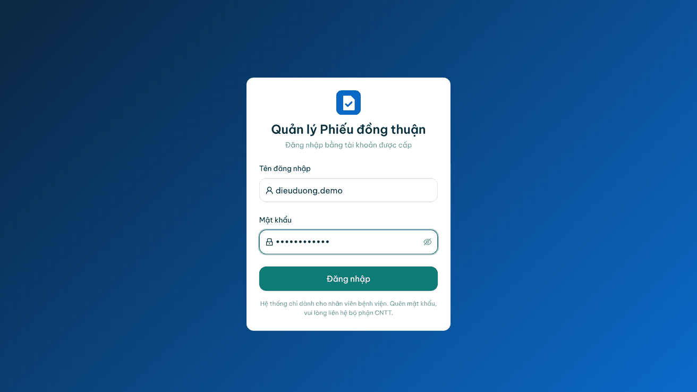

*Hình 1.1. Trang đăng nhập: nhập tên đăng nhập, mật khẩu rồi bấm **Đăng nhập**.*

Lưu ý:

- Nhập sai mật khẩu 5 lần thì tài khoản bị tạm khóa (mặc định 15 phút). Chờ hết thời gian, hoặc nhờ quản trị hệ thống mở khóa.
- Quên mật khẩu: liên hệ bộ phận CNTT để được đặt lại mật khẩu tạm.
- Khi phiên đăng nhập hết hạn, phần mềm đưa bạn về trang đăng nhập. Đăng nhập lại, phần mềm mở lại đúng trang bạn đang làm.

### 1.2. Đổi mật khẩu lần đầu

Tài khoản mới, hoặc tài khoản vừa được quản trị đặt lại mật khẩu, phải đổi mật khẩu ngay sau khi đăng nhập. Trang **Đổi mật khẩu** tự hiện ra.

1. Nhập **Mật khẩu hiện tại** (mật khẩu tạm được cấp).
2. Nhập **Mật khẩu mới**, rồi nhập lại ở ô **Nhập lại mật khẩu mới**.
3. Bấm **Đổi mật khẩu**. Phần mềm chuyển sang trang **Tổng quan**.

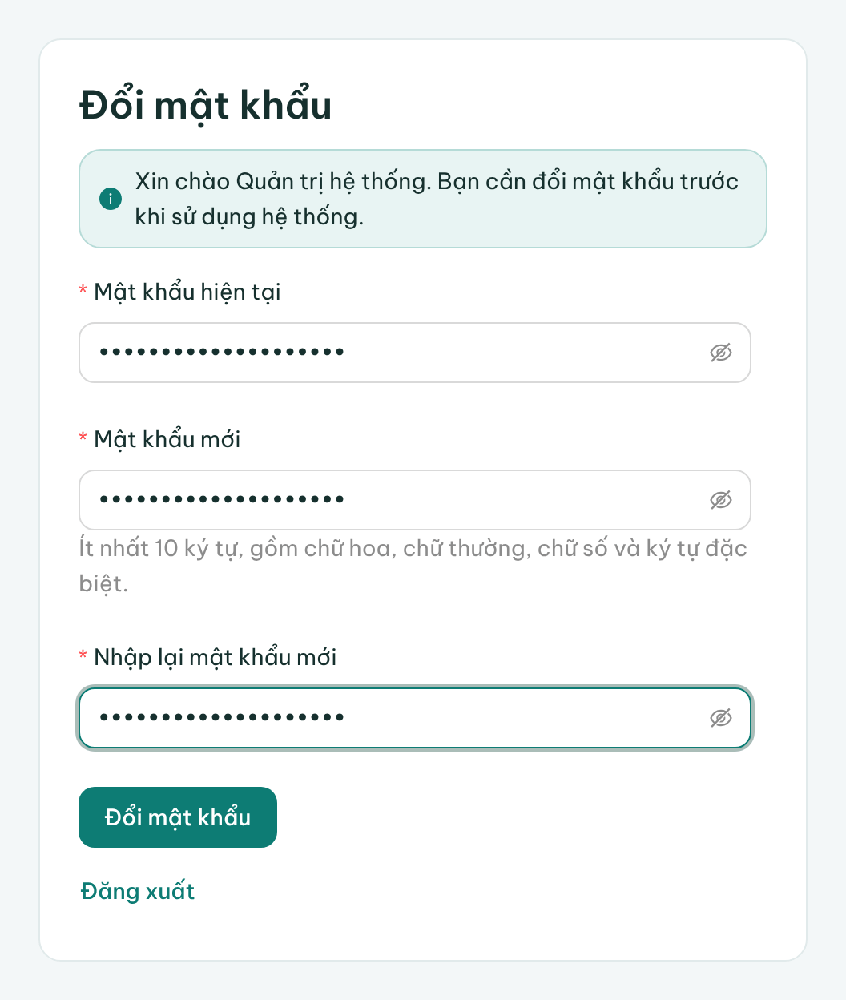

*Hình 1.2. Đổi mật khẩu bắt buộc ở lần đăng nhập đầu tiên.*

Mật khẩu mới phải:

- dài từ 10 ký tự trở lên;
- có chữ hoa, chữ thường, chữ số và ký tự đặc biệt;
- không chứa tên đăng nhập.

Sau khi đổi mật khẩu, các phiên đăng nhập của bạn trên máy khác bị đăng xuất. Bạn có thể đổi mật khẩu bất cứ lúc nào ở **Tài khoản của tôi** (mục 1.5).

### 1.3. Giao diện và menu

Trên máy tính, thanh trên cùng có:

- bên trái: tên phần mềm **Phiếu đồng thuận** và khoa/phòng của bạn (tài khoản không thuộc khoa nào thì ghi **Toàn viện**);
- ở giữa: menu ngang;
- bên phải: tên của bạn. Bấm vào tên để mở **Tài khoản của tôi** hoặc **Đăng xuất**.

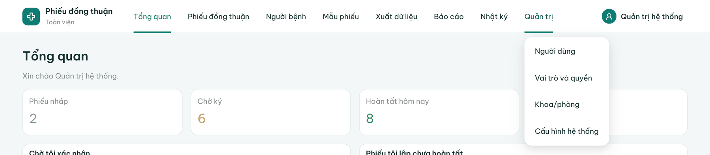

*Hình 1.3. Menu ngang. Mục đang mở được gạch chân. Bấm **Quản trị** để mở các mục con.*

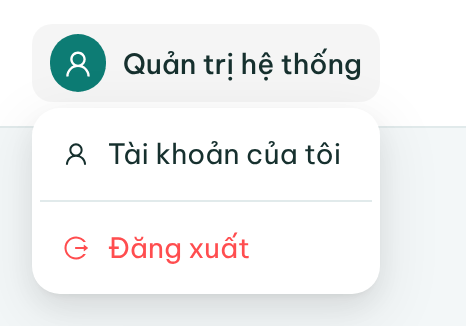

*Hình 1.4. Bấm vào tên của bạn để mở **Tài khoản của tôi** hoặc **Đăng xuất**.*

Mỗi người chỉ thấy các mục menu được phép dùng. Với phân quyền mặc định:

| Mục menu | Tiếp đón, Điều dưỡng, Bác sĩ | Trưởng khoa | Quản lý mẫu phiếu | Báo cáo / Xuất dữ liệu | Kiểm tra | Quản trị hệ thống |
|---|---|---|---|---|---|---|
| **Tổng quan** | có | có | có | có | có | có |
| **Phiếu đồng thuận** | có | có | chỉ xem | chỉ xem | chỉ xem | có |
| **Người bệnh** | có | có | không | chỉ xem | chỉ xem | có |
| **Mẫu phiếu** | chỉ xem | chỉ xem | có | chỉ xem | chỉ xem | có |
| **Xuất dữ liệu** | không | có | không | có | không | có |
| **Báo cáo** (Báo cáo thống kê) | không | có | không | có | có | có |
| **Nhật ký** (Nhật ký hệ thống) | không | không | không | không | có | có |
| **Điều dưỡng** (Báo cáo điều dưỡng, mục 9) | chỉ Điều dưỡng: **Báo cáo của khoa** | không | không | không | không | có |
| **Quản trị** | không | không | không | không | chỉ **Người dùng** (xem) | có |

Vai trò **Phòng Điều dưỡng** thấy **Tổng quan** và **Điều dưỡng** → **Tổng hợp hằng ngày**.

Quản trị hệ thống có thể đổi quyền của từng vai trò (mục 8.3), nên menu của bạn có thể khác bảng trên.

Trên điện thoại hoặc máy tính bảng, menu được thu gọn. Bấm nút ☰ (**Mở menu**) ở góc trên bên trái để mở danh sách đầy đủ.

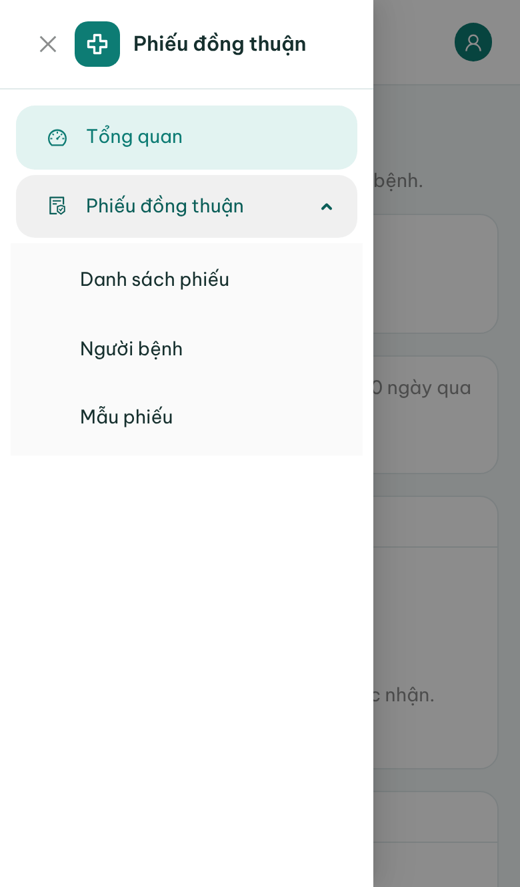

*Hình 1.5. Menu trên điện thoại: bấm ☰ ở góc trên bên trái, chọn mục cần mở.*

### 1.4. Trang Tổng quan

Trang **Tổng quan** mở ra ngay sau khi đăng nhập. Muốn quay lại trang này, bấm **Tổng quan** trên menu hoặc bấm tên phần mềm ở góc trên bên trái.

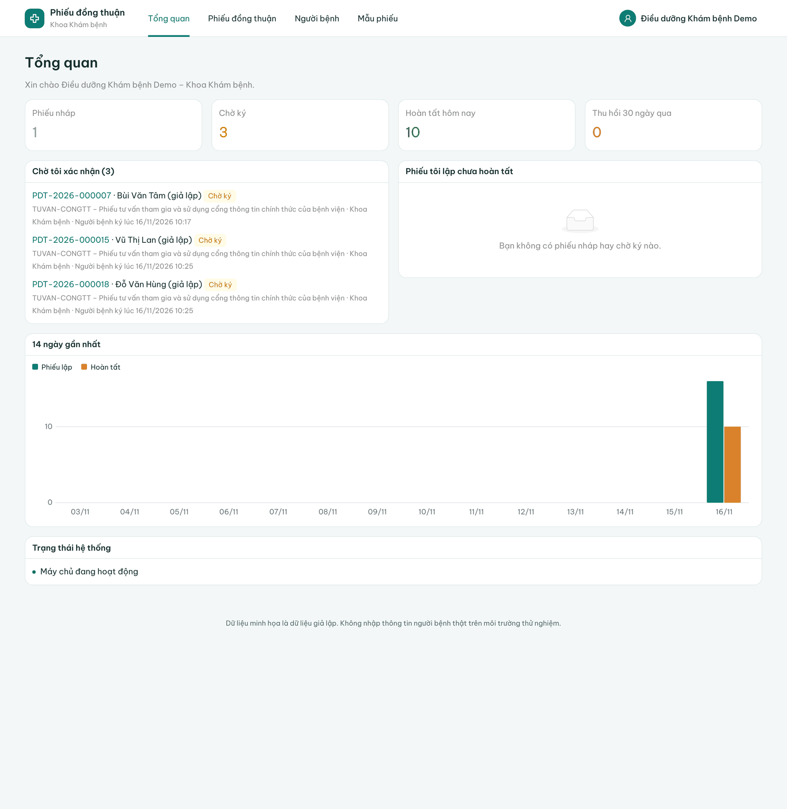

*Hình 1.6. Trang Tổng quan: bốn ô số liệu, danh sách **Chờ tôi xác nhận**, **Phiếu tôi lập chưa hoàn tất** và biểu đồ 14 ngày.*

Trang có:

- **Phiếu nháp**, **Chờ ký**, **Hoàn tất hôm nay**, **Thu hồi 30 ngày qua**: số phiếu trong phạm vi bạn được xem (khoa của bạn và phiếu bạn lập; vai trò toàn viện thì cả bệnh viện).
- **Chờ tôi xác nhận**: phiếu người bệnh đã ký và **bước xác nhận đang chờ thuộc vai trò của bạn** (bước giữa hoặc bước cuối). Phiếu còn chờ một bước trước của vai trò khác chưa hiện ở đây; phiếu bạn đã xác nhận một bước cũng không hiện nữa (mỗi bước một người khác nhau). Bấm số phiếu để mở.
- **Phiếu tôi lập chưa hoàn tất**: phiếu bạn lập còn ở trạng thái nháp hoặc chờ ký.
- **14 ngày gần nhất**: số phiếu lập và số phiếu hoàn tất mỗi ngày.
- **Trạng thái hệ thống**: **Máy chủ đang hoạt động** nghĩa là phần mềm kết nối bình thường.

### 1.5. Tài khoản của tôi và chữ ký mẫu

Bấm vào tên của bạn ở góc trên bên phải, chọn **Tài khoản của tôi**. Trang có ba phần:

- **Thông tin tài khoản**: họ tên, tên đăng nhập, chức danh, khoa/phòng, vai trò.
- **Chữ ký mẫu**: chữ ký của bạn, dùng khi ký xác nhận phiếu.
- **Đổi mật khẩu**: đổi mật khẩu như mục 1.2.

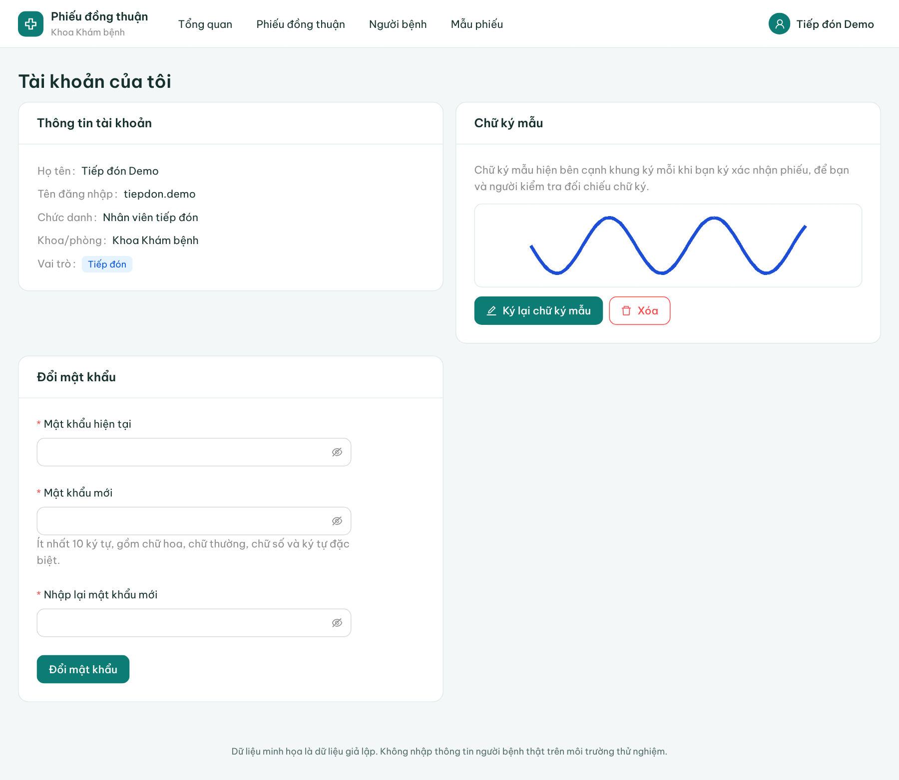

*Hình 1.7. Trang **Tài khoản của tôi**. Phần **Chữ ký mẫu** ở bên phải.*

Ký chữ ký mẫu (nên làm một lần trước khi bắt đầu xác nhận phiếu):

1. Trong phần **Chữ ký mẫu**, bấm **Ký chữ ký mẫu** (đã có chữ ký mẫu thì nút là **Ký lại chữ ký mẫu**).
2. Ký vào khung bằng ngón tay, bút cảm ứng hoặc chuột, như khi ký giấy tờ thường ngày. Ký hỏng thì bấm **Ký lại**.
3. Bấm **Lưu chữ ký mẫu**.

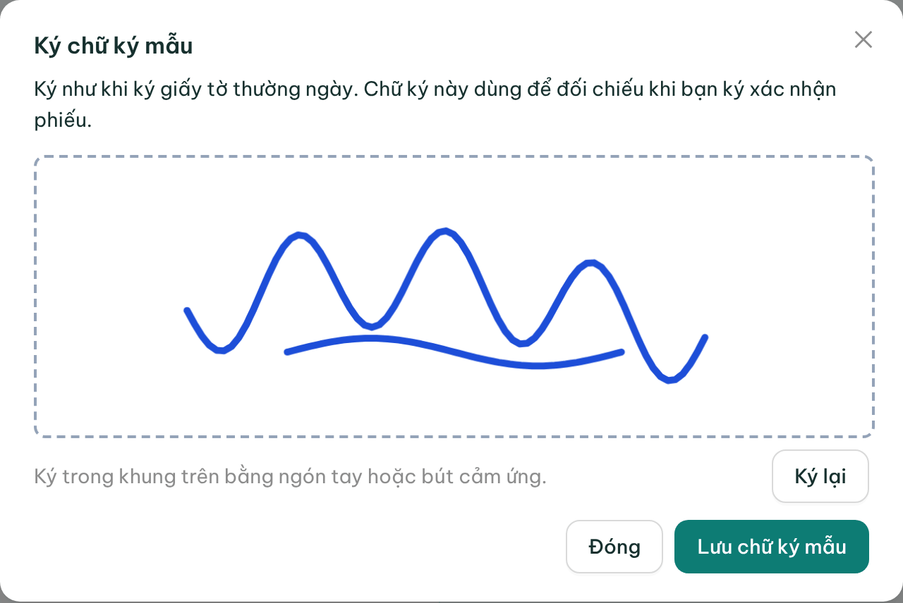

*Hình 1.8. Ký chữ ký mẫu rồi bấm **Lưu chữ ký mẫu**.*

Khi đã có chữ ký mẫu, mỗi lần ký xác nhận phiếu bạn chỉ cần bấm nút xác nhận, không phải ký lại (xem mục 2.10). Muốn bỏ chữ ký mẫu, bấm **Xóa** rồi xác nhận. Phiếu đã ký giữ nguyên chữ ký đã ký.

### 1.6. Đăng xuất

1. Bấm vào tên của bạn ở góc trên bên phải.
2. Chọn **Đăng xuất**.

Máy dùng chung (ví dụ điện thoại ký phiếu của khoa): đăng xuất khi đổi ca để người sau đăng nhập bằng tài khoản của mình.

---

## 2. Tiếp đón, Điều dưỡng, Bác sĩ

Ba vai trò này có cùng các chức năng: tìm và thêm người bệnh, lập phiếu, cho người bệnh ký, ký xác nhận phía bệnh viện. Bạn thấy phiếu của khoa mình và phiếu do chính mình lập.

Quy trình thường gặp:

1. Tìm người bệnh hoặc thêm người bệnh mới (mục 2.1–2.3).
2. Lập phiếu hoặc lập bộ phiếu, soạn nội dung, bấm **Trình ký** (mục 2.4–2.7).
3. Đưa máy cho người bệnh ký (mục 2.8; phía người bệnh xem phần 3).
4. Nhân viên đúng vai trò ký xác nhận; người xác nhận cuối bấm **Xác nhận và hoàn tất** (mục 2.9–2.11).
5. Xem hoặc in PDF đã ký (mục 2.12).

### 2.1. Tìm người bệnh

1. Bấm **Người bệnh** trên menu.
2. Gõ vào ô tìm kiếm: họ tên (gõ không dấu cũng được), mã người bệnh, hoặc số CCCD đủ 12 số. Nhấn Enter.
3. Bấm tên người bệnh để mở hồ sơ.

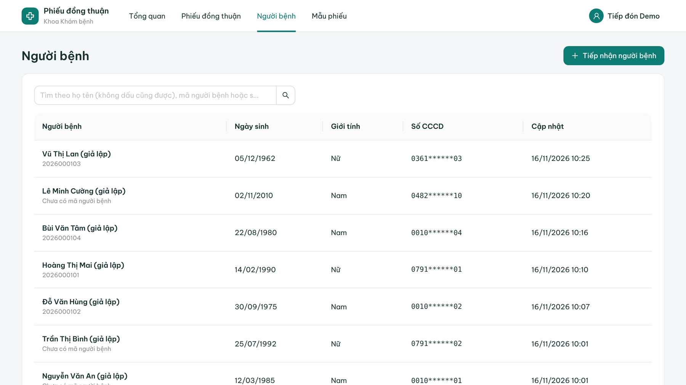

*Hình 2.1. Danh sách người bệnh. Số CCCD được che bớt. Nút **Tiếp nhận người bệnh** ở góc phải để thêm người bệnh mới.*

### 2.2. Thêm người bệnh mới (Tiếp nhận người bệnh)

Bấm **Người bệnh** → **Tiếp nhận người bệnh**. Có ba cách điền thông tin.

**Cách 1: quét mã QR trên CCCD bằng máy quét 2D**

1. Bấm vào ô *"Đặt con trỏ vào đây rồi quét mã QR trên CCCD (máy quét 2D)"*.
2. Quét mã QR trên thẻ CCCD. Phần mềm tự điền họ tên, ngày sinh, giới tính, số CCCD, số CMND cũ, nơi thường trú, ngày cấp.
3. Kiểm tra lại thông tin. Bổ sung số điện thoại, dân tộc, nghề nghiệp, mã thẻ BHYT, mã người bệnh nếu có.
4. Bấm **Lưu hồ sơ**.

Không có máy quét: bấm **Quét bằng camera**, cho phép trình duyệt dùng camera, đưa mã QR ở mặt thẻ vào giữa khung hình và giữ yên 1–2 giây. Camera chỉ hoạt động khi phần mềm chạy qua địa chỉ an toàn (HTTPS).

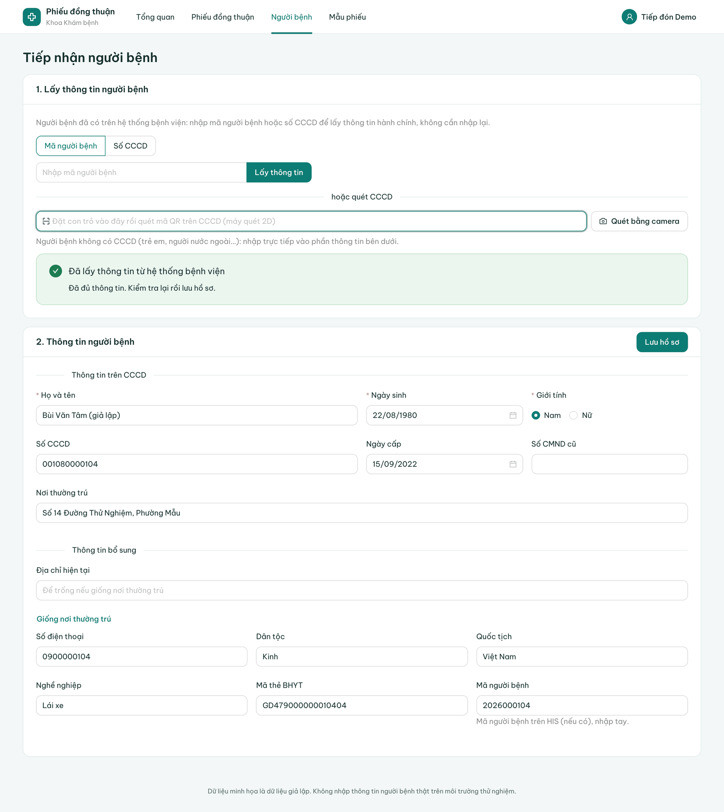

*Hình 2.2. Sau khi quét CCCD: thông tin trên thẻ được điền sẵn. Khung xanh **Đã lấy thông tin từ hệ thống bệnh viện** chỉ có khi bệnh viện đã kết nối hệ thống thông tin người bệnh.*

Khi bệnh viện đã kết nối hệ thống thông tin người bệnh, sau khi quét thẻ, phần mềm tự lấy thêm thông tin còn thiếu (mã người bệnh, số điện thoại…). Phần mềm chỉ điền vào ô còn trống, thông tin trên thẻ được ưu tiên.

Nếu thấy khung vàng **Cần kiểm tra lại** (ví dụ *"Họ tên có ký tự lạ"*), máy quét có thể chưa đọc đúng tiếng Việt có dấu. Hãy đối chiếu với thẻ và sửa lại.

**Cách 2: Lấy thông tin từ hệ thống bệnh viện**

Chỉ có khi bệnh viện đã kết nối hệ thống thông tin người bệnh. Khi đó, phần đầu trang có tên **1. Lấy thông tin người bệnh**.

1. Chọn **Mã người bệnh** hoặc **Số CCCD**.
2. Nhập mã hoặc 12 số CCCD.
3. Bấm **Lấy thông tin**.
4. Đọc khung **Đã lấy thông tin từ hệ thống bệnh viện**: khung cho biết ô nào còn phải nhập. Nhập phần còn thiếu rồi bấm **Lưu hồ sơ**.

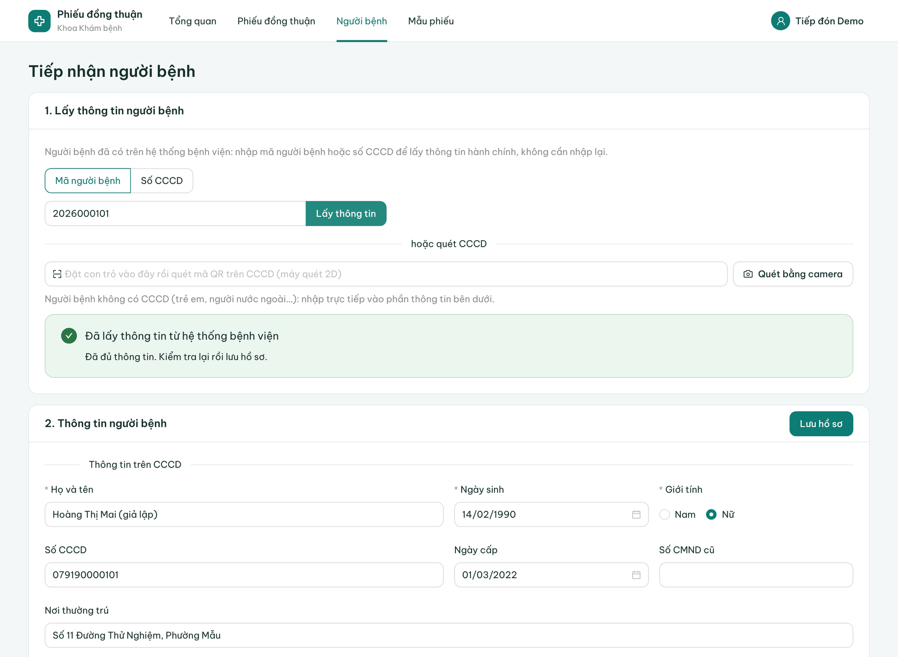

*Hình 2.3. Lấy thông tin theo mã người bệnh: thông tin hành chính được điền sẵn vào phần **2. Thông tin người bệnh**.*

Nếu phần mềm báo không tìm thấy người bệnh, hoặc chưa kết nối được hệ thống thông tin người bệnh, hãy kiểm tra lại mã hoặc nhập trực tiếp (cách 3).

**Cách 3: nhập trực tiếp**

Dùng cho người bệnh không có CCCD (trẻ em, người nước ngoài…). Nhập thẳng vào phần **2. Thông tin người bệnh**, rồi bấm **Lưu hồ sơ**.

Các ô bắt buộc: **Họ và tên**, **Ngày sinh**, **Giới tính**. Phần mềm kiểm tra:

- **Số CCCD** gồm 12 chữ số và phải khớp năm sinh, giới tính;
- **Số điện thoại** đúng dạng, ví dụ 0912345678;
- **Mã thẻ BHYT** gồm 17 ký tự (2 chữ và 15 số). Mã thẻ cũ 15 ký tự vẫn lưu được nhưng có cảnh báo nhắc cập nhật sang mã mới;
- **Địa chỉ hiện tại**: để trống nếu giống nơi thường trú, hoặc bấm **Giống nơi thường trú** để chép.

**Người bệnh đã có hồ sơ**

Khi quét CCCD của người đã có hồ sơ, phần mềm báo **Người bệnh đã có hồ sơ trong hệ thống**:

- bấm **Cập nhật hồ sơ theo CCCD** để cập nhật hồ sơ cũ theo thông tin trên thẻ, rồi bấm **Lưu thay đổi**;
- hoặc bấm **Mở hồ sơ** để mở hồ sơ đã có.

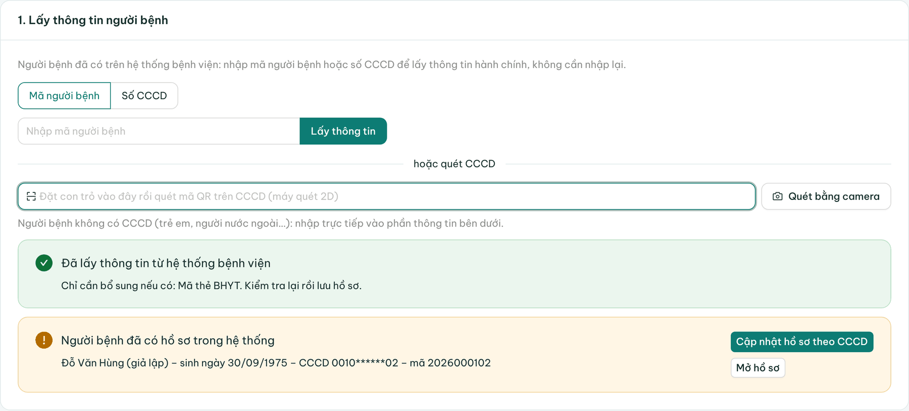

*Hình 2.4. Quét CCCD của người đã có hồ sơ: chọn cập nhật hồ sơ cũ hoặc mở hồ sơ. Phần mềm không tạo hồ sơ trùng.*

### 2.3. Hồ sơ người bệnh và người đại diện

Hồ sơ người bệnh có ba phần:

- **Thông tin nhân thân**. Số CCCD, số điện thoại, mã thẻ BHYT được che bớt. Bấm biểu tượng con mắt bên cạnh để xem đầy đủ. Bấm **Sửa thông tin** để sửa.
- **Người đại diện / người ký thay**: người ký thay cho người bệnh (cha mẹ của trẻ em, người giám hộ…).
- **Phiếu đồng thuận**: các phiếu của người bệnh, và nút **Lập phiếu**.

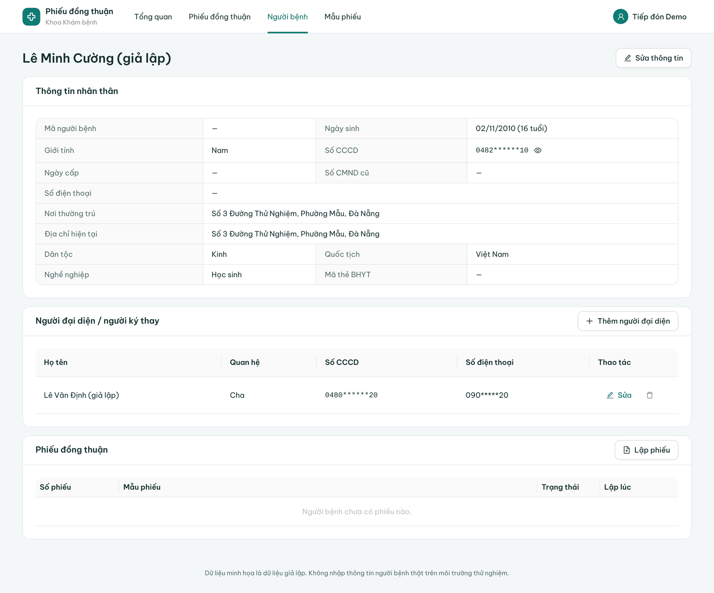

*Hình 2.5. Hồ sơ người bệnh: thông tin nhân thân, người đại diện và danh sách phiếu.*

Thêm người đại diện:

1. Bấm **Thêm người đại diện**.
2. Quét CCCD của người đại diện vào ô quét ở đầu hộp (hoặc nhập tay).
3. Chọn **Quan hệ với người bệnh**: Cha, Mẹ, Vợ/Chồng, Con, Anh/chị/em ruột, Người giám hộ, Người thân khác, Khác.
4. Nhập số điện thoại nếu có, rồi bấm **Lưu**.

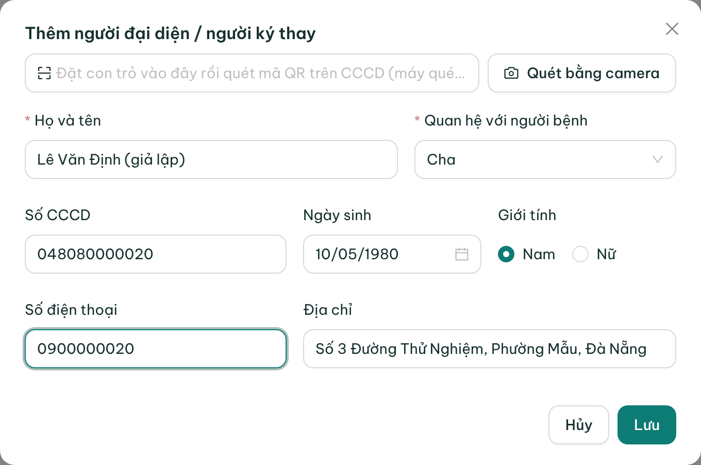

*Hình 2.6. Hộp **Thêm người đại diện / người ký thay**: thông tin được điền sẵn sau khi quét CCCD của người đại diện; chọn quan hệ rồi bấm **Lưu**.*

### 2.4. Lập phiếu

1. Bấm **Phiếu đồng thuận** → **Lập phiếu**. (Hoặc mở hồ sơ người bệnh, bấm **Lập phiếu**: người bệnh được chọn sẵn.)
2. Ở phần **1. Người bệnh**, chọn người bệnh:
   - gõ họ tên, mã người bệnh hoặc số CCCD vào ô tìm, rồi bấm **Chọn** ở dòng đúng người;
   - hoặc dùng **Lấy từ hệ thống bệnh viện** (khi bệnh viện đã kết nối): nhập mã người bệnh hoặc số CCCD, bấm **Lấy thông tin**. Người đã có hồ sơ được chọn ngay. Người chưa có hồ sơ: hộp **Lưu hồ sơ người bệnh** mở ra với thông tin điền sẵn; nhập phần còn thiếu rồi bấm **Lưu và chọn người bệnh**;
   - hoặc bấm **Tiếp nhận người bệnh mới** để thêm người bệnh như mục 2.2. Lưu xong (nút **Lưu và lập phiếu**), phần mềm quay lại trang lập phiếu.
3. Ở phần **2. Mẫu phiếu**, kiểm tra **Khoa của phiếu**. Mặc định là khoa của bạn. Chọn khoa đang điều trị người bệnh: nhân viên khoa đó (ví dụ điều dưỡng khoa) sẽ thấy phiếu để xác nhận. Bạn vẫn thấy phiếu mình lập.
4. Bấm **Lập phiếu** ở dòng mẫu cần dùng. Phần mềm tạo phiếu nháp và mở trang soạn nội dung (mục 2.6).

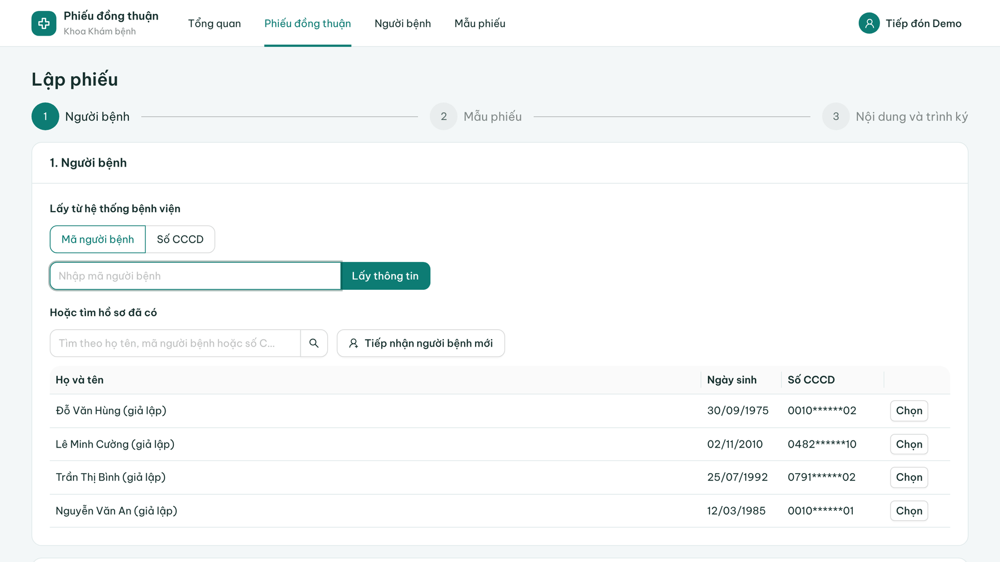

*Hình 2.7. Lập phiếu, bước 1: lấy thông tin từ hệ thống bệnh viện, hoặc tìm hồ sơ đã có rồi bấm **Chọn**.*

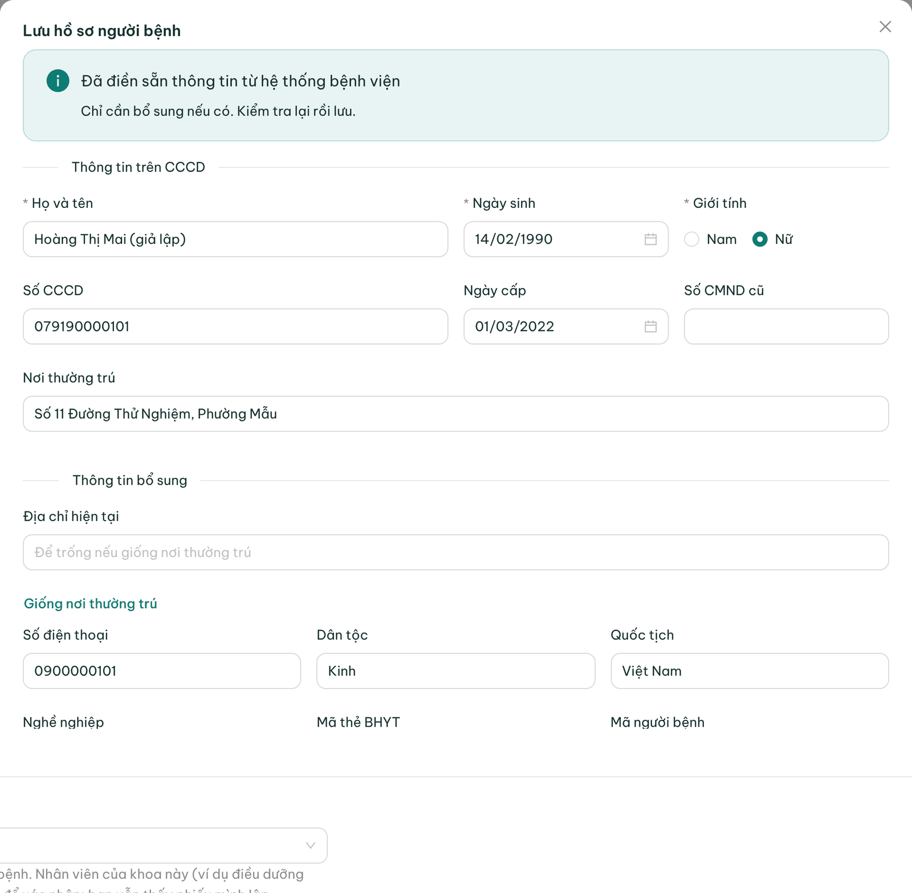

*Hình 2.8. Người bệnh chưa có hồ sơ: kiểm tra thông tin điền sẵn, nhập phần còn thiếu, bấm **Lưu và chọn người bệnh**.*

Chỉ các mẫu đang phát hành mới có trong danh sách. Không có mẫu nào cho khoa đã chọn thì phần mềm báo *"Chưa có mẫu phiếu nào đang phát hành cho khoa này."*

### 2.5. Lập bộ phiếu (người bệnh ký một lần cho cả bộ)

Khi khoa có từ 2 mẫu trở lên, mỗi mẫu có ô đánh dấu. Mặc định tất cả các mẫu được chọn. Máy nhớ lựa chọn lần trước của bạn theo từng khoa.

1. Đánh dấu các mẫu cần làm cho người bệnh.
2. Bấm **Lập bộ phiếu (… mẫu)**.
3. Phần mềm mở phiếu đầu tiên của bộ. Soạn nội dung rồi bấm **Trình ký**: phần mềm tự chuyển sang phiếu nháp tiếp theo.
4. Lặp lại đến khi trình ký hết các phiếu.

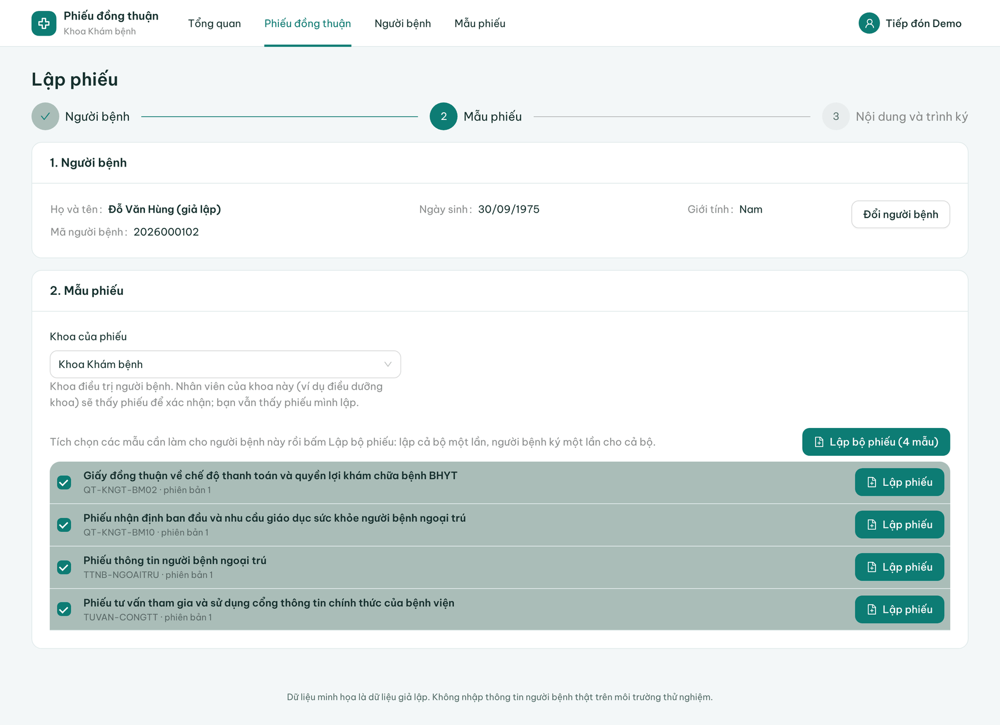

*Hình 2.9. Lập phiếu, bước 2: chọn **Khoa của phiếu**, đánh dấu các mẫu, bấm **Lập bộ phiếu (4 mẫu)**. Muốn lập một phiếu lẻ, bấm **Lập phiếu** ở dòng mẫu đó.*

Trên mỗi phiếu của bộ có thanh **Bộ phiếu của … (… phiếu)**: liệt kê các phiếu, trạng thái từng phiếu. Bấm tên phiếu để chuyển nhanh.

### 2.6. Soạn nội dung phiếu và trình ký

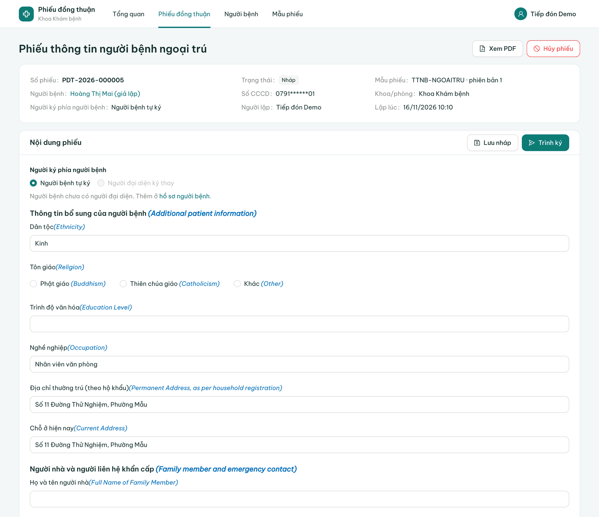

*Hình 2.10. Phiếu nháp: chọn **Người ký phía người bệnh**, điền nội dung, rồi bấm **Lưu nháp** hoặc **Trình ký** ở góc phải phần **Nội dung phiếu**.*

1. Ở **Người ký phía người bệnh**, chọn:
   - **Người bệnh tự ký**; hoặc
   - **Người đại diện ký thay**, rồi chọn người đại diện trong danh sách. Lựa chọn này chỉ bấm được khi hồ sơ người bệnh đã có người đại diện (thêm như mục 2.3).
2. Điền nội dung phiếu:
   - một số ô được điền sẵn từ hồ sơ người bệnh (ví dụ dân tộc, nghề nghiệp, địa chỉ, số thẻ BHYT). Bạn vẫn sửa được;
   - một số ô do phần mềm tự tính (ví dụ BMI), không nhập tay;
   - một số câu chỉ hiện khi chọn một câu trả lời nhất định (ví dụ chọn "Có" thì phải ghi rõ).
3. Bấm **Lưu nháp** để lưu dở, làm tiếp sau.
4. Kiểm tra xong, bấm **Trình ký**. Nội dung phiếu và thông tin người bệnh được khóa, phiếu chuyển sang **Chờ ký**.

Nếu còn thiếu thông tin, phần mềm báo *"Còn … mục chưa đạt yêu cầu; xem các ô được đánh dấu đỏ."* Sửa các ô đỏ rồi bấm **Trình ký** lại.

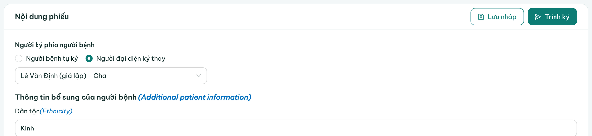

*Hình 2.11. Người bệnh là trẻ em: chọn **Người đại diện ký thay** và chọn người đại diện trong hồ sơ.*

Bấm **Xem PDF** bất cứ lúc nào để xem trước bản in. Phiếu chưa hoàn tất có dòng *"BẢN XEM TRƯỚC – CHƯA CÓ CHỮ KÝ"*.

### 2.7. Kế thừa phiếu lần trước

Chức năng này chỉ chạy khi quản trị đã đặt số ngày ở **Cấu hình hệ thống → Kế thừa phiếu lần trước** (mục 8.5).

Khi người bệnh làm lại **cùng mẫu phiếu**, **ở cùng khoa**, trong số ngày đó, phiếu mới được điền sẵn câu trả lời của phiếu **đã hoàn tất** gần nhất. Áp dụng cả khi lập phiếu lẻ và lập bộ phiếu.

- Trên trang phiếu nháp có khung vàng *"Đã điền sẵn theo phiếu … (hoàn tất …): kiểm tra lại trước khi trình ký."* Khung còn đó khi mở lại phiếu hoặc tải lại trang, cho đến khi trình ký. Với bộ phiếu, thanh bộ phiếu cũng ghi phiếu nào được điền sẵn.
- Hãy kiểm tra lại từng câu trước khi bấm **Trình ký**.
- Không kế thừa: ý kiến Đồng ý/Không đồng ý, lời xác nhận và chữ ký. Người bệnh vẫn chọn và ký lại.
- Phiếu nháp, phiếu đã hủy, phiếu đã thu hồi không được dùng để điền sẵn.

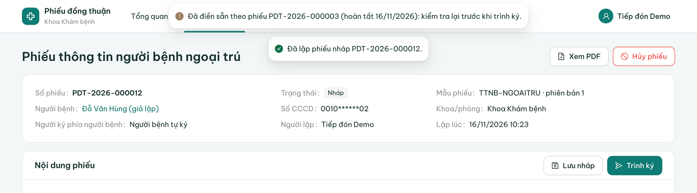

*Hình 2.12. Khung vàng trên phiếu nháp: phiếu mới được điền sẵn theo phiếu PDT-2026-000001 đã hoàn tất.*

### 2.8. Trình ký: cho người bệnh ký trên điện thoại

Sau khi trình ký, phiếu ở trạng thái **Chờ ký** và có khung *"Phiếu đang chờ ký"*.

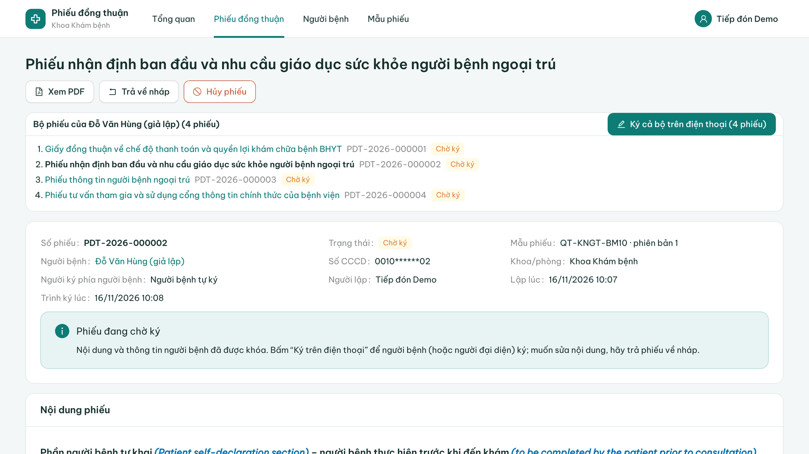

*Hình 2.13. Cả bộ phiếu đã trình ký: nút **Ký cả bộ trên điện thoại (4 phiếu)** ở thanh bộ phiếu.*

Có hai cách cho người bệnh ký:

- **Cách 1: trên máy của bệnh viện.** Người bệnh ký ngay trên máy bạn đang dùng (điện thoại, máy tính bảng hoặc máy tính). Bạn mở chế độ ký rồi đưa máy cho người bệnh.
- **Cách 2: trên điện thoại của người bệnh (mã QR).** Bạn hiện mã QR trên màn hình; người bệnh quét bằng điện thoại của mình, nhập ngày sinh rồi ký. Máy của bạn không phải chuyển chế độ (xem phần **Cách 2** bên dưới).

#### Cách 1: ký trên máy của bệnh viện

1. Mở phiếu trên máy sẽ đưa cho người bệnh (thường là điện thoại ký phiếu của khoa).
2. Bấm:
   - **Ký trên điện thoại** nếu là phiếu lẻ;
   - **Ký cả bộ trên điện thoại (… phiếu)** nếu là bộ phiếu. Khi đó người bệnh ký một lần cho mọi phiếu đang chờ ký của bộ.
3. Đọc hộp thông báo, bấm **Bắt đầu ký**.
4. Máy chuyển sang màn hình ký, không còn menu. **Phiên đăng nhập của bạn trên máy này được đóng.** Đưa máy cho người bệnh (hoặc người đại diện). Cách ký: xem phần 3.1.
5. Người bệnh ký xong và đưa máy lại. Bấm **Nhân viên: thoát chế độ ký** nếu khung đăng nhập chưa hiện. Nhập mật khẩu của bạn ở khung **Nhân viên đăng nhập để thoát chế độ ký**, bấm **Đăng nhập và thoát chế độ ký**. Máy mở lại trang phiếu.

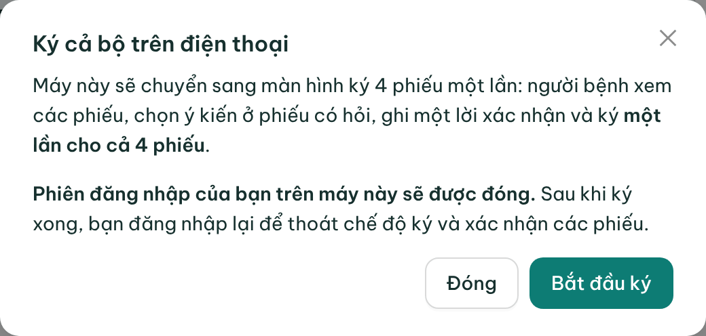

*Hình 2.14. Hộp **Ký cả bộ trên điện thoại**: bấm **Bắt đầu ký** để chuyển máy sang màn hình ký.*

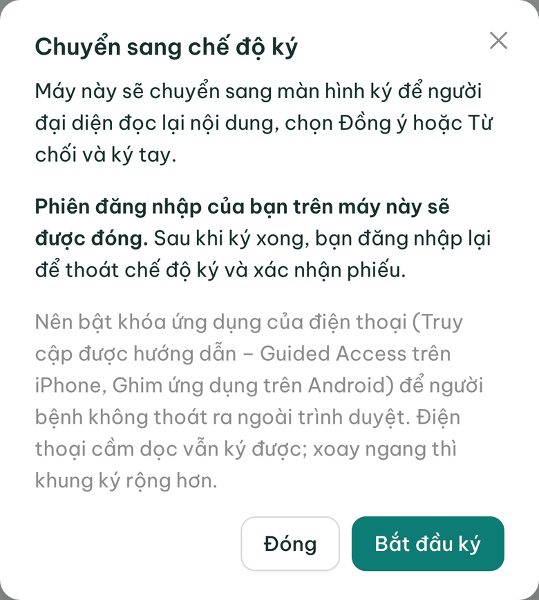

*Hình 2.15. Phiếu lẻ: hộp **Chuyển sang chế độ ký** trên điện thoại.*

Lưu ý:

- Nên bật khóa ứng dụng của điện thoại trước khi đưa máy: **Truy cập được hướng dẫn** (Guided Access) trên iPhone, **Ghim ứng dụng** trên Android. Người bệnh sẽ không thoát được ra ngoài trình duyệt.
- Màn hình ký chỉ nhận chữ ký cho đúng phiếu (hoặc bộ phiếu) đó. Không ai làm được việc khác trên máy cho đến khi nhân viên đăng nhập lại.
- Phiên ký có thời hạn (mặc định 30 phút). Nếu tải lại trang hoặc phiên hết hạn, màn hình báo *"Không có phiên ký đang mở"* hoặc *"Phiên ký đã kết thúc"*. Bấm **Đăng nhập**, mở lại phiếu và bấm **Ký trên điện thoại** (hoặc **Ký cả bộ trên điện thoại**) lần nữa.
- Bộ phiếu chỉ ký chung được khi các phiếu chờ ký **cùng một người ký** (cùng là người bệnh tự ký, hoặc cùng một người đại diện). Nếu khác nhau, thanh bộ phiếu báo không ký chung được. Hãy trả phiếu về nháp để chọn cùng người ký, hoặc ký riêng từng phiếu bằng nút **Ký trên điện thoại**.
- Phiếu còn nháp không có trong phiên ký của cả bộ. Thanh bộ phiếu nhắc *"Còn … phiếu nháp chưa trình ký…"*.

#### Cách 2: người bệnh ký trên điện thoại của mình (mã QR)

Dùng khi người bệnh muốn ký trên điện thoại riêng, hoặc khi không tiện đưa máy của bệnh viện. Điện thoại của người bệnh phải vào được địa chỉ của phần mềm (ví dụ bắt Wi-Fi của bệnh viện; xem với phòng CNTT).

1. Mở phiếu (hoặc phiếu bất kỳ trong bộ) đang chờ ký. Bấm:
   - **Mã QR cho người bệnh** nếu là phiếu lẻ;
   - **Mã QR ký cả bộ** trên thanh bộ phiếu nếu là bộ phiếu. Người bệnh ký một lần cho mọi phiếu đang chờ ký của bộ.

   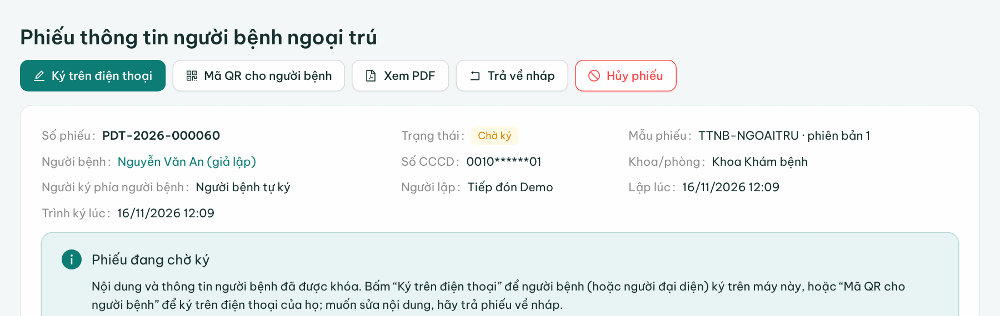

   *Hình 2.15a. Phiếu đang chờ ký: nút **Mã QR cho người bệnh** cạnh nút **Ký trên điện thoại**.*

2. Đọc hộp thông báo, bấm **Tạo mã QR**. Mã QR hiện ra.
3. Mời người bệnh (hoặc người đại diện) mở camera điện thoại, quét mã, chạm vào đường dẫn hiện ra. Cách làm trên điện thoại: xem phần 3.1.

   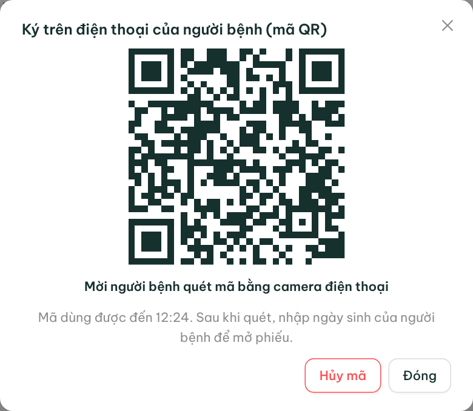

   *Hình 2.15b. Mã QR dùng được 15 phút nếu chưa quét, mở được trên **một** điện thoại.*

4. Hộp tự cập nhật: *"Đã mở trên điện thoại lúc …"* khi người bệnh đã nhập đúng ngày sinh, rồi *"Người bệnh đã ký xong"*. Bấm **Xong**. Trang phiếu hiện chữ ký của người bệnh; bạn xác nhận phiếu như thường lệ (mục 2.10).

   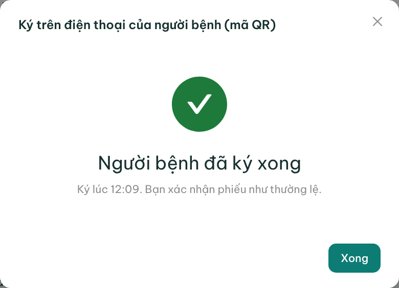

   *Hình 2.15c. Người bệnh đã ký xong trên điện thoại của mình.*

Lưu ý:

- Máy của bạn vẫn giữ phiên đăng nhập, không chuyển sang chế độ ký. Bạn có thể bấm **Đóng** để làm việc khác; mã vẫn dùng được đến giờ ghi trên hộp.
- Muốn dừng (ví dụ người bệnh đổi ý, muốn ký trên máy của bệnh viện): bấm **Hủy mã**. Điện thoại đã mở mã cũng không ký được nữa. Mở phiên ký khác (tạo mã mới, hoặc bấm **Ký trên điện thoại**) thì mã cũ hết hiệu lực.
- Người bệnh nhập sai ngày sinh 5 lần thì mã bị hủy: kiểm tra lại ngày sinh trong hồ sơ người bệnh, rồi bấm **Tạo mã mới**.
- Mỗi lần tạo mã, mở mã (kèm địa chỉ IP và trình duyệt của điện thoại), nhập sai ngày sinh, hủy mã đều được ghi nhật ký hệ thống.

### 2.9. Sau khi người bệnh ký

Phiếu vẫn ở trạng thái **Chờ ký** nhưng có khung xanh *"… đã ký lúc …"*. Khung cho biết:

- **Đã có …/… chữ ký**: số chữ ký đã có trên tổng số chữ ký cần có (người bệnh, các bước xác nhận, xác nhận cuối);
- danh sách các bước xác nhận: bước nào đã xác nhận (ai, lúc nào), bước nào **đang chờ**, bước nào **chưa đến lượt**;
- việc bạn cần làm tiếp, ví dụ *"Bấm “Xác nhận: …” và ký vào khung để xác nhận phần của bạn."*

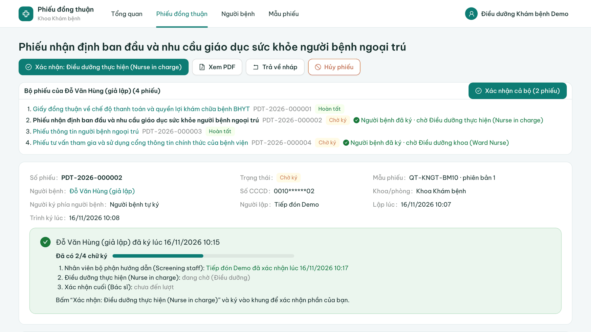

*Hình 2.16. Phiếu có 3 bước phía bệnh viện: bước 1 đã xác nhận, bước 2 (điều dưỡng) đang chờ. Nút **Xác nhận: Điều dưỡng thực hiện (Nurse in charge)** ở đầu trang.*

### 2.10. Xác nhận phía bệnh viện

Mỗi mẫu phiếu quy định ai xác nhận. Với các mẫu hiện có:

| Mẫu phiếu | Người bệnh chọn ý kiến? | Các bước xác nhận phía bệnh viện |
|---|---|---|
| QT-KNGT-BM02 – Giấy đồng thuận về chế độ thanh toán và quyền lợi khám chữa bệnh BHYT | Không, chỉ ký | Tiếp đón (xác nhận cuối) |
| TTNB-NGOAITRU – Phiếu thông tin người bệnh ngoại trú | Không, chỉ ký | Tiếp đón (xác nhận cuối) |
| QT-KNGT-BM10 – Phiếu nhận định ban đầu và nhu cầu giáo dục sức khỏe người bệnh ngoại trú | Không, chỉ ký | Tiếp đón → Điều dưỡng → Bác sĩ (xác nhận cuối) |
| TUVAN-CONGTT – Phiếu tư vấn tham gia và sử dụng cổng thông tin chính thức của bệnh viện | Có: Đồng ý (Agree) / Không đồng ý (Disagree) | Tiếp đón → Điều dưỡng (xác nhận cuối) |

Người quản lý mẫu phiếu có thể đổi cấu hình này (phần 5). Khung trên trang phiếu luôn cho biết bước nào đang chờ, vai trò nào cần xác nhận.

Điều kiện để thấy nút xác nhận:

- bạn có đúng vai trò của bước đang chờ;
- bạn thấy được phiếu (phiếu thuộc khoa của bạn, hoặc do bạn lập);
- mỗi bước một người khác nhau: một tài khoản không xác nhận hai phần trên cùng một phiếu;
- các bước trước đã xác nhận xong. Bước xác nhận cuối chỉ mở khi mọi bước giữa đã xong.

Các bước xác nhận:

1. Mở phiếu. Bấm **Xác nhận: <tên bước>** (bước giữa) hoặc **Xác nhận và hoàn tất** (bước cuối).
2. Ký trong hộp vừa mở:
   - nếu đã có chữ ký mẫu: hộp hiện **Ký bằng chữ ký mẫu của bạn**. Không cần ký lại. Muốn ký tay riêng lần này, bấm **Ký tay lần này**;
   - nếu chưa có chữ ký mẫu: ký vào khung bằng ngón tay, bút cảm ứng hoặc chuột. Nút xác nhận chỉ bấm được sau khi đã ký.
3. Nếu là bước cuối và quản trị đã bật gắn phiếu với lượt tiếp nhận: chọn lượt tiếp nhận (mục 2.11).
4. Bấm **Ký và xác nhận** (bước giữa) hoặc **Ký và hoàn tất** (bước cuối).

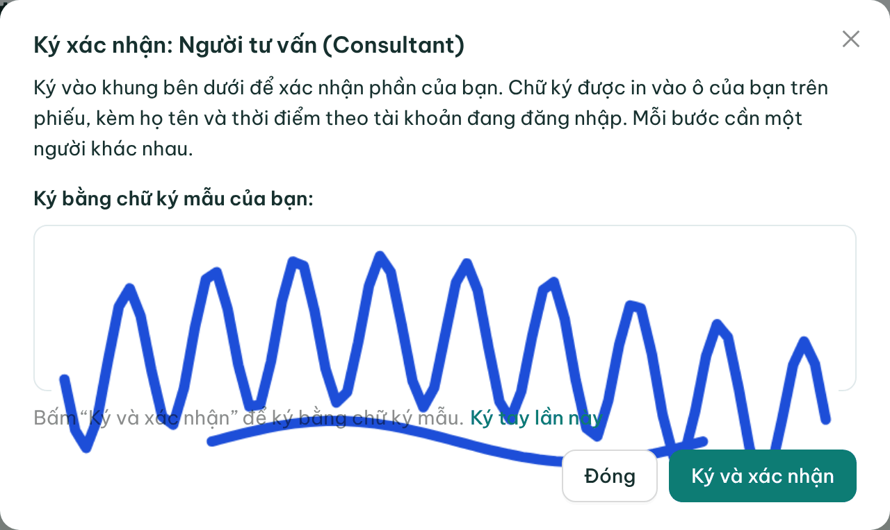

*Hình 2.17. Ký xác nhận bằng chữ ký mẫu: bấm **Ký và hoàn tất** (bước giữa là **Ký và xác nhận**). Bấm **Ký tay lần này** nếu muốn ký tay.*

Chữ ký của bạn được in vào ô của bạn trên phiếu, kèm họ tên và thời điểm theo tài khoản đang đăng nhập.

**Xác nhận cả bộ.** Với bộ phiếu, bấm **Xác nhận cả bộ (… phiếu)** trên thanh bộ phiếu. Bạn ký một lần cho mọi phiếu đang đến lượt mình. Phiếu nào còn bước giữa thì được xác nhận bước đó. Phiếu nào đến bước cuối thì được hoàn tất. Bấm **Ký và xác nhận cả bộ**.

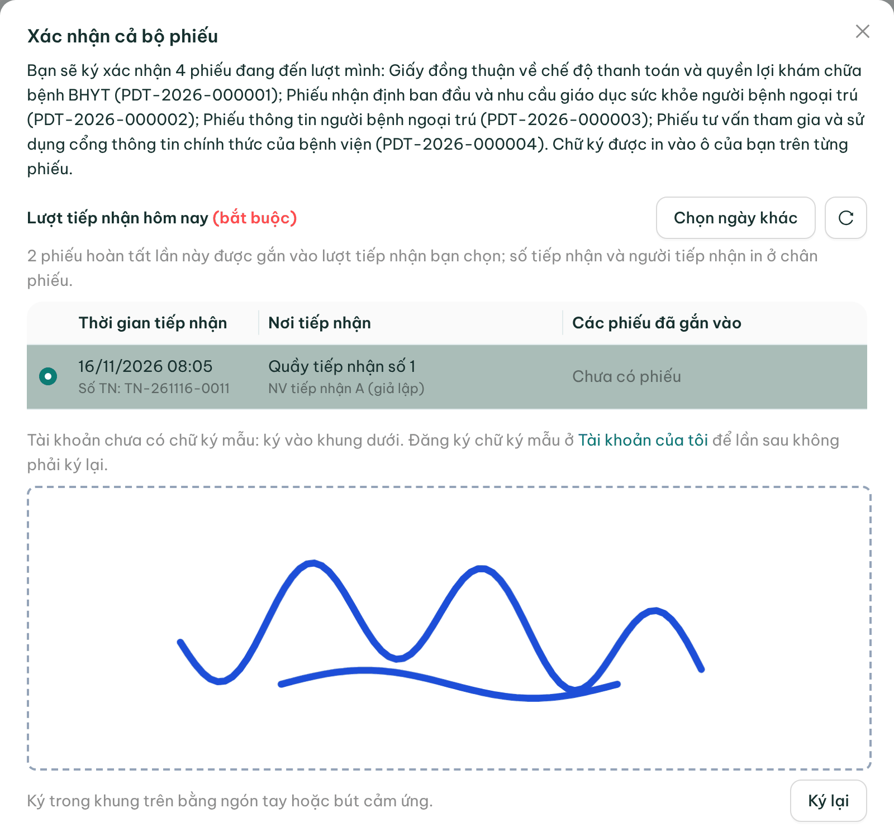

*Hình 2.18. **Xác nhận cả bộ phiếu**: hộp liệt kê các phiếu đến lượt bạn. Chọn lượt tiếp nhận (nếu có), ký vào khung, rồi bấm **Ký và xác nhận cả bộ** ở cuối hộp.*

### 2.11. Chọn lượt tiếp nhận khi ký hoàn tất

Phần này chỉ có khi quản trị đã bật **Gắn phiếu với lượt tiếp nhận (HIS)** ở **Cấu hình hệ thống**. Khi đó, hộp ký hoàn tất (và hộp **Xác nhận cả bộ** khi có phiếu được hoàn tất) có bảng **Lượt tiếp nhận hôm nay (bắt buộc)**.

1. Xem bảng các lượt tiếp nhận của người bệnh trên HIS, mới nhất ở trên. Mỗi dòng có thời gian tiếp nhận, số tiếp nhận, nơi tiếp nhận, người tiếp nhận và **Các phiếu đã gắn vào** lượt đó.
2. Bấm vào dòng đúng lượt tiếp nhận mà phiếu thuộc về.
3. Phiếu thuộc lượt của ngày khác: bấm **Chọn ngày khác**, chọn từ ngày đến ngày. Bấm **Hôm nay** để quay về danh sách hôm nay. Bấm nút làm mới (biểu tượng mũi tên tròn) để tải lại danh sách.
4. Ký rồi bấm **Ký và hoàn tất** (hoặc **Ký và xác nhận cả bộ**).

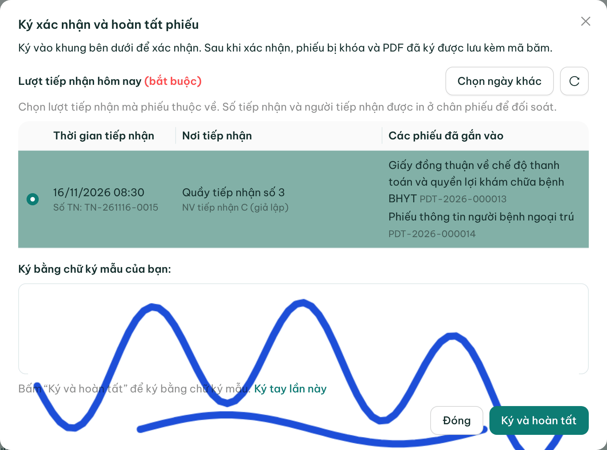

*Hình 2.19. Ký hoàn tất: dòng lượt tiếp nhận đã chọn được tô màu. Cột **Các phiếu đã gắn vào** giúp tránh chọn nhầm lượt.*

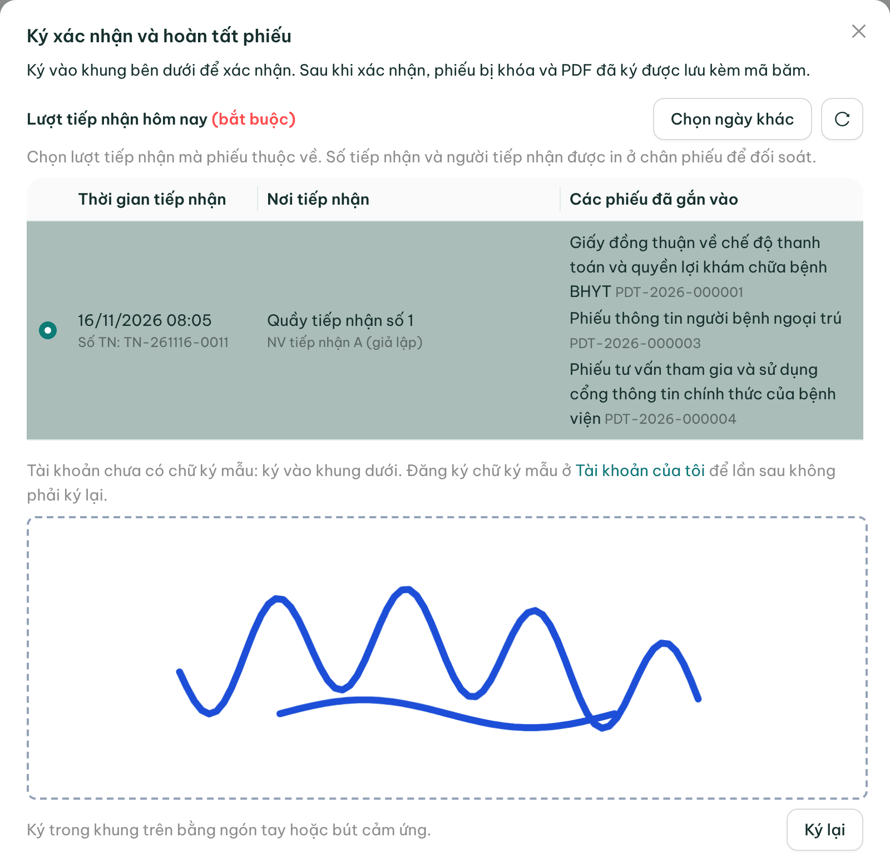

*Hình 2.20. Tài khoản chưa có chữ ký mẫu: chọn lượt tiếp nhận rồi ký vào khung bên dưới. Nút **Ký và hoàn tất** ở cuối hộp chỉ bấm được khi đã chọn lượt và đã ký.*

Lưu ý:

- Hồ sơ người bệnh cần có mã người bệnh hoặc số CCCD để tra lượt tiếp nhận.
- Số tiếp nhận, thời gian, nơi tiếp nhận và người tiếp nhận được in ở chân mỗi trang PDF.
- Bảng báo lỗi (không lấy được danh sách từ HIS): bấm **Thử lại**. Nếu chưa khắc phục ngay được, báo quản trị tạm tắt chức năng này. Sau khi tắt, bấm **Thử lại** là ký hoàn tất được (phiếu hoàn tất lúc tắt không gắn lượt tiếp nhận).
- Hôm nay chưa có lượt nào và phiếu thuộc lượt trước: bấm **Chọn ngày khác**.

### 2.12. Phiếu đã hoàn tất, xem và in PDF

Sau bước xác nhận cuối, phiếu chuyển sang **Hoàn tất**: phiếu bị khóa, không sửa được, PDF đã ký được lưu kèm mã băm (SHA-256) để phát hiện nếu file bị sửa.

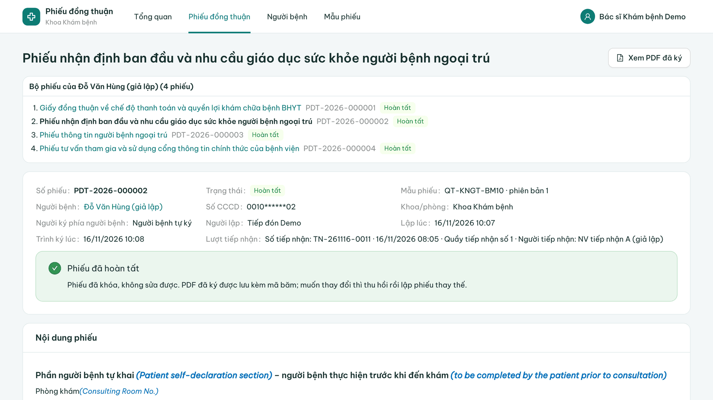

*Hình 2.21. Phiếu hoàn tất: dòng **Lượt tiếp nhận** (khi có gắn lượt) và khung **Phiếu đã hoàn tất**. Nút **Xem PDF đã ký** ở góc phải.*

Phần **Lịch sử phiếu** ở cuối trang ghi: ai lập phiếu, lúc trình ký, người bệnh ký (kèm lời xác nhận), từng nhân viên ký xác nhận, lúc hoàn tất, và mã SHA-256 của PDF đã ký.

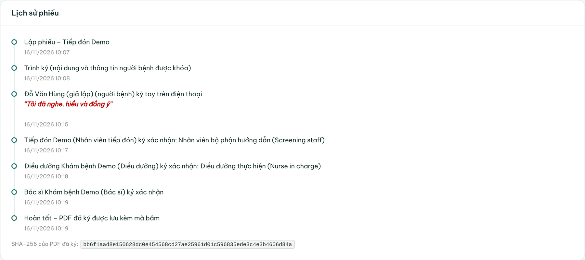

*Hình 2.22. **Lịch sử phiếu**: lời xác nhận của người bệnh in đỏ; dưới cùng là mã SHA-256 của PDF đã ký.*

Xem và in PDF:

1. Bấm **Xem PDF** (phiếu chưa hoàn tất) hoặc **Xem PDF đã ký** (phiếu hoàn tất).
2. PDF hiện trong cửa sổ. Dùng nút in hoặc tải trên thanh công cụ của PDF, hoặc bấm **Tải PDF** ở cuối cửa sổ rồi in file đã tải.

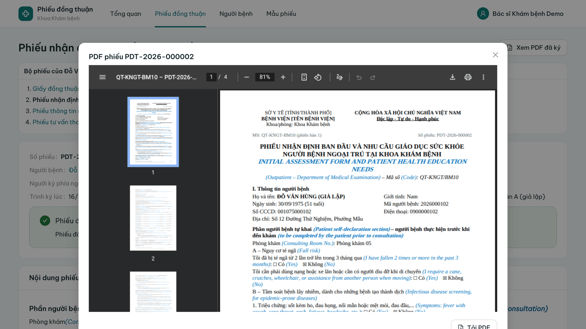

*Hình 2.23. Cửa sổ xem PDF: thanh công cụ của PDF có nút tải và in. Nút **Tải PDF** ở góc dưới bên phải.*

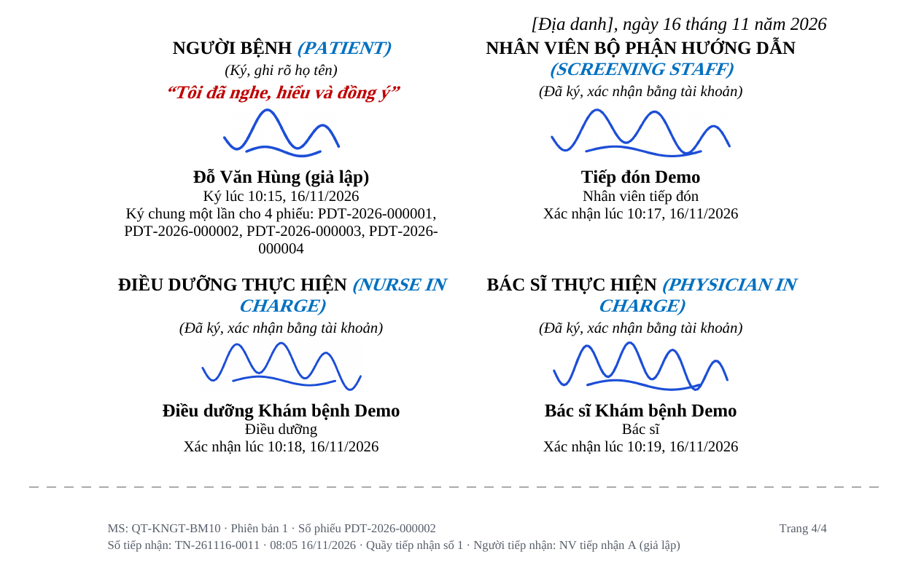

*Hình 2.24. Phần chữ ký trên PDF: chữ ký người bệnh kèm lời xác nhận (chữ đỏ), dòng "Ký chung một lần cho 4 phiếu", chữ ký từng nhân viên. Chân trang có số phiếu và lượt tiếp nhận (phần giữa trang trống đã được lược bớt).*

### 2.13. Trả về nháp, hủy phiếu

**Trả về nháp** (phiếu đang **Chờ ký**, chưa hoàn tất): dùng khi cần sửa nội dung.

1. Bấm **Trả về nháp**, rồi bấm **Trả về nháp** trong hộp hỏi lại.
2. Nếu người bệnh đã ký, chữ ký của người bệnh bị bỏ. Sau khi sửa, phải trình ký và ký lại.

**Hủy phiếu** (phiếu **Nháp** hoặc **Chờ ký**): dùng khi phiếu lập nhầm, không dùng nữa.

1. Bấm **Hủy phiếu**.
2. Nhập lý do (ít nhất 5 ký tự).
3. Bấm **Hủy phiếu** trong hộp.

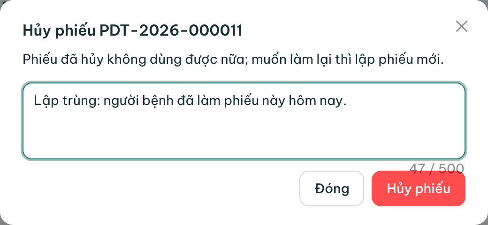

*Hình 2.25. Hủy phiếu: phải ghi lý do. Phiếu đã hủy không dùng được nữa; muốn làm lại thì lập phiếu mới.*

Phiếu đã **Hoàn tất** không trả về nháp, không hủy được. Muốn thay đổi, trưởng khoa (hoặc quản trị) thu hồi phiếu, rồi lập phiếu thay thế (mục 4.1, 4.2).

### 2.14. Danh sách phiếu

Bấm **Phiếu đồng thuận** trên menu để xem các phiếu bạn được phép xem.

- Tìm theo số phiếu, họ tên, mã người bệnh.
- Lọc theo **Trạng thái**, **Mẫu phiếu**, khoảng ngày lập (**Từ ngày** – **Đến ngày**).
- Bấm số phiếu (hoặc bấm đúp vào dòng) để mở phiếu.

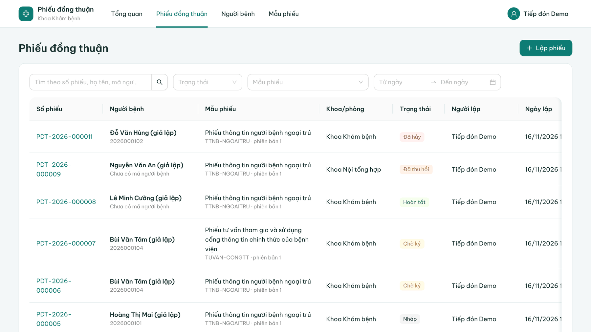

*Hình 2.26. Danh sách phiếu: bộ lọc ở trên, cột **Trạng thái** có màu để dễ phân biệt.*

### 2.15. Phiếu người bệnh tự làm tại kiosk

Phiếu người bệnh tự làm tại kiosk (phần 3.2) đã có chữ ký người bệnh, thuộc khoa đặt máy kiosk và chờ nhân viên xác nhận. Trên thanh bộ phiếu và trang phiếu có nhãn:

- **Lập tại kiosk · quét CCCD** hoặc **Lập tại kiosk · nhập mã y tế/CCCD**: đối chiếu CCCD của người bệnh trước khi xác nhận;
- **Lập tại kiosk · tự khai** (màu cam): người bệnh tự khai, chưa đối chiếu hồ sơ. Kiểm tra kỹ giấy tờ tùy thân và thông tin hành chính trước khi xác nhận.

Kiểm tra xong, bấm **Xác nhận cả bộ (… phiếu)** như mục 2.10.

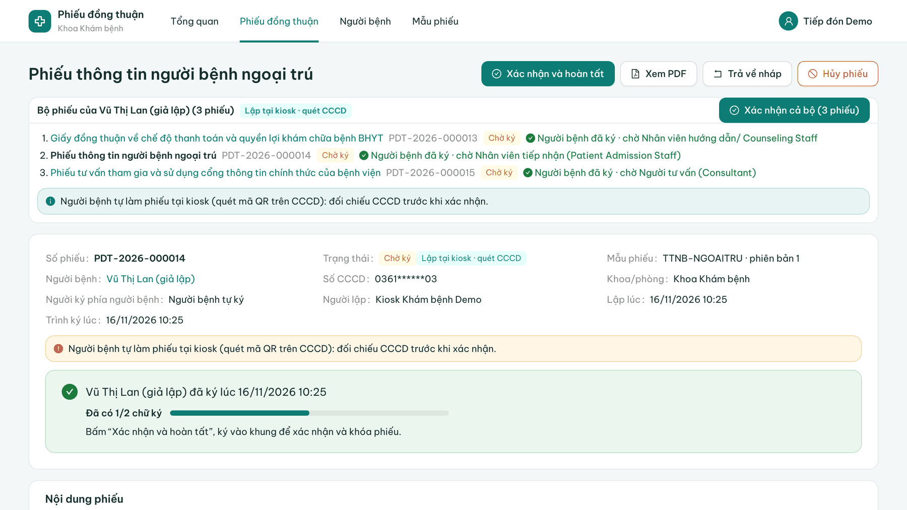

*Hình 2.27. Bộ phiếu do người bệnh tự làm tại kiosk: nhãn **Lập tại kiosk · quét CCCD** và lời nhắc đối chiếu CCCD.*

---

## 3. Người bệnh

Phần này mô tả màn hình người bệnh (hoặc người đại diện) nhìn thấy. Nhân viên nên đọc để hướng dẫn người bệnh.

### 3.1. Ký trên điện thoại

Nhân viên mở chế độ ký (mục 2.8) rồi đưa máy cho người bệnh, hoặc hiện mã QR để người bệnh ký trên điện thoại của mình. Màn hình ký không có menu. Có thể cầm dọc. Xoay ngang thì khung ký rộng hơn.

**Ký trên điện thoại của mình (quét mã QR)**

1. Mở camera điện thoại, quét mã QR trên màn hình của nhân viên, chạm vào đường dẫn hiện ra.
2. Nhập **ngày sinh của người bệnh** (người đại diện ký thay cũng nhập ngày sinh của người bệnh), ví dụ gõ 12031985 cho 12/03/1985. Chạm **Mở phiếu**. Nhập sai thì màn hình báo còn mấy lần thử; sai 5 lần thì mã bị hủy, nhờ nhân viên tạo mã mới.
3. Đọc phiếu, chọn ý kiến (nếu phiếu có hỏi), ghi lời xác nhận và ký như hướng dẫn bên dưới.
4. Màn hình *"Đã ghi nhận chữ ký"* hiện ra là xong. Có thể đóng trang. Mã chỉ dùng một lần; điện thoại khác quét lại mã cũng không mở được.

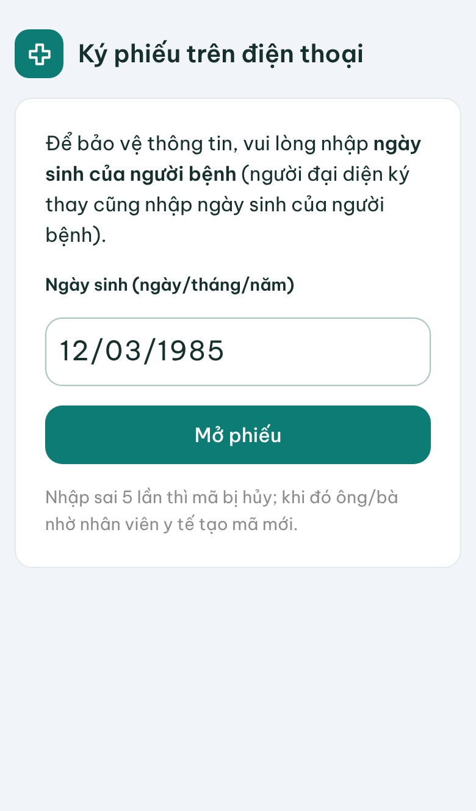
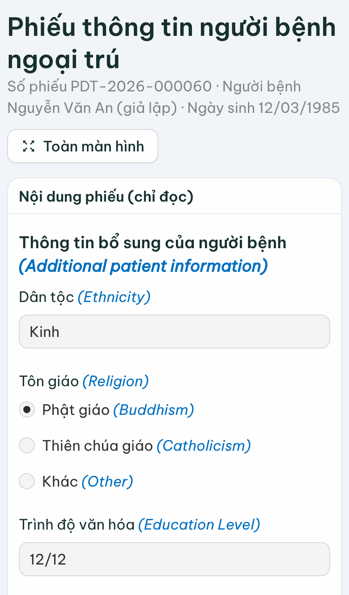
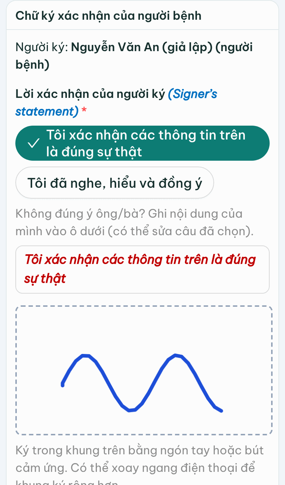
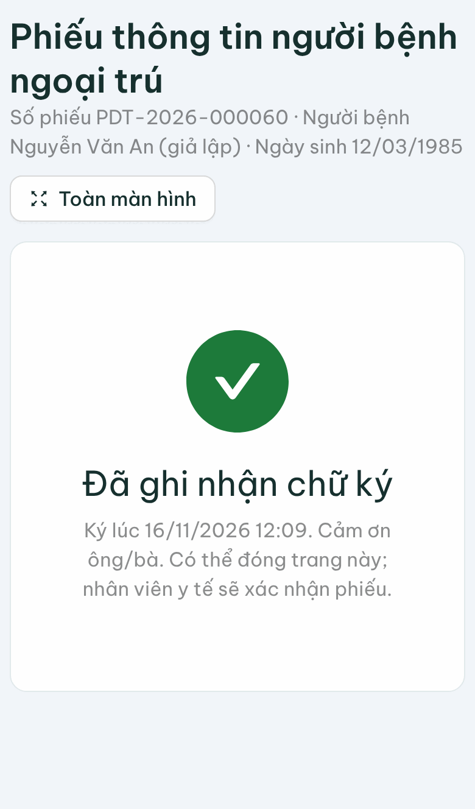

*Hình 3.1a. Trên điện thoại của người bệnh, từ trái sang: nhập ngày sinh; đọc phiếu; ghi lời xác nhận và ký; đã ký xong. Lỡ tải lại trang thì phiếu mở lại, không phải nhập lại ngày sinh.*

**Ký một bộ phiếu (nhiều phiếu, ký một lần)**

1. Màn hình **Ký … phiếu một lần** liệt kê **Các phiếu cần ký**. Chạm **Xem nội dung phiếu** để đọc từng phiếu. Chạm lần nữa để thu gọn.
2. Phiếu nào có câu hỏi ý kiến thì chọn câu trả lời, ví dụ **Đồng ý (Agree)** hoặc **Không đồng ý (Disagree)**.
3. Ở phần **Chữ ký của người bệnh cho cả … phiếu**, ghi lời xác nhận: chạm một câu gợi ý (ví dụ *"Tôi đã nghe, hiểu và đồng ý"*), hoặc tự viết vào ô bên dưới. Ô có dấu * đỏ là bắt buộc.
4. Ký vào khung bằng ngón tay hoặc bút cảm ứng. Ký hỏng thì chạm **Ký lại**.
5. Chạm **Xác nhận chữ ký cho cả … phiếu**. Nút chỉ chạm được khi đã chọn đủ ý kiến, đã ghi lời xác nhận (nếu bắt buộc) và đã ký. Dòng chữ dưới nút cho biết còn thiếu gì.
6. Màn hình báo **Đã ký xong … phiếu**. Đưa máy lại cho nhân viên.

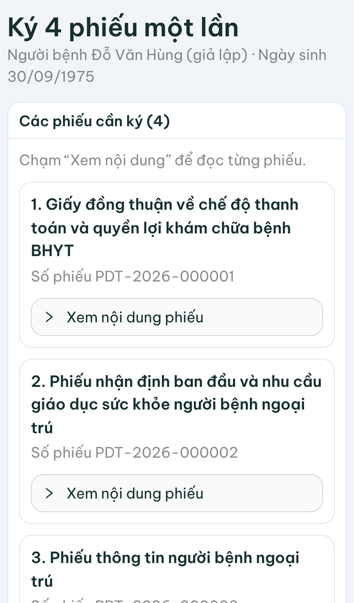
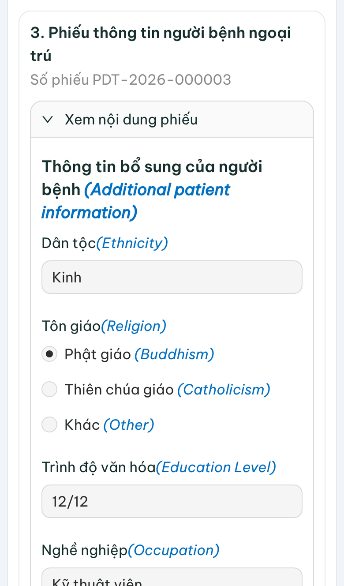

*Hình 3.1. Trái: danh sách phiếu cần ký. Phải: chạm **Xem nội dung phiếu** để đọc nội dung (chỉ đọc).*

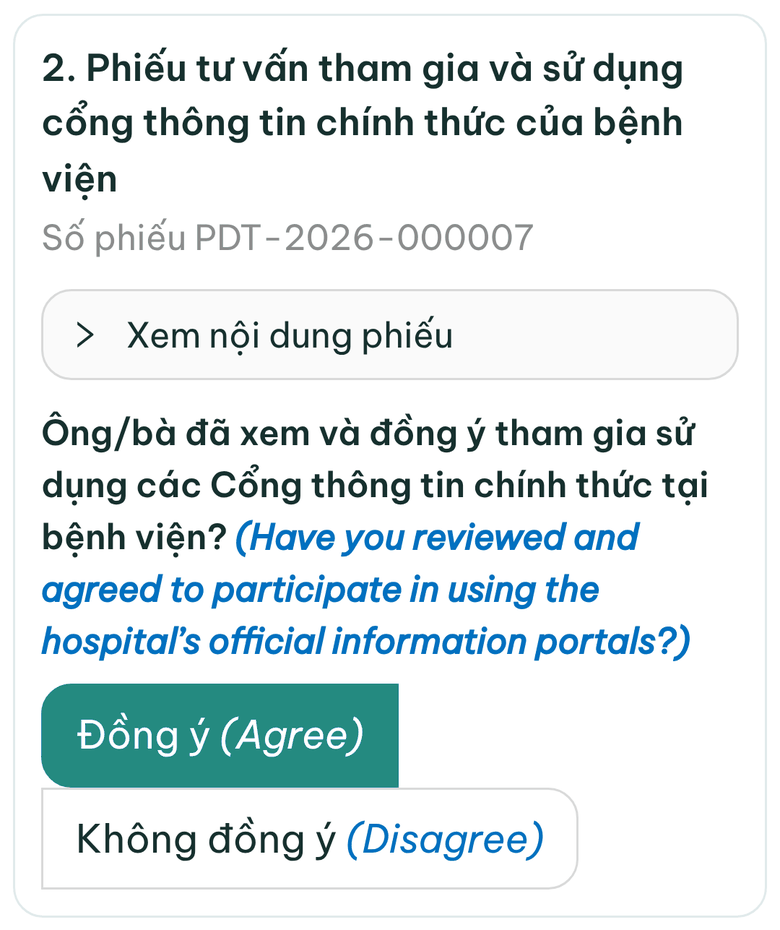
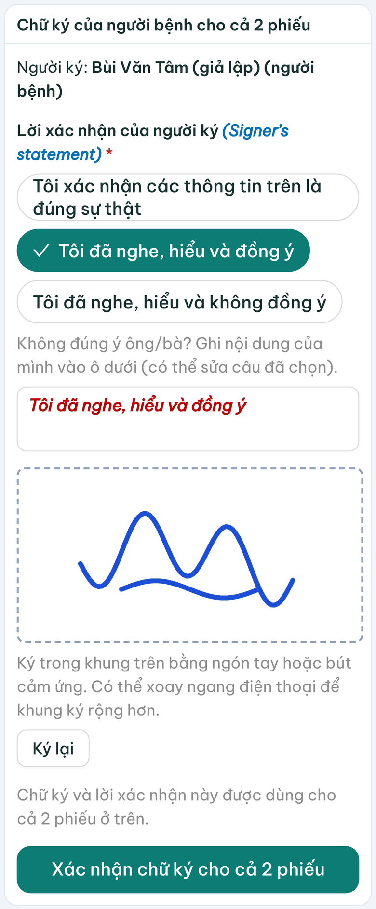

*Hình 3.2. Trái: phiếu có hỏi ý kiến, đã chọn **Đồng ý (Agree)**. Phải: chọn lời xác nhận (hiện chữ đỏ trong ô), ký vào khung, chạm **Xác nhận chữ ký cho cả 2 phiếu**.*

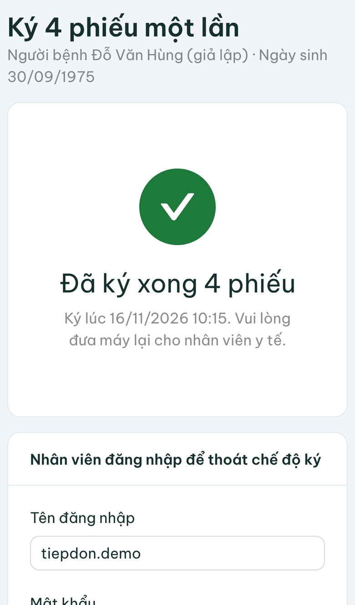
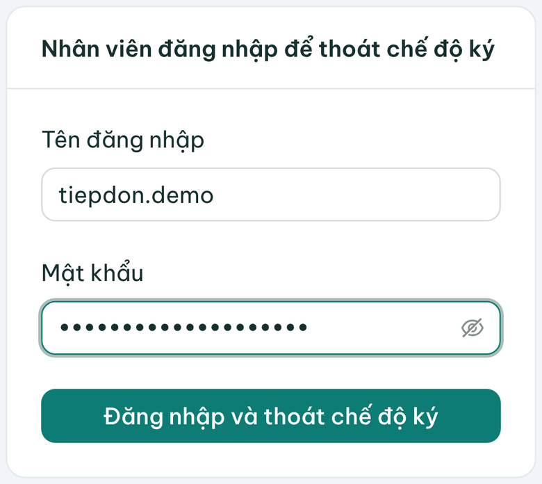

*Hình 3.3. Trái: **Đã ký xong 4 phiếu**, đưa máy lại cho nhân viên. Phải: nhân viên nhập mật khẩu, bấm **Đăng nhập và thoát chế độ ký**.*

**Ký một phiếu lẻ**

Giống như trên nhưng chỉ có một phiếu: phần **Nội dung phiếu (chỉ đọc)** ở trên, phần ký ở dưới. Phiếu có câu hỏi ý kiến thì chọn **Đồng ý** hoặc **Từ chối** (hoặc nhãn riêng của phiếu). Chạm **Xác nhận chữ ký**. Màn hình báo **Đã ghi nhận chữ ký**.

Khi người đại diện ký thay, dòng **Người ký** ghi rõ *"…, ký thay cho người bệnh …"*.

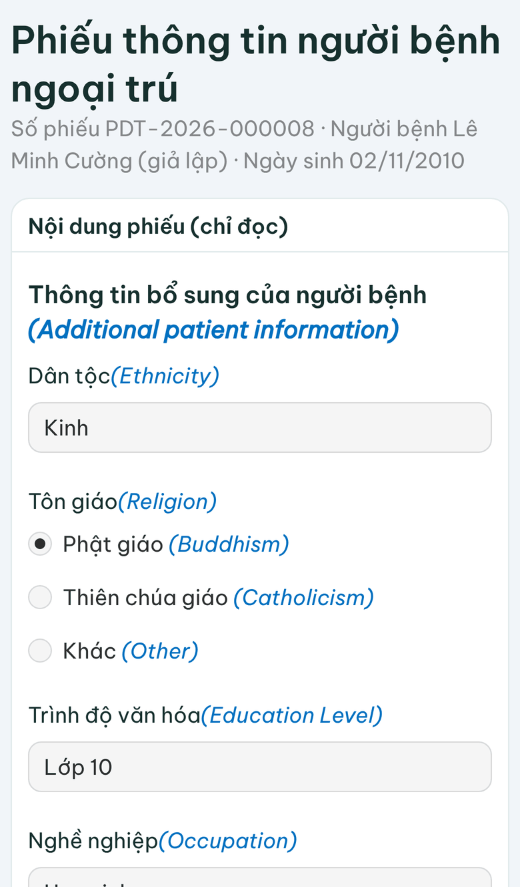
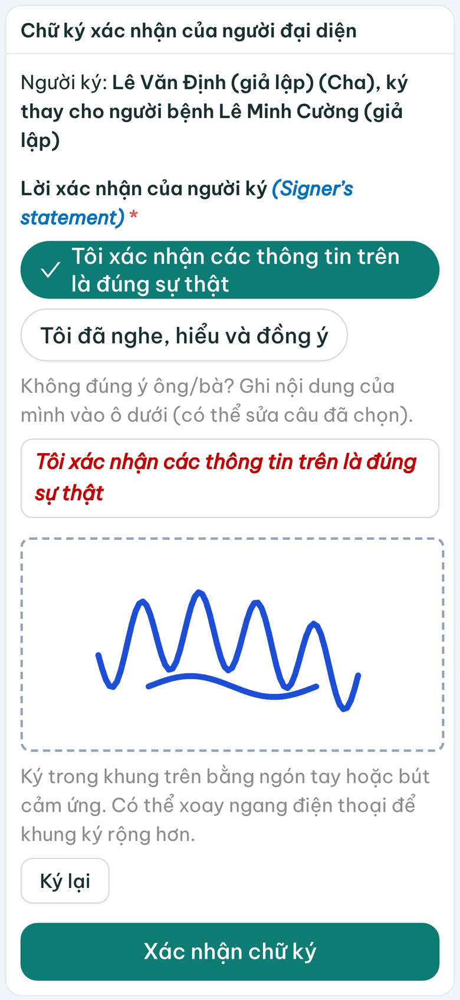

*Hình 3.4. Trái: phiếu lẻ, nội dung chỉ đọc ở trên. Phải: người đại diện ký thay cho người bệnh là trẻ em.*

### 3.2. Tự làm phiếu tại kiosk

Máy kiosk là màn hình cảm ứng 32 inch đặt dọc, có máy quét mã QR gắn bên dưới. Người bệnh làm 3 bước: **Nhận diện**, **Trả lời**, **Ký tên**. Thanh bước ở đầu màn hình cho biết đang ở bước nào.

**Bước 1: Nhận diện.** Trên màn hình đầu, chạm một trong ba cách:

- **Quét CCCD** (nhanh nhất): lật thẻ sang mặt có mã QR, đưa mã QR lại gần đèn đỏ của máy quét, giữ yên 1–2 giây. Nghe tiếng "bíp" là xong, máy tự chuyển sang bước sau. Máy chỉ đọc chữ trong mã QR, không chụp hay lưu ảnh thẻ.
- **Nhập mã y tế hoặc số CCCD**: chọn **Mã y tế** hoặc **Số CCCD**, nhập bằng bàn phím số trên màn hình, chạm **Ô tiếp**, nhập **Ngày sinh (ngày/tháng/năm)**, chạm **Lấy thông tin**. Máy chỉ hiện thông tin khi ngày sinh khớp hồ sơ.
- **Nhập thông tin** (khi không mang CCCD hoặc chưa có mã y tế): nhập **Họ và tên**, **Ngày sinh**, **Giới tính**, **Số điện thoại**, **Số CCCD** (nếu có), **Chỗ ở hiện nay**, rồi chạm **Tiếp tục**. Bàn phím tiếng Việt có hàng phím dấu: gõ chữ rồi chạm dấu.

*Hình 3.5. Trái: màn hình đầu, chọn cách lấy thông tin. Phải: hướng dẫn đưa mã QR trên thẻ vào máy quét.*

*Hình 3.6. Trái: nhập mã y tế và ngày sinh bằng bàn phím số. Phải: tự nhập thông tin; ô có dấu * là bắt buộc.*

Sau khi nhận diện, màn hình hỏi **Đây có phải thông tin của ông/bà?**. Chạm **Đúng, tiếp tục**. Nếu không đúng, chạm **Không phải tôi** để về màn hình đầu. Hồ sơ chưa có số điện thoại thì máy yêu cầu nhập số điện thoại.

Nếu ông/bà đã làm các phiếu này gần đây, máy hỏi **Thông tin của ông/bà có thay đổi so với lần trước không?**:

- **Không thay đổi, giữ như lần trước**: máy dùng lại câu trả lời lần trước (không hiện lại câu trả lời cũ), chỉ hỏi các câu còn lại;
- **Có thay đổi, trả lời lại**: trả lời lại từ đầu.

Câu Đồng ý/Không đồng ý và chữ ký luôn làm lại.

*Hình 3.7. Trái: kiểm tra thông tin của mình, chạm **Đúng, tiếp tục**. Phải: câu hỏi giữ như lần trước hay trả lời lại.*

**Bước 2: Trả lời.** Mỗi màn hình một câu hỏi.

- Phía trên có danh sách **Phiếu của ông/bà hôm nay** (đã trả lời, đang làm, chưa làm) và thứ tự câu hỏi, ví dụ **Câu 2/6**.
- Câu có lựa chọn: chạm vào nút lớn. Câu cần gõ chữ: dùng bàn phím trên màn hình. Câu số: dùng bàn phím số.
- Câu hỏi ý kiến (Đồng ý/Không đồng ý): chạm **Xem nội dung phiếu** để đọc phiếu trước khi chọn.
- Chạm **Tiếp tục** để sang câu sau, **Quay lại** để về câu trước, **Làm lại từ đầu** (góc trên bên phải) để xóa hết và bắt đầu lại.
- Câu đã có trong hồ sơ thì máy không hỏi lại.

*Hình 3.8. Trái: câu có lựa chọn. Giữa: câu nhập chữ, có bàn phím tiếng Việt. Phải: câu hỏi Đồng ý/Không đồng ý, có nút **Xem nội dung phiếu**.*

**Bước 3: Ký tên.** Màn hình **Ký tên cho các phiếu**:

1. Xem lại danh sách phiếu và tóm tắt câu trả lời. Chạm **Xem nội dung** để đọc lại từng phiếu.
2. Chọn lời xác nhận (câu đầu tiên được chọn sẵn), hoặc chạm **Tự nhập nội dung khác** để tự gõ.
3. Ký vào khung.
4. Chạm **Ký xác nhận cho cả … phiếu** (một phiếu thì nút là **Ký xác nhận**).

Màn hình báo **Ông/bà đã ký xong … phiếu** và mời đến **quầy tiếp đón** để nhân viên kiểm tra và xác nhận. Màn hình hiện tên người bệnh, mã y tế (nếu có) và số phiếu. Sau 15 giây, máy tự về trang đầu và xóa thông tin khỏi màn hình. Muốn thay đổi nội dung, người bệnh báo nhân viên tại quầy.

*Hình 3.9. Trái: chọn lời xác nhận, ký một lần cho cả bộ. Phải: đã ký xong, mời đến quầy tiếp đón.*

Lưu ý về kiosk:

- **60 giây không chạm** thì máy tự xóa thông tin và về trang đầu. 10 giây cuối có dòng nhắc *"Màn hình sẽ tự về trang đầu sau … giây"*. Chạm vào màn hình để tiếp tục.
- Nhập mã/CCCD kèm ngày sinh sai **5 lần** thì máy tạm khóa tra cứu **5 phút**. Trong lúc này, quét thẻ cũng phải chờ. Người bệnh vẫn chọn **Nhập thông tin** (không kèm số CCCD) được, hoặc đến quầy tiếp đón. Quản trị mở khóa sớm được: **Quản trị → Người dùng**, tài khoản kiosk có trạng thái **Tạm khóa tra cứu**, bấm **⋯** → **Mở khóa**.
- Các phiếu chuyên môn khác (nếu có) do điều dưỡng làm cùng người bệnh tại phòng khám.

**Dành cho nhân viên: đăng nhập và đăng xuất máy kiosk**

- Mỗi sáng, nhân viên bật máy và đăng nhập bằng **tài khoản kiosk** do quản trị cấp (lần đầu phải đổi mật khẩu). Phiên đăng nhập giữ trong ngày.
- Đăng xuất máy: **giữ biểu tượng bệnh viện ở góc trên bên trái 3 giây**, hộp **Đăng xuất máy kiosk?** hiện ra, bấm **Đăng xuất**.

*Hình 3.10. Hộp đăng xuất máy kiosk, mở bằng cách giữ biểu tượng bệnh viện 3 giây.*

---

## 4. Trưởng khoa

Trưởng khoa có mọi chức năng của mục 2, thêm **Thu hồi** phiếu đã ký, **Báo cáo** và **Xuất dữ liệu**. Số liệu và phiếu trong phạm vi khoa của trưởng khoa (và phiếu do trưởng khoa lập).

### 4.1. Thu hồi phiếu đã hoàn tất

Dùng khi phiếu đã ký có sai sót. Phiếu thu hồi hết hiệu lực nhưng vẫn được lưu nguyên, kể cả PDF đã ký.

1. Mở phiếu đã **Hoàn tất**.
2. Bấm **Thu hồi**.
3. Nhập lý do thu hồi (ít nhất 5 ký tự).
4. Bấm **Thu hồi** trong hộp.

*Hình 4.1. Thu hồi phiếu: bắt buộc ghi lý do.*

Phiếu chuyển sang **Đã thu hồi**, trang phiếu ghi **Lý do thu hồi** và thời điểm.

### 4.2. Lập phiếu thay thế

1. Mở phiếu **Đã thu hồi**.
2. Bấm **Lập phiếu thay thế**. Phần mềm tạo phiếu nháp mới, chép nội dung từ phiếu cũ, giữ khoa của phiếu cũ.
3. Sửa nội dung cho đúng, rồi trình ký và cho người bệnh ký như mục 2.6–2.10.

Mỗi phiếu thu hồi chỉ lập phiếu thay thế được một lần. Phiếu mới ghi **Thay thế cho phiếu …**, phiếu cũ ghi **Phiếu thay thế …** (bấm để mở). Người có quyền lập phiếu (tiếp đón, điều dưỡng, bác sĩ…) cũng bấm **Lập phiếu thay thế** được.

*Hình 4.2. Phiếu đã thu hồi: trạng thái **Đã thu hồi**, dòng **Lý do thu hồi**, nút **Lập phiếu thay thế** ở góc phải.*

*Hình 4.3. Phiếu thay thế: dòng **Thay thế cho phiếu** dẫn về phiếu cũ, nội dung đã được chép sẵn.*

### 4.3. Báo cáo thống kê và xuất dữ liệu của khoa

Cách dùng như phần 6. Khác biệt: trưởng khoa chỉ thấy số liệu của khoa mình. Trang **Báo cáo thống kê** ghi *"Số liệu trong phạm vi khoa của bạn."* Trang **Xuất dữ liệu** ghi *"Bạn chỉ xuất được phiếu của khoa mình và phiếu do mình lập."* Số CCCD, số điện thoại, số thẻ BHYT trong file xuất được che một phần.

*Hình 4.4. Báo cáo của trưởng khoa: không có ô chọn khoa, số liệu chỉ của khoa mình.*

---

## 5. Quản lý mẫu phiếu

Người quản lý mẫu phiếu tạo và sửa mẫu, quản lý phiên bản và phát hành. Mỗi lần sửa là một **phiên bản mới**. Phiếu đã lập luôn giữ đúng phiên bản lúc lập.

### 5.1. Danh sách mẫu phiếu

Bấm **Mẫu phiếu** trên menu. Bảng có: mã và tên mẫu, **Xác nhận phía bệnh viện** (vai trò xác nhận cuối), **Phạm vi**, **Đang phát hành** (phiên bản nào, từ khi nào), **Nháp**, **Trạng thái** (**Đang dùng** hoặc **Ngừng sử dụng**). Bấm tên mẫu để mở.

*Hình 5.1. Danh sách mẫu phiếu. Nút **Thêm mẫu phiếu** ở góc phải.*

### 5.2. Xem mẫu

Trang chi tiết mẫu có:

- dòng thông tin: **Xác nhận phía bệnh viện**, **Phạm vi**, nút **Sửa thông tin mẫu**;
- bảng **Các phiên bản**: trạng thái (**Nháp**, **Đang phát hành**, **Ngừng dùng**), ngày cập nhật, ngày phát hành; nút **Xem**, **Phát hành**, **Ngừng dùng**;
- phần của phiên bản đang xem, có ba thẻ: **Xem trước** (thử điền để kiểm tra điều kiện hiển thị và cách tính điểm, dữ liệu thử không được lưu), **Cấu hình ký**, **Định nghĩa (JSON)**.

*Hình 5.2. Chi tiết mẫu phiếu: bảng **Các phiên bản** và thẻ **Xem trước** của phiên bản đang phát hành.*

### 5.3. Tạo phiên bản mới

1. Mở mẫu cần sửa.
2. Bấm **Tạo phiên bản mới**. Phần mềm chép phiên bản mới nhất thành phiên bản nháp. Nút này bị mờ khi mẫu đã có một phiên bản nháp.
3. Sửa phiên bản nháp ở thẻ **Soạn định nghĩa (JSON)** (mục 5.4) hoặc **Cấu hình ký** (mục 5.5).
4. Kiểm tra ở thẻ **Xem trước**.
5. Phát hành (mục 5.6).

Chỉ phiên bản nháp sửa được.

*Hình 5.3. Phiên bản 2 ở trạng thái **Nháp**, có nút **Phát hành**. Phiên bản 1 vẫn **Đang phát hành** cho đến khi phát hành phiên bản 2.*

### 5.4. Soạn định nghĩa (JSON)

Thẻ **Soạn định nghĩa (JSON)** chứa toàn bộ nội dung mẫu: tiêu đề, các phần, đoạn văn, câu hỏi, điều kiện hiển thị, cách tính điểm, tùy chọn in. Cấu trúc chi tiết xem tài liệu API ([docs/api.md](api.md), mục 6b) và [docs/mau-phieu.md](mau-phieu.md).

1. Mở thẻ **Soạn định nghĩa (JSON)** của phiên bản nháp.
2. Sửa nội dung trong ô soạn.
3. Bấm **Lưu phiên bản nháp**.
4. Nếu có lỗi, phần mềm liệt kê ở khung **Định nghĩa chưa hợp lệ** (hoặc báo *"Nội dung không phải JSON hợp lệ."*). Sửa rồi lưu lại.
5. Mở thẻ **Xem trước** để kiểm tra kết quả.

*Hình 5.4. Thẻ **Soạn định nghĩa (JSON)** của phiên bản nháp. Nút **Lưu phiên bản nháp** ở dưới ô soạn.*

Mẹo: ghi tiếng Anh trong ngoặc như các mẫu hiện có, ví dụ "Dân tộc (Ethnicity)". Phần mềm tự in phần tiếng Anh màu xanh, chữ nghiêng.

### 5.5. Cấu hình ký

Thẻ **Cấu hình ký** của phiên bản nháp cho phép cấu hình việc ký mà không cần sửa JSON:

- **Thứ tự ký**: các bước xác nhận trung gian, tối đa 5 bước. Mỗi bước chọn **Vai trò xác nhận** và nhập **Tên ô ký trên phiếu**, thêm **Ghi chú dưới tên ô ký** nếu cần. Bấm **Thêm bước xác nhận** để thêm. Dùng các nút mũi tên để đổi thứ tự, nút thùng rác để xóa. Bước xác nhận cuối do vai trò ở **Sửa thông tin mẫu** đảm nhận.
- **Ý kiến của người bệnh khi ký**: **Hỏi Đồng ý / Không đồng ý** (có thể đặt câu hỏi và nhãn riêng) hoặc **Chỉ ký xác nhận (không hỏi)**.
- **Lời xác nhận của người ký**: đánh dấu **Có ô lời xác nhận**, đặt tiêu đề ô, chọn **Bắt buộc ghi lời xác nhận trước khi ký**, thêm **Câu gợi ý (bấm chọn nhanh)**.
- **Tên các ô ký trên PDF**: tên ô người bệnh, người đại diện, ô xác nhận cuối. Ô để trống thì dùng nhãn mặc định.

Bấm **Lưu cấu hình ký**. Cấu hình chỉ áp dụng cho phiếu mới sau khi **phát hành** phiên bản. Phiếu đã lập vẫn ký theo phiên bản của nó.

*Hình 5.5. Thẻ **Cấu hình ký** của một mẫu chỉ ký xác nhận, không có bước trung gian, có ô lời xác nhận bắt buộc.*

*Hình 5.6. Ví dụ mẫu có hai bước xác nhận trung gian (Tiếp đón, rồi Điều dưỡng) trước bước xác nhận cuối của Bác sĩ.*

### 5.6. Phát hành, ngừng dùng

**Phát hành** phiên bản nháp:

1. Trong bảng **Các phiên bản**, bấm **Phát hành** ở dòng phiên bản nháp.
2. Bấm **Phát hành** trong hộp hỏi lại.

Từ lúc này, phiếu mới dùng phiên bản vừa phát hành. Phiên bản phát hành trước đó ngừng dùng cho phiếu mới. Phiếu đã lập giữ nguyên phiên bản cũ.

*Hình 5.7. Hộp hỏi lại trước khi phát hành phiên bản 2.*

**Ngừng dùng**: bấm **Ngừng dùng** ở phiên bản đang phát hành, rồi xác nhận. Mẫu không dùng được để lập phiếu mới cho đến khi phát hành phiên bản khác.

### 5.7. Sửa thông tin mẫu, thêm mẫu mới

**Sửa thông tin mẫu**: bấm **Sửa thông tin mẫu** để đổi **Tên mẫu**, **Vai trò xác nhận cuối (Xác nhận và hoàn tất)** và công tắc **Đang sử dụng** (tắt để không lập phiếu mới từ mẫu này). Bấm **Lưu**.

Đổi vai trò xác nhận cuối có hiệu lực **ngay**, cho cả phiếu đang chờ xác nhận của mẫu. Phần mềm hiện cảnh báo trước khi lưu.

*Hình 5.8. Đổi vai trò xác nhận cuối: cảnh báo *"Áp dụng ngay cho mọi phiếu chưa hoàn tất của mẫu này"*.*

**Thêm mẫu phiếu**: bấm **Thêm mẫu phiếu**, nhập **Mã mẫu** (in ở góc phiếu), **Tên mẫu**, chọn **Vai trò xác nhận phía bệnh viện**, bấm **Tạo**. Phần mềm tạo phiên bản nháp 1. Soạn nội dung (mục 5.4), cấu hình ký (mục 5.5) rồi phát hành.

---

## 6. Báo cáo / Xuất dữ liệu

Vai trò này xem báo cáo và xuất dữ liệu của toàn viện. Trưởng khoa dùng cùng các trang này nhưng chỉ trong phạm vi khoa mình (mục 4.3).

### 6.1. Báo cáo thống kê

1. Bấm **Báo cáo** trên menu.
2. Chọn khoảng ngày lập phiếu (mặc định từ đầu tháng đến hôm nay), **Mẫu phiếu**, **Khoa/phòng** nếu cần.

Báo cáo đếm phiếu theo **ngày lập** và theo **trạng thái hiện tại** của phiếu. Trang có:

- các ô **Tổng số phiếu**, **Hoàn tất**, **Chờ ký**, **Nháp**, **Đã hủy**, **Đã thu hồi**;
- **Ý kiến của người bệnh (phiếu hoàn tất)**: **Đồng ý**, **Từ chối**, **Tỉ lệ từ chối**;
- **Người ký phía người bệnh (phiếu hoàn tất)**: **Người bệnh tự ký**, **Người đại diện ký**;
- **Thời gian từ lập đến hoàn tất**: **Trung bình**, **Trung vị**, **90% phiếu dưới**, số phiếu theo từng mốc thời gian;
- biểu đồ **Số phiếu lập theo ngày**;
- bảng **Theo khoa/phòng** và **Theo mẫu phiếu**.

*Hình 6.1. Báo cáo thống kê: bộ lọc ở trên, các ô số liệu, biểu đồ theo ngày và hai bảng theo khoa, theo mẫu.*

### 6.2. Xuất dữ liệu (Excel, CSV)

1. Bấm **Xuất dữ liệu** trên menu.
2. Ở **Bộ lọc**, chọn **Trạng thái**, **Mẫu phiếu**, **Khoa/phòng**, khoảng ngày lập. Để trống là lấy tất cả.
3. Ở **Định dạng và dữ liệu**, chọn **Excel (.xlsx)** hoặc **CSV (.csv)**.
4. Muốn có nội dung từng phiếu (mỗi câu hỏi một cột), đánh dấu **Kèm nội dung phiếu theo mẫu**. Ô này chỉ chọn được khi đã chọn đúng một mẫu ở bộ lọc.
5. Ở **Cột xuất**, đánh dấu các cột cần lấy. Bấm **Mặc định** để về bộ cột mặc định, **Chọn tất cả** để lấy mọi cột.
6. Bấm **Xuất file**. Trình duyệt tải file về. Phần mềm báo *"Đã xuất … phiếu: <tên file>"*.

*Hình 6.2. Xuất dữ liệu: bộ lọc và định dạng bên trái, chọn cột bên phải, nút **Xuất file** ở dưới.*

Lưu ý:

- Số CCCD, số điện thoại, số thẻ BHYT được che một phần (ví dụ `0790******12`). Cột có nhãn **che** là cột bị che. Chỉ người được cấp quyền riêng (mặc định là quản trị hệ thống) mới thấy ô **Xuất đầy đủ số CCCD, số điện thoại, số thẻ BHYT (dữ liệu nhạy cảm)**. Lần xuất đầy đủ được ghi nhật ký.
- Mỗi lần xuất tối đa 100.000 phiếu. Nhiều hơn thì thu hẹp bộ lọc.
- Xuất quá nhiều lần trong một phút (quá 10 lần), phần mềm báo *"Bạn thao tác quá nhiều lần"*. Chờ một phút rồi thử lại.
- File không lưu lại trên máy chủ. Hãy giữ file theo đúng quy định bảo mật của bệnh viện.

### 6.3. Lịch sử xuất

Phần **Lịch sử xuất của tôi** ở cuối trang **Xuất dữ liệu** liệt kê các lần bạn đã xuất: thời điểm, định dạng, bộ lọc, số phiếu, dữ liệu **Đã che** hay **Nhạy cảm đầy đủ**, **Kèm nội dung**, tên file, dung lượng, số cột, thời gian xuất và mã SHA-256 của file. Người có quyền xem nhật ký thấy **Lịch sử xuất (toàn hệ thống)**, có thêm cột **Người xuất**.

*Hình 6.3. **Lịch sử xuất của tôi**: một lần xuất Excel kèm nội dung và một lần xuất CSV, cả hai đều **Đã che**.*

---

## 7. Kiểm tra

Vai trò Kiểm tra (thanh tra, pháp chế, quản lý chất lượng) chỉ đọc: xem phiếu và hồ sơ người bệnh của toàn viện, xem mẫu phiếu, báo cáo, danh sách người dùng và nhật ký hệ thống. Mỗi lần xem phiếu, xem hồ sơ người bệnh, tải PDF đều được ghi nhật ký.

### 7.1. Nhật ký hệ thống

1. Bấm **Nhật ký** trên menu.
2. Lọc theo **Hành động**, **Loại đối tượng**, **Mã đối tượng (Id)**, khoảng thời gian (**Từ thời điểm** – **Đến thời điểm**).
3. Bấm dấu **+** ở đầu dòng để xem chi tiết: **Mã yêu cầu** và nội dung thay đổi.
4. Với phiếu và người bệnh, bấm mã đối tượng để mở phiếu hoặc hồ sơ đó.

*Hình 7.1. Nhật ký hệ thống: mỗi dòng ghi thời điểm, người dùng, hành động, đối tượng, địa chỉ IP. Dòng đầu đang mở chi tiết.*

Nhật ký chỉ ghi thêm, không ai sửa hay xóa được. Giá trị nhạy cảm (số CCCD, số điện thoại, nội dung phiếu, mật khẩu) đã được che khi ghi.

### 7.2. Xem phiếu

Mở **Phiếu đồng thuận**, tìm và mở phiếu như mục 2.14. Người kiểm tra chỉ xem: không có nút sửa, xác nhận hay thu hồi. Bấm **Xem PDF đã ký** để xem bản đã ký. Phần **Lịch sử phiếu** cho biết ai làm gì, lúc nào, và mã SHA-256 của PDF đã ký.

*Hình 7.2. Người kiểm tra xem phiếu: chỉ có nút **Xem PDF đã ký**.*

---

## 8. Quản trị hệ thống

Quản trị hệ thống có toàn quyền: mọi chức năng ở các phần trên, cùng menu **Quản trị** gồm **Người dùng**, **Vai trò và quyền**, **Khoa/phòng**, **Cấu hình hệ thống**.

### 8.1. Người dùng

Bấm **Quản trị** → **Người dùng**. Tìm theo họ tên, tên đăng nhập, chức danh. Lọc theo **Khoa/phòng**, **Trạng thái**. Cột **Trạng thái**: **Hoạt động**, **Tạm khóa** (nhập sai mật khẩu nhiều lần), **Đã khóa**.

*Hình 8.1. Danh sách người dùng: vai trò, trạng thái, lần đăng nhập gần nhất. Cột **Thao tác** ở bên phải.*

Thêm người dùng:

1. Bấm **Thêm người dùng**.
2. Nhập **Tên đăng nhập** (chữ không dấu, số, dấu chấm, gạch ngang, gạch dưới), **Họ tên**, **Chức danh**.
3. Chọn **Khoa/phòng** và **Vai trò** (chọn được nhiều vai trò).
4. Nhập **Email**, **Số điện thoại** nếu có.
5. Nhập **Mật khẩu ban đầu** (theo quy tắc mật khẩu ở mục 1.2). Người dùng phải đổi mật khẩu ở lần đăng nhập đầu tiên.
6. Bấm **Lưu**. Báo tên đăng nhập và mật khẩu ban đầu cho người dùng theo cách an toàn.

*Hình 8.2. Hộp **Thêm người dùng**.*

Sửa, khóa, mở khóa, đặt lại mật khẩu:

- Bấm **Sửa** để sửa họ tên, chức danh, khoa/phòng, vai trò, email, số điện thoại. Không đổi được tên đăng nhập.
- Bấm nút **⋯** ở cột **Thao tác** để chọn:
  - **Khóa tài khoản**: người dùng bị đăng xuất khỏi mọi thiết bị và không đăng nhập được cho đến khi mở khóa. Khi nhân viên nghỉ việc, hãy khóa tài khoản thay vì xóa, để giữ nhật ký;
  - **Mở khóa**: chỉ có khi tài khoản đang bị khóa, tạm khóa (nhập sai mật khẩu), hoặc là tài khoản kiosk đang **Tạm khóa tra cứu** (người bệnh nhập sai ngày sinh nhiều lần). Mở khóa tài khoản kiosk thì máy tra cứu lại được ngay;
  - **Đặt lại mật khẩu**: đặt mật khẩu tạm. Mọi phiên đăng nhập của người dùng bị đăng xuất. Người dùng phải đổi mật khẩu ở lần đăng nhập tiếp theo.

*Hình 8.3. Menu **⋯**: **Khóa tài khoản**, **Đặt lại mật khẩu** (và **Mở khóa** khi tài khoản đang khóa).*

### 8.2. Tài khoản cho máy kiosk

Mỗi máy kiosk dùng một tài khoản riêng:

1. **Thêm người dùng**, ví dụ tên đăng nhập `kiosk.kkb`.
2. Chọn **Khoa/phòng** là khoa đặt máy. Phiếu lập trên kiosk thuộc khoa này.
3. Chọn **chỉ một** vai trò **Kiosk người bệnh**. Phần mềm từ chối nếu thêm vai trò khác hoặc không chọn khoa.
4. Đặt mật khẩu ban đầu, bấm **Lưu**. Nhân viên đăng nhập máy kiosk lần đầu và đổi mật khẩu.
5. Chọn các mẫu dùng trên kiosk ở **Cấu hình hệ thống** (mục 8.5).

Tài khoản kiosk chỉ dùng được màn hình kiosk. Mở trang khác cũng bị đưa về kiosk.

*Hình 8.4. Tài khoản kiosk: một vai trò **Kiosk người bệnh** và khoa đặt máy.*

### 8.3. Vai trò và quyền

1. Bấm **Quản trị** → **Vai trò và quyền**.
2. Chọn vai trò ở cột trái (mỗi vai trò ghi số quyền).
3. Đánh dấu hoặc bỏ dấu các quyền theo nhóm: **Hệ thống**, **Người bệnh**, **Mẫu phiếu**, **Phiếu đồng thuận**, **Báo cáo và xuất dữ liệu**, **Phạm vi dữ liệu**.
4. Bấm **Lưu thay đổi** (hoặc **Hủy thay đổi** để bỏ).

Người dùng nhận quyền mới khi phiên đăng nhập được làm mới (tối đa 15 phút). Vai trò **Quản trị hệ thống** luôn có toàn bộ quyền. Vai trò **Kiosk người bệnh** có quyền cố định. Hai vai trò này không sửa được.

Quyền **Xem dữ liệu toàn viện** cho phép xem phiếu của mọi khoa. Không có quyền này thì chỉ thấy phiếu của khoa mình và phiếu mình lập.

*Hình 8.5. Vai trò **Điều dưỡng** và các quyền mặc định.*

### 8.4. Khoa/phòng

Bấm **Quản trị** → **Khoa/phòng**.

- **Thêm khoa/phòng**: nhập **Mã khoa** (ví dụ KKB), **Tên khoa/phòng**, chọn **Trạng thái** (**Đang sử dụng** hoặc **Ngừng sử dụng**), bấm **Lưu**.
- **Sửa**: đổi mã, tên, trạng thái.
- **Xóa**: chỉ xóa được khoa chưa có người dùng. Khoa không dùng nữa thì đặt **Ngừng sử dụng**.

*Hình 8.6. Danh sách khoa/phòng.*

### 8.5. Cấu hình hệ thống

Bấm **Quản trị** → **Cấu hình hệ thống**. Mọi thay đổi ở đây được ghi nhật ký hệ thống.

**Tên đơn vị in trên phiếu.** Nhập **Cơ quan chủ quản**, **Tên bệnh viện**, **Địa danh** (in ở dòng ngày tháng, ví dụ "Hà Nội, ngày … tháng … năm …"), bấm **Lưu**. Phiếu in sau khi lưu dùng tên mới. PDF đã ký giữ nguyên. Khi chưa nhập, phiếu dùng giá trị mẫu như trong ảnh. Hãy nhập tên đơn vị thật trước khi đưa vào sử dụng.

**Logo bệnh viện.** Bấm **Tải logo lên** (hoặc **Thay logo**), chọn ảnh PNG hoặc JPG, tối đa 1 MB, nên là ảnh vuông nền trắng hoặc trong suốt, rộng từ 300 điểm ảnh. Logo in ở góc trên bên trái mọi phiếu tạo sau khi lưu. Bấm **Bỏ logo** để bỏ.

*Hình 8.7. **Tên đơn vị in trên phiếu** (đang là giá trị mẫu) và **Logo bệnh viện** (chưa có logo).*

**Khung chữ ký.** Ảnh thiết kế của bệnh viện (logo, viền màu) làm nền khung ký trên điện thoại, kiosk, máy tính và khung chữ ký mẫu. Trên PDF, mỗi chỗ ký in khung này: đã ký thì chữ ký nằm giữa khung, chưa ký thì khung trống. Ảnh phải là **PNG**, tối đa 1 MB, nên ngang tỉ lệ 4:3, rộng từ 1200 điểm ảnh. Bấm **Tải khung lên** (hoặc **Thay khung**, **Bỏ khung**). Có hiệu lực ở màn hình ký mở sau khi lưu và PDF tạo sau khi lưu.

**Kiosk người bệnh tự làm phiếu.** Chọn các mẫu người bệnh tự làm trên kiosk, **theo thứ tự làm**, rồi bấm **Lưu mẫu kiosk**. Chỉ chọn được mẫu đã phát hành. Chỉ dùng mẫu người bệnh tự trả lời được (không có bảng nhiều dòng hay ngày giờ). Phiếu nhiều mục chuyên môn (ví dụ BM10) để điều dưỡng làm. Mẫu nào không dùng được trên kiosk thì có khung cảnh báo.

*Hình 8.8. **Khung chữ ký** (chưa có khung) và **Kiosk người bệnh tự làm phiếu** với ba mẫu theo thứ tự làm.*

**Gắn phiếu với lượt tiếp nhận (HIS).** Bật công tắc **Bắt buộc chọn lượt tiếp nhận khi ký hoàn tất phiếu**: người ký hoàn tất phải chọn lượt tiếp nhận (mục 2.11). Có hiệu lực ngay, không cần khởi động lại.

- Công tắc chỉ bật được khi phòng CNTT đã cấu hình kết nối hệ thống thông tin người bệnh. Chưa cấu hình thì công tắc bị mờ và có khung thông báo.
- **HIS lỗi thì tắt** để nhân viên hoàn tất phiếu tiếp (phiếu hoàn tất lúc tắt không gắn lượt tiếp nhận). HIS ổn định thì bật lại.

**Kế thừa phiếu lần trước.** Nhập số ngày (0–365, **0 là tắt**), bấm **Lưu**. Cách hoạt động: xem mục 2.7 và 3.2.

*Hình 8.9. Công tắc gắn lượt tiếp nhận đang bật; kế thừa phiếu lần trước 30 ngày.*

**Cấu hình triển khai (chỉ đọc).** Thông tin do phòng CNTT đặt trên máy chủ. Không sửa được ở đây.

- **API thông tin người bệnh**: **Đã kết nối** thì có nút **Lấy thông tin**, chọn lượt tiếp nhận, lấy số liệu HIS cho báo cáo điều dưỡng; **Chưa cấu hình** thì các chức năng này ẩn hoặc nhập tay.
- **Tra cứu HIS tự động khi quét CCCD**: cách kết nối cũ, đang tạm hoãn. Ghi **Không dùng** là bình thường, kể cả khi API thông tin người bệnh đã kết nối.
- **Ký số VNPT SmartCA**, **Giới hạn mỗi lần xuất dữ liệu**, **Lưu trữ**.

*Hình 8.10. Cấu hình triển khai trên máy thử (chưa cấu hình API thông tin người bệnh).*

### 8.6. Chữ ký mẫu

Mỗi nhân viên tự ký chữ ký mẫu của mình ở **Tài khoản của tôi** (mục 1.5). Quản trị không ký thay được. Khi xác nhận phiếu, tài khoản đã có chữ ký mẫu thì ký bằng chữ ký mẫu, không phải vẽ lại. Vẫn chọn **Ký tay lần này** được. Tài khoản chưa có chữ ký mẫu thì vẽ vào khung ký mỗi lần xác nhận. Hãy nhắc nhân viên xác nhận phiếu (tiếp đón, điều dưỡng, bác sĩ) ký chữ ký mẫu trước khi dùng.

---

## 9. Báo cáo điều dưỡng hằng ngày

Mỗi khoa lập một **Báo cáo công tác điều dưỡng** mỗi ngày theo mẫu giấy đang dùng, rồi gửi Phòng Điều dưỡng. Phòng Điều dưỡng xem **bảng tổng hợp** của các khoa theo mẫu giấy "Tổng kết báo cáo Phòng Điều dưỡng hằng ngày", in PDF và xuất Excel.

| Ai | Làm gì | Menu |
|---|---|---|
| Điều dưỡng của khoa | Lập, lưu nháp, gửi báo cáo của khoa mình (mục 9.1) | **Điều dưỡng** → **Báo cáo của khoa** |
| Phòng Điều dưỡng | Xem bảng tổng hợp; xem, in và mở lại báo cáo của khoa; cài khoa báo cáo và số giường; số liệu HIS (mục 9.2–9.5) | **Điều dưỡng** → **Tổng hợp hằng ngày** |

### 9.1. Lập và gửi báo cáo của khoa (điều dưỡng)

1. Bấm **Điều dưỡng** trên menu, chọn **Báo cáo của khoa**.

   

   *Hình 9.1. Menu **Điều dưỡng** chỉ hiện với tài khoản được lập hoặc xem báo cáo điều dưỡng.*

2. Báo cáo lập cho khoa của tài khoản (ghi dưới tên phần mềm, góc trên bên trái). Ngày báo cáo mặc định là hôm nay. Muốn lập bù cho ngày trước, chọn ngày ở góc trên bên phải. Lập bù được trong vòng một năm; không chọn được ngày sau hôm nay.
3. Nhập số liệu theo mẫu giấy. Ô nào không có số thì để trống. Mục **I. Nhân sự** và ô **Số NB theo chỉ tiêu** được điền sẵn theo báo cáo khoa đã gửi gần nhất: kiểm tra lại cho đúng ngày hôm nay.

   

   *Hình 9.2. Báo cáo chưa lập (nhãn **Chưa lập**). Khung xanh cho biết các số đã được điền sẵn.*

4. Ở **Phần tick**, mỗi dòng chọn **Có sự cố/ Không ổn** hoặc **Không có sự cố/ Ổn**. Phải chọn đủ mọi dòng mới gửi được.
5. Ở **Phần báo cáo (nhập thêm)**, ghi các vấn đề bất thường trong ngày (nếu có). Xuống dòng được.

   

   *Hình 9.3. Mỗi dòng của phần tick chọn một trong hai ô. Nút **Lưu nháp** và **Gửi báo cáo** ở cuối trang.*

6. Chưa xong thì bấm **Lưu nháp**. Báo cáo nháp chưa được tính vào bảng tổng hợp.
7. Xong thì bấm **Gửi báo cáo**, rồi bấm **Gửi** để xác nhận. Bấm **Xem lại** nếu muốn sửa tiếp.

   

   *Hình 9.4. Xác nhận gửi. Sau khi gửi, khoa không sửa được nữa.*

8. Gửi xong, báo cáo bị khóa và có nhãn **Đã gửi** kèm giờ gửi, người gửi. Bấm **In PDF** để xem, in hoặc tải báo cáo.

   

   *Hình 9.5. Báo cáo đã gửi: các ô không sửa được, có nút **In PDF**.*

   

   *Hình 9.6. PDF báo cáo của khoa (trang 1) theo bố cục mẫu giấy. Chân trang ghi giờ gửi và người gửi.*

Lưu ý:

- Cần sửa báo cáo đã gửi: đề nghị Phòng Điều dưỡng **mở lại** (mục 9.3). Khi được mở lại, trang báo cáo hiện khung ghi lý do. Sửa rồi bấm **Gửi báo cáo** lại.
- Trang báo **Khoa chưa có trong danh sách khoa báo cáo điều dưỡng**: liên hệ Phòng Điều dưỡng để được thêm vào danh sách (mục 9.4). Trong lúc chờ, bạn chỉ xem được, không lưu được.
- Tài khoản ghi sai khoa: nhờ quản trị sửa khoa/phòng của tài khoản (mục 8.1).
- Phần nhập thêm có thể ghi tên người bệnh. Phần này được mã hóa khi lưu, và nhật ký hệ thống không ghi nội dung của nó. Mỗi lần lưu, gửi, mở lại đều được ghi nhật ký.

### 9.2. Bảng tổng hợp hằng ngày (Phòng Điều dưỡng)

1. Bấm **Điều dưỡng** trên menu, chọn **Tổng hợp hằng ngày**. Chọn ngày ở góc trên bên phải.
2. Ô trên cùng ghi **Khoa đã gửi** (số khoa đã gửi trên số khoa phải báo cáo), và số liệu HIS được lấy hay nhập tay lúc nào, bởi ai.
3. **Mục A** có một dòng cho mỗi khoa phải báo cáo, kèm trạng thái **Đã gửi**, **Nháp** hoặc **Chưa lập**. Chỉ báo cáo **đã gửi** được tính. Khoa chưa gửi thì để trống các ô do khoa báo cáo, chỉ có số giường và cột **NB PK chờ nhập viện**. Dòng **Tổng** cộng các khoa.
4. **Mục C** cộng số liệu thủ thuật các khoa đã gửi. **Mục B**, **mục D** và cột **NB PK chờ nhập viện** là số liệu HIS (mục 9.5).

   

   *Hình 9.7. Bảng tổng hợp, mục A–D. Ba nút **Lấy số liệu HIS**, **Nhập số liệu HIS**, **Khoa báo cáo và số giường** chỉ có với tài khoản Phòng Điều dưỡng.*

5. **Mục E** ghi **Ổn** khi mọi khoa đã gửi đều báo ổn. Có khoa báo sự cố thì ghi **Không ổn** kèm tên khoa, chữ màu đỏ. Dòng **ĐD thực hiện thuốc** của phần tick không có trong mục E (mẫu giấy tổng hợp không có dòng này); xem dòng này trong báo cáo của từng khoa.
6. **Mục F** là phần báo cáo nhập thêm của các khoa, giữ nguyên xuống dòng như khoa đã ghi.

   

   *Hình 9.8. Mục E: một khoa báo sự cố về cung cấp thuốc. Mục F: phần nhập thêm của hai khoa.*

7. Bấm **In PDF** để xem và in bảng tổng hợp theo mẫu giấy. Bấm **Xuất Excel** để tải file Excel.

   

   *Hình 9.9. PDF bảng tổng hợp (trang 1). Chân trang ghi giờ in, số khoa đã gửi và lúc có số liệu HIS.*

### 9.3. Xem và mở lại báo cáo của một khoa (Phòng Điều dưỡng)

1. Trong mục A, bấm **tên khoa**. Báo cáo của khoa mở ở bên phải, chỉ xem. Bấm **In PDF** để in báo cáo của khoa.

   

   *Hình 9.10. Báo cáo của một khoa. Nút **Mở lại** chỉ có khi khoa đã gửi.*

2. Khoa cần sửa: bấm **Mở lại**, ghi lý do, bấm **Mở lại** trong hộp. Báo cáo trở về nháp; khoa thấy lý do, sửa rồi gửi lại.

   

   *Hình 9.11. Bắt buộc ghi lý do. Lý do được ghi vào nhật ký và hiện cho khoa.*

### 9.4. Cài khoa báo cáo và số giường (Phòng Điều dưỡng, làm khi bắt đầu dùng)

1. Trên trang **Tổng hợp hằng ngày**, bấm **Khoa báo cáo và số giường**.
2. Tick các khoa phải gửi báo cáo, nhập **số giường thực kê** (không tính băng ca), bấm **Lưu**.
3. Khi khoa đổi số giường hoặc có khoa mới phải báo cáo, vào lại đây sửa.

   

   *Hình 9.12. Khoa chưa được tick thì chưa lập được báo cáo và không có dòng trên bảng tổng hợp.*

### 9.5. Số liệu HIS (mục B, mục D, cột "NB PK chờ nhập viện")

- Khi phòng CNTT đã cài câu truy vấn số liệu, bấm **Lấy số liệu HIS**. Số liệu được lưu theo ngày. Số **NB PK chờ nhập viện** là số tại lúc bấm. Nếu có mã khoa trên HIS không khớp khoa nào, phần mềm báo để phòng CNTT kiểm tra.
- HIS lỗi hoặc chưa cài câu truy vấn: bấm **Nhập số liệu HIS**, nhập số, bấm **Lưu**. Số nhập tay thay số đã lấy từ HIS của ngày đó.

  

  *Hình 9.13. Nhập tay số liệu HIS. Ô để trống thì bảng tổng hợp để trống.*

---

## 10. Câu hỏi thường gặp

**Tôi quên mật khẩu thì làm sao?**
Liên hệ bộ phận CNTT. Quản trị đặt lại mật khẩu tạm (mục 8.1). Bạn đăng nhập bằng mật khẩu tạm rồi đổi mật khẩu mới.

**Tài khoản báo bị tạm khóa?**
Do nhập sai mật khẩu 5 lần. Chờ hết thời gian khóa (mặc định 15 phút), hoặc nhờ quản trị **Mở khóa**.

**Vì sao tôi không thấy nút "Lấy thông tin"?**
Nút này chỉ có khi bệnh viện đã kết nối hệ thống thông tin người bệnh. Nếu chưa có, hãy quét CCCD hoặc nhập trực tiếp.

**Người bệnh không có CCCD thì sao?**
Nhập trực tiếp vào phần **2. Thông tin người bệnh** ở trang **Tiếp nhận người bệnh**. Số CCCD không bắt buộc.

**Camera không bật khi bấm "Quét bằng camera"?**
Trình duyệt chỉ mở camera khi phần mềm chạy qua địa chỉ an toàn (HTTPS) và đã được cho phép dùng camera. Cho phép camera trong cài đặt trình duyệt, hoặc dùng máy quét 2D, hoặc nhập tay.

**Người bệnh có ký trên điện thoại riêng của họ được không?**
Được. Bấm **Mã QR cho người bệnh** (hoặc **Mã QR ký cả bộ**), người bệnh quét mã, nhập ngày sinh của người bệnh rồi ký (mục 2.8, cách 2 và mục 3.1). Điện thoại phải vào được địa chỉ của phần mềm, ví dụ qua Wi-Fi của bệnh viện.

**Người bệnh quét mã QR nhưng điện thoại không mở được trang?**
Thường do điện thoại không vào được mạng của bệnh viện (đang dùng 4G). Nhờ người bệnh bắt Wi-Fi của bệnh viện rồi quét lại, hoặc dùng cách 1 (ký trên máy của bệnh viện).

**Lỡ tải lại trang khi người bệnh đang ký?**
Phiên ký kết thúc, màn hình báo *"Không có phiên ký đang mở"*. Bấm **Đăng nhập**, mở lại phiếu, bấm **Ký trên điện thoại** (hoặc **Ký cả bộ trên điện thoại**) để mở phiên mới. Phiếu chưa bị mất gì.

**Muốn sửa phiếu đã trình ký?**
Nếu phiếu chưa hoàn tất: bấm **Trả về nháp**, sửa, rồi trình ký lại. Chữ ký của người bệnh (nếu đã ký) bị bỏ, phải ký lại. Nếu phiếu đã hoàn tất: nhờ trưởng khoa thu hồi rồi lập phiếu thay thế (mục 4.1, 4.2).

**Vì sao tôi không thấy nút xác nhận trên phiếu?**
Kiểm tra: bạn có đúng vai trò của bước đang chờ không; các bước trước đã xác nhận xong chưa; bạn đã xác nhận một bước khác trên phiếu này chưa (mỗi bước một người khác nhau); phiếu có thuộc khoa của bạn không. Khung xanh trên trang phiếu ghi rõ đang chờ vai trò nào.

**Phiếu có trong "Chờ tôi xác nhận" nhưng mở ra không có nút xác nhận?**
Danh sách tính theo bước đang chờ của từng phiếu. Nếu vừa có người khác xác nhận bước đó (hoặc phiếu vừa được trả về nháp), hãy tải lại trang Tổng quan. Nếu vẫn thấy, kiểm tra quyền của bạn với phiếu đó (mục 2.10).

**Hộp ký hoàn tất báo không lấy được danh sách tiếp nhận?**
Bấm **Thử lại**. Nếu vẫn lỗi, báo quản trị. Quản trị có thể tạm tắt **Gắn phiếu với lượt tiếp nhận (HIS)** ở **Cấu hình hệ thống**. Sau khi tắt, bấm **Thử lại** là ký hoàn tất được, không cần tải lại trang.

**Không thấy phiếu mà đồng nghiệp khoa khác lập?**
Bạn chỉ thấy phiếu của khoa mình và phiếu do mình lập. Khi lập phiếu, người lập cần chọn đúng **Khoa của phiếu** (khoa điều trị người bệnh) để khoa đó thấy và xác nhận.

**Xuất dữ liệu báo "Bạn thao tác quá nhiều lần"?**
Mỗi người được xuất tối đa 10 lần mỗi phút. Chờ một phút rồi thử lại.

**Kiosk báo đã tạm khóa tra cứu?**
Do nhập mã/CCCD kèm ngày sinh sai 5 lần. Máy mở lại sau 5 phút, hoặc quản trị **Mở khóa** tài khoản kiosk ở **Quản trị → Người dùng** (trạng thái **Tạm khóa tra cứu**). Trong lúc chờ, người bệnh chọn **Nhập thông tin** (không kèm số CCCD) hoặc đến quầy tiếp đón.

**Không lập được báo cáo điều dưỡng của khoa?**
Kiểm tra: tài khoản có vai trò Điều dưỡng và đúng khoa (quản trị sửa ở mục 8.1); khoa đã có trong danh sách khoa báo cáo (Phòng Điều dưỡng cài ở mục 9.4); ngày báo cáo không sau hôm nay và không quá một năm trước. Báo cáo đã gửi thì phải nhờ Phòng Điều dưỡng mở lại mới sửa được.

**Phiếu mới được điền sẵn câu trả lời cũ, có cần kiểm tra không?**
Có. Đây là chức năng kế thừa phiếu lần trước (mục 2.7). Kiểm tra lại từng câu trước khi trình ký. Ý kiến Đồng ý/Không đồng ý, lời xác nhận và chữ ký không được điền sẵn.
