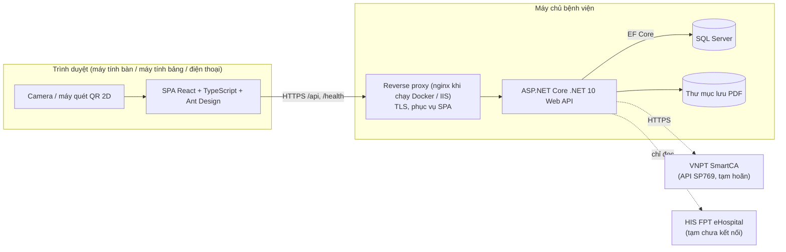
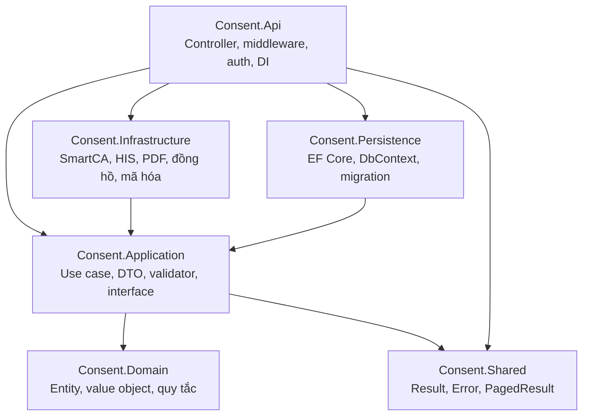
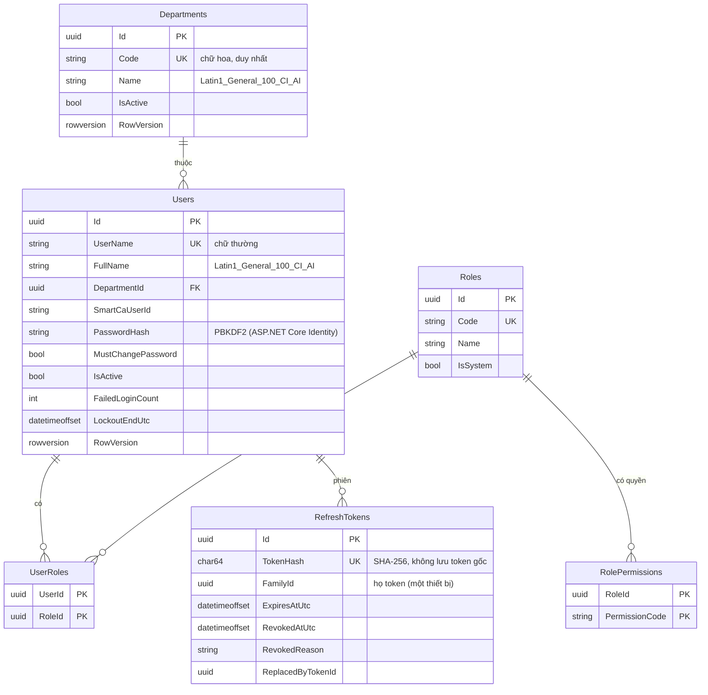
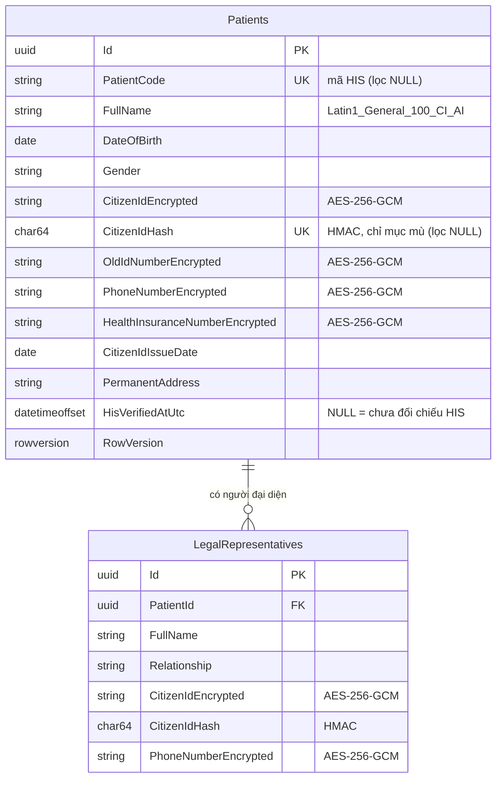
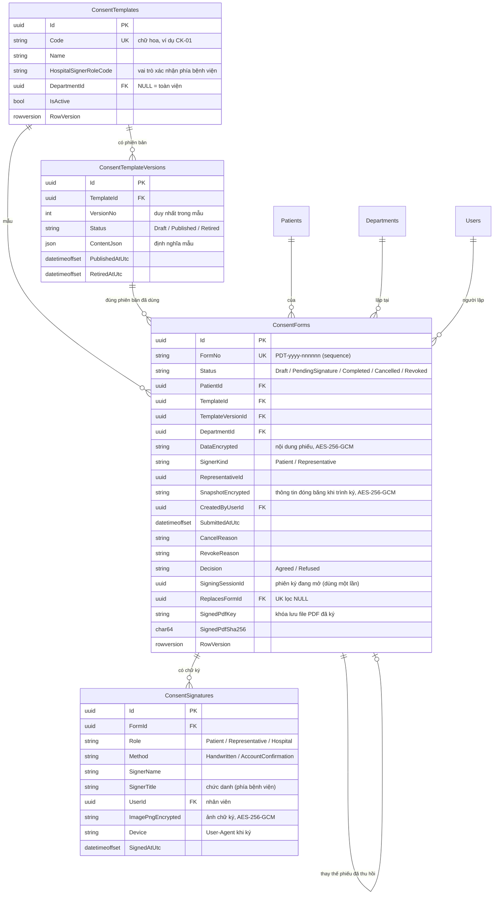
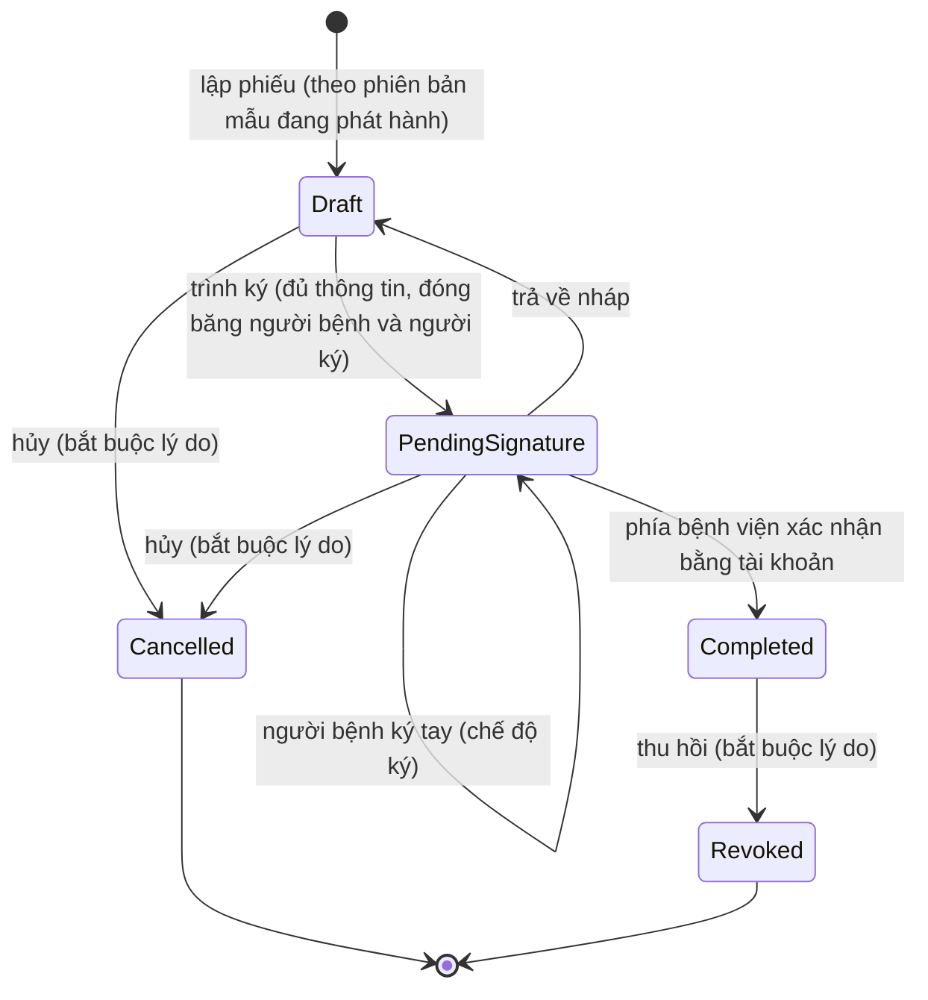
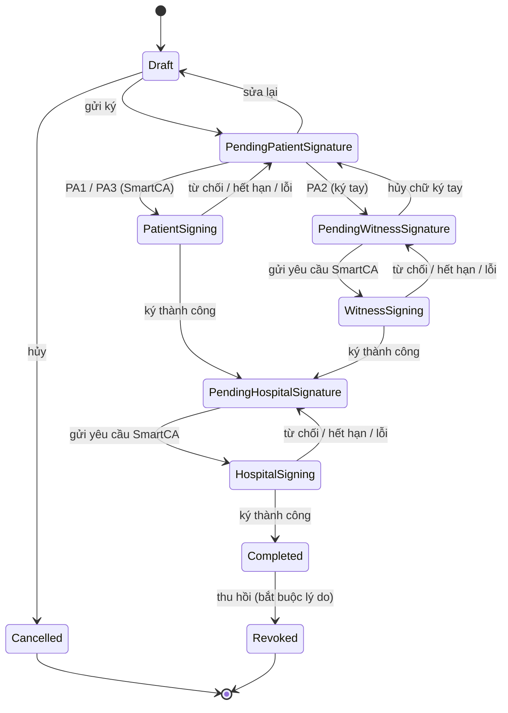
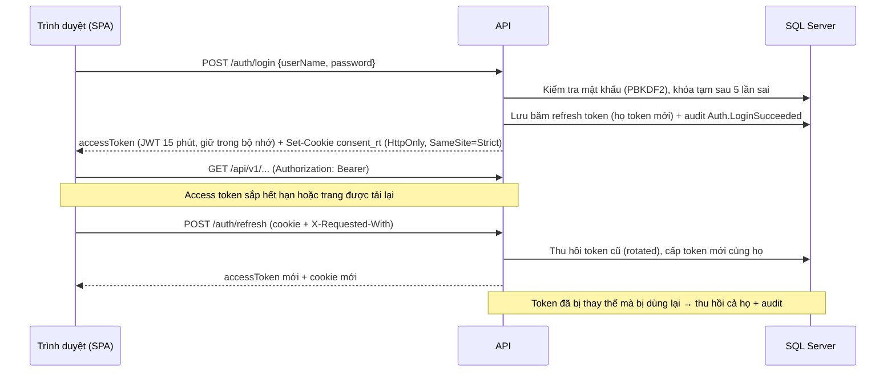

# Kiến trúc — Quản lý Phiếu đồng thuận

> Cập nhật đến Sprint 6. Các sơ đồ dùng Mermaid (GitHub hiển thị trực tiếp).
> Tài liệu liên quan: [Yêu cầu nghiệp vụ](yeu-cau-nghiep-vu.md) · [Kế hoạch](KE_HOACH_TRIEN_KHAI.md) · [Tích hợp SmartCA](tich-hop-smartca.md)

---

## 1. Tổng quan



- Trình duyệt chỉ gọi API của bệnh viện. **Không gọi trực tiếp** SmartCA hay HIS, nên bí mật kết nối chỉ nằm trên máy chủ.
- **Hiện tạm chưa kết nối HIS và SmartCA** (ADR-017, nét đứt trong sơ đồ): ứng dụng chạy độc lập; hai kết nối này bổ sung sau qua các interface đã có.
- Web và API chạy chung một domain qua reverse proxy, nên không cần CORS ở môi trường chính thức.

---

## 2. Công nghệ (phiên bản đang dùng)

| Thành phần | Công nghệ |
|---|---|
| Backend | ASP.NET Core .NET 10, EF Core 10.0.15 (SQL Server), JWT Bearer, FluentValidation 12, OpenAPI (`Microsoft.AspNetCore.OpenApi`), Health Checks, Rate Limiting |
| Cơ sở dữ liệu | Microsoft SQL Server (Docker dev: SQL Server 2022 Developer) |
| Frontend | React 19.3, TypeScript 7.0, Vite 8.3, Ant Design 6.7 (locale `vi_VN`), React Router 8.5, TanStack Query 5, dayjs |
| Kiểm thử backend | xUnit 2.9, `Microsoft.AspNetCore.Mvc.Testing` (integration), Testcontainers (SQL Server thật trong Docker), test kiến trúc bằng reflection |
| Kiểm thử frontend | Vitest 5, Testing Library, jsdom |
| Lint frontend | oxlint (mặc định của template Vite hiện tại, cảnh báo bị coi là lỗi) |
| PDF | PDFsharp-MigraDoc **6.2.4** (MIT; không nâng lên 6.5 trở lên vì đã đổi sang AGPL, ADR-020), font Tinos nhúng sẵn (SIL OFL 1.1) |
| Hạ tầng | Docker Compose (dev/test), GitHub Actions (CI) |

Nguyên tắc chọn thư viện: chỉ thêm khi cần, ưu tiên giấy phép MIT/Apache. Không dùng MediatR, AutoMapper (đã chuyển sang giấy phép thương mại) và FluentAssertions 8+ (giấy phép thương mại).

---

## 3. Clean Architecture



| Tầng | Được phụ thuộc vào | Không được phụ thuộc vào |
|---|---|---|
| Domain | (không gì) | mọi tầng khác |
| Shared | (không gì) | mọi tầng khác |
| Application | Domain, Shared | Persistence, Infrastructure, Api |
| Persistence | Application, Domain | Infrastructure, Api |
| Infrastructure | Application, Domain, Shared | Persistence, Api |
| Api | tất cả (composition root) | — |

Quy tắc này được **kiểm tra tự động** bởi `backend/tests/Consent.ArchitectureTests`. Vi phạm sẽ làm CI thất bại.

Quy ước code:
- Controller chỉ nhận request, gọi use case và trả kết quả, không chứa nghiệp vụ.
- API bất đồng bộ đều nhận `CancellationToken`.
- Nullable reference types bật; cảnh báo biên dịch bị coi là lỗi.
- Khóa chính là UUID; mã nghiệp vụ (ví dụ `PDT-2026-000123`) là cột riêng.
- Thời gian lưu UTC.

---

## 4. Cấu trúc thư mục

```
backend/
  ConsentManagement.slnx
  Directory.Build.props        # net10.0, nullable, warnings-as-errors, analyzers
  Directory.Packages.props     # quản lý phiên bản NuGet tập trung
  dotnet-tools.json            # dotnet-ef (công cụ migration)
  Dockerfile
  src/
    Consent.Domain/            # Common (Entity, IAuditableEntity, SensitiveData), Departments, Patients (Patient,
                               #   LegalRepresentative, CitizenIdNumber), Identity (User, Role,
                               #   RefreshToken, PasswordPolicy, SystemRoles), Authorization (Permissions), Auditing,
                               #   ConsentTemplates (mẫu, phiên bản), ConsentForms (phiếu, vòng đời)
    Consent.Shared/            # Result, Error (kèm lỗi theo trường), PagedResult
    Consent.Application/       # Abstractions (repository, IClock, ICurrentUser, ITokenService…), Auth, Users,
                               #   Departments, Roles, Auditing (service + validator FluentValidation),
                               #   ConsentTemplates (định nghĩa mẫu, kiểm tra, đánh giá dữ liệu, 4 mẫu của bệnh viện khởi tạo sẵn),
                               #   ConsentForms (lập/soạn/trình ký/hủy phiếu, ký tay và hoàn tất: ConsentSigningService,
                               #   kiểm tra ảnh chữ ký SignatureImage, IConsentPdfRenderer), IDocumentStore
    Consent.Persistence/       # ConsentDbContext, Configurations, Repositories, Auditing (interceptor),
                               #   Seeding, Migrations
    Consent.Infrastructure/    # Security (băm mật khẩu, JWT, mã hóa AES-GCM, chỉ mục mù), His (HIS giả lập), Time,
                               #   Pdf (MigraDoc, font Tinos), Storage (lưu PDF đã ký, mã hóa)
    Consent.Api/               # Controllers, Authorization (HasPermission), Infrastructure (pipeline, lỗi,
                               #   security headers, correlation id, cookie, rate limiting)
  tests/
    Consent.Domain.Tests/
    Consent.Application.Tests/       # service với repository giả trong bộ nhớ
    Consent.Api.IntegrationTests/    # pipeline/phân quyền (không CSDL) + luồng thật với SQL Server (Testcontainers)
    Consent.Infrastructure.Tests/    # mã hóa, chỉ mục mù, HIS giả lập, sinh PDF (font tiếng Việt, ảnh chữ ký), kho lưu PDF,
                                     #   token phiên ký
    Consent.ArchitectureTests/
frontend/
  src/
    app/                       # App (providers), routes, navigation (theo quyền), lazyPages, theme
    api/                       # http client (ProblemDetails → ApiError, tự làm mới phiên), auth, admin (TanStack Query)
    auth/                      # AuthProvider, guards (RequireAuth/RequirePermission), permissions, tokenStore
    components/                # layout chung, PageHeader, PagePlaceholder
    features/<module>/         # dashboard, account, admin (users, roles, departments), patients (QR CCCD, tiếp nhận,
                               #   danh sách, hồ sơ, người đại diện), consents (danh sách, lập phiếu, soạn phiếu
                               #   theo định nghĩa mẫu, xem PDF, xác nhận, thu hồi), templates (mẫu phiếu, phiên bản,
                               #   soạn JSON), signing (chế độ ký trên máy tính bảng, khung ký)
    pages/                     # đăng nhập, đổi mật khẩu bắt buộc, 403, 404, lỗi
    utils/                     # định dạng ngày, quy tắc mật khẩu, tìm kiếm không dấu, lỗi form
    test/                      # setup Vitest, giả lập API, dữ liệu mẫu
  nginx.conf, Dockerfile
docs/                          # kế hoạch, SRS, kiến trúc, tích hợp
scripts/run-checks.sh          # chạy mọi kiểm tra giống CI
docker-compose.yml, .env.example
```

---

## 5. Mô hình dữ liệu

Bảng được thêm dần theo sprint.

**Đã có:** Sprint 1 (migration `AddUsersRolesAndAudit`): `Departments`, `Users`, `UserRoles`, `Roles`, `RolePermissions`, `RefreshTokens`, `AuditLogs`. Sprint 2 (migration `AddPatients`): `Patients`, `LegalRepresentatives`. Sprint 3 (migration `AddConsentTemplatesAndForms`): `ConsentTemplates`, `ConsentTemplateVersions`, `ConsentForms` và sequence `ConsentFormNumbers`. Sprint 4 (migration `AddConsentSignatures`): `ConsentSignatures`; `ConsentForms` thêm quyết định, phiên ký, phiếu bị thay thế và thông tin PDF đã ký. Sprint 5 (migration `AddExportJobsAndReportIndexes`): `ExportJobs` (lịch sử xuất) và các chỉ mục phục vụ báo cáo/xuất dữ liệu trên `ConsentForms` (`CreatedAtUtc` kèm cột đếm, `CompletedAtUtc`, `RevokedAtUtc`, `CreatedByUserId + Status`). Sprint 6 (migration `AddSystemSettings`): `SystemSettings` (khóa/giá trị cấu hình do quản trị sửa: tên đơn vị in trên PDF; không chứa bí mật).







Khóa ngoại của `ConsentForms` không xóa dây chuyền (phiếu là hồ sơ cần lưu trữ). Chỉ mục `(Status, DepartmentId, CreatedAtUtc)` phục vụ danh sách lọc theo trạng thái và khoa.

`AuditLogs` không có khóa ngoại (giữ nguyên lịch sử kể cả khi đối tượng bị xóa) và có trigger chặn UPDATE/DELETE.

**Dự kiến (khi bật lại SmartCA, quyết định 9):** `ConsentSignatures` có thêm phương thức `SmartCA`/`ProxySmartCA`, người chứng kiến, lý do (danh mục `SigningReasons`) và số sê-ri chứng thư; bảng `SignatureTransactions` theo dõi giao dịch ký SmartCA; mỗi lượt ký có thể lưu một bản PDF. Khi kết nối HIS, `ConsentForms` có thêm mã đợt khám và trạng thái đối chiếu HIS.

Danh mục quyền được định nghĩa trong mã nguồn (`PermissionCatalog`) và gán cho vai trò qua bảng `RolePermissions` (thay cho bảng `Permissions` dự kiến trong kế hoạch). Bảng `ExportJobs` (Sprint 5): `Id`, `Kind`, `RequestedByUserId`, `RequestedAtUtc`, `Format`, `FiltersJson`, `Columns`, `IncludesContent`, `IncludesSensitiveData`, `RowCount`, `FileName`, `FileSizeBytes`, `FileSha256`, `DurationMs`. Không lưu file đã xuất.

---

## 6. Vòng đời phiếu

**Đang áp dụng (ký tay trên máy tính bảng, quyết định 10):**



- Quy tắc chuyển trạng thái nằm trong Domain (`ConsentForm.CanEdit/CanSubmit/CanReturnToDraft/CanCancel/CanComplete/CanRevoke`). Toàn bộ bảng chuyển đổi (5 trạng thái × 6 thao tác) có unit test. Chuyển sai quy tắc → API trả `409 consent_forms.invalid_status` kèm thông báo tiếng Việt.
- Trong "Chờ ký" có hai bước con: chờ người bệnh ký tay (mở phiên ký, `SignByPatient`), rồi chờ phía bệnh viện xác nhận (`Complete`, luật BR-02: người bệnh ký trước). Bảng chuyển đổi trong unit test tách hai bước này: 6 trạng thái × 8 thao tác.
- Trả về nháp sau khi người bệnh đã ký sẽ bỏ chữ ký (nội dung sẽ đổi); nhật ký audit vẫn giữ dấu vết. Phiếu hoàn tất chỉ có thể thu hồi, rồi lập phiếu thay thế (`ReplacesFormId`).
- API trả kèm `actions` (thao tác người dùng được làm với phiếu) để giao diện chỉ hiện nút hợp lệ; API vẫn kiểm tra lại.

**Khi bật lại SmartCA (tạm hoãn, quyết định 9):** bước chờ ký được tách theo từng người ký:



`PendingHospitalSignature`/`HospitalSigning` tương ứng `PendingDoctorSignature`/`DoctorSigning` trong kế hoạch: người ký phía bệnh viện được cấu hình theo mẫu, không nhất thiết là bác sĩ.

---

## 7. Quy ước API

| Chủ đề | Quy ước |
|---|---|
| Đường dẫn | `/api/v1/<tài-nguyên>` (REST, danh từ số nhiều, kebab-case) |
| Định dạng | JSON camelCase; thời gian ISO 8601 UTC |
| Lỗi | ProblemDetails (RFC 9457), `title` tiếng Việt, có `traceId`; không lộ stack trace hay câu lệnh SQL |
| Phân trang | `?page=&pageSize=` (tối đa 100) → `{ items, page, pageSize, totalCount }` |
| Health | `GET /health` (liveness, không kiểm tra phụ thuộc), `GET /health/ready` (kiểm tra SQL Server) |
| Tài liệu | OpenAPI tại `/openapi/v1.json`, **chỉ bật ở môi trường Development** |
| Bảo mật | Security headers (`X-Content-Type-Options`, `X-Frame-Options`, `Referrer-Policy`, CSP), HSTS ngoài Development, CORS chỉ cho origin cấu hình |

---

## 8. Xác thực, phân quyền và nhật ký audit

### 8.1. Phiên đăng nhập



| Thành phần | Thiết kế |
|---|---|
| Mật khẩu | Băm bằng `PasswordHasher` của ASP.NET Core Identity (PBKDF2 có salt, tự nâng cấp tham số khi đăng nhập). Chính sách: ≥ 10 ký tự, chữ hoa, chữ thường, số, ký tự đặc biệt, không chứa tên đăng nhập |
| Chống dò tài khoản | Cùng thông báo cho sai tên và sai mật khẩu; vẫn băm mật khẩu khi tài khoản không tồn tại để thời gian phản hồi tương đương; trạng thái "bị khóa bởi quản trị" chỉ báo khi mật khẩu đúng |
| Khóa tạm | 5 lần sai liên tiếp → khóa 15 phút (cấu hình `Auth:*`) |
| Access token | JWT HMAC-SHA256, 15 phút, claim: `sub`, `name`, `full_name`, `dept`, `role`, `perm`. Khóa ký ≥ 32 byte; thiếu khóa thì API không khởi động |
| Refresh token | 32 byte ngẫu nhiên, chỉ lưu SHA-256; cookie `HttpOnly`, `Secure`, `SameSite=Strict`, `Path=/api/v1/auth`; hạn 12 giờ, xoay vòng mỗi lần dùng; phát hiện dùng lại → thu hồi cả họ token |
| CSRF | Cookie `SameSite=Strict` + bắt buộc header `X-Requested-With` ở endpoint dùng cookie |
| Giới hạn tần suất | Đăng nhập/đổi mật khẩu 10 lần/phút/IP, làm mới phiên 30 lần/phút/IP (cấu hình `RateLimiting:*`) |
| Phía trình duyệt | Access token chỉ trong bộ nhớ; tự làm mới trước khi hết hạn; khi gặp 401 thì làm mới một lần rồi gửi lại; đăng xuất chủ động không giữ lại đường dẫn cũ (máy dùng chung) |

### 8.2. Phân quyền

- **Mặc định an toàn:** `FallbackPolicy` yêu cầu đăng nhập cho mọi endpoint; chỉ endpoint đánh dấu `[AllowAnonymous]` (đăng nhập, làm mới, đăng xuất, health) mới mở.
- **Theo quyền:** `[HasPermission(Permissions.UsersManage)]` tạo policy động `perm:<mã>` kiểm tra claim `perm` trong access token.
- **Quyền thuộc vai trò:** người dùng có nhiều vai trò; quyền hiệu lực là hợp các quyền. Vai trò `ADMIN` luôn có toàn bộ quyền và không sửa được. Thay đổi quyền có hiệu lực ở lần làm mới token tiếp theo (≤ 15 phút); khóa tài khoản thu hồi refresh token ngay.
- **Phạm vi theo khoa:** access token chứa khoa của người dùng (`dept`) và quyền `scope.all_departments` cho vai trò toàn viện. `ICurrentUser` cung cấp hai thông tin này để lọc phiếu theo khoa (mục 8.6). Hồ sơ người bệnh dùng chung toàn viện, vì một người bệnh có thể khám ở nhiều khoa.
- **Giao diện:** menu và nút được ẩn/hiện theo quyền; trang không có quyền hiển thị 403. Đây chỉ là trải nghiệm người dùng, kiểm soát thật luôn nằm ở API.

### 8.3. Nhật ký audit

- `AuditSaveChangesInterceptor` (EF Core) ghi **trong cùng giao dịch** mọi thao tác tạo/sửa/xóa trên thực thể `IAuditableEntity` (khoa, người dùng, vai trò, gán vai trò, gán quyền, người bệnh, người đại diện, mẫu phiếu, phiên bản mẫu, phiếu): người thực hiện, IP, User-Agent, mã truy vết, giá trị trước/sau.
- Che dữ liệu nhạy cảm: `PasswordHash` luôn ghi `***`; bỏ qua thuộc tính kỹ thuật (`RowVersion`, bộ đếm đăng nhập sai…), vốn đã có sự kiện xác thực riêng.
- Sự kiện xác thực được ghi tường minh: đăng nhập thành công/thất bại, khóa tạm, đăng xuất, đổi mật khẩu, phát hiện dùng lại refresh token.
- **Chỉ ghi thêm:** không có API sửa/xóa; `ConsentDbContext` từ chối lưu nếu bản ghi audit bị sửa/xóa; trigger `TR_AuditLogs_AppendOnly` trong SQL Server chặn mọi `UPDATE`/`DELETE` (kể cả truy cập trực tiếp CSDL).

### 8.4. Bảo vệ dữ liệu người bệnh

| Biện pháp | Cách làm |
|---|---|
| Mã hóa cột | Số CCCD, số CMND cũ, số điện thoại, mã thẻ BHYT (người bệnh và người đại diện) mã hóa **AES-256-GCM** (có xác thực toàn vẹn, nonce ngẫu nhiên). Định dạng lưu `v1:` + Base64 để xoay vòng khóa sau này. Thực hiện trong suốt bằng EF Core value converter: Domain và Application làm việc với giá trị gốc |
| Chỉ mục mù | `CitizenIdHash` = HMAC-SHA256 (khóa bí mật riêng) của số CCCD, cập nhật tự động bằng `BlindIndexInterceptor`. Dùng để tìm chính xác và **chặn trùng bằng chỉ mục duy nhất trong CSDL**. Khác SHA-256 thường: không thể thử hết 10^12 số CCCD nếu không có khóa |
| Khóa | `DataProtection:FieldEncryptionKey` và `DataProtection:BlindIndexKey`, mỗi khóa 32 byte ngẫu nhiên, hai khóa phải khác nhau; thiếu khóa thì API không khởi động. **Mất khóa mã hóa = mất dữ liệu đã mã hóa**: phải sao lưu khóa an toàn, tách khỏi bản sao lưu CSDL |
| Không đưa vào URL | Tra cứu theo CCCD dùng `POST` với body; danh sách không bao giờ trả số đầy đủ |
| Che khi hiển thị | API danh sách che số CCCD (`0361******25`); giao diện che CCCD/SĐT/BHYT mặc định, bấm biểu tượng con mắt mới hiện số đầy đủ |
| Nhật ký truy cập | Mỗi lần xem hồ sơ (`Patients.Viewed`) và tra cứu CCCD (`Patients.LookedUp`) đều được ghi, không ghi số CCCD |
| Audit | Thuộc tính gắn `[SensitiveData]` luôn được che `***` trong nhật ký thay đổi |
| QR | Chuỗi QR gốc không được lưu; chỉ lưu các trường đã kiểm tra |

### 8.5. Quét CCCD và tích hợp HIS

- **Đọc QR:** phân tích ở trình duyệt (`cccdQrParser.ts`) để điền form ngay. Hỗ trợ máy quét 2D chế độ bàn phím (nội dung + Enter) và camera (`@zxing/browser`, chỉ tải khi mở camera, cần HTTPS). Có cảnh báo khi họ tên có ký tự lạ (máy quét chưa hỗ trợ tiếng Việt có dấu) hoặc số CCCD không khớp ngày sinh/giới tính. Máy chủ kiểm tra lại mọi trường (`PatientRequestValidator`, `CitizenIdNumber`).
- **HIS — hiện chưa kết nối (ADR-017):** mặc định `His:Provider=None` → `DisabledHisGateway`: không gọi ra ngoài, tra cứu trả `hisStatus: "Disabled"`, không đối chiếu khi lưu; giao diện (qua `GET /api/v1/features`) ẩn mọi thông tin HIS và mã người bệnh được nhập tay.
- **Khi bật lại HIS:** `IHisGateway` (Application) có `FakeHisGateway` (Infrastructure, `His:Provider=Fake`) cho phát triển/kiểm thử; **API từ chối khởi động nếu dùng HIS giả lập ở Production** (để không sinh mã người bệnh/thẻ BHYT không có thật). Kết nối FPT eHospital sẽ là một cài đặt khác của cùng interface. Mọi lời gọi HIS có thời gian chờ (`His:TimeoutSeconds`); HIS lỗi không chặn việc tiếp nhận (cho nhập tay, đánh dấu "Chưa đối chiếu HIS").
- **Đối chiếu khi lưu (khi đã kết nối HIS):** máy chủ tự gọi HIS lúc tạo/cập nhật hồ sơ để đặt `HisVerifiedAtUtc`, không tin cờ do client gửi.

### 8.6. Mẫu phiếu, phiếu đồng thuận và PDF

- **Mẫu là dữ liệu, không phải code (ADR-019):** mỗi phiên bản mẫu lưu một định nghĩa JSON gồm phần, khối nội dung và trường nhập liệu (10 kiểu khối, điều kiện hiển thị, câu hỏi tính điểm). Đặc tả ở mục 6b của [tài liệu API](api.md). `TemplateDefinitionValidator` kiểm tra định nghĩa khi lưu nháp và kiểm tra lại khi phát hành. Phiên bản đã phát hành không sửa được: muốn đổi thì tạo phiên bản mới. Phiếu lưu `TemplateVersionId` nên luôn hiển thị và in theo đúng phiên bản đã dùng.
- **Một logic, hai nơi chạy:** giao diện (`DynamicForm`, `templateLogic.ts`) dựng form từ định nghĩa và tính điều kiện hiển thị, tổng điểm ngay khi nhập. Máy chủ (`FormDataEvaluator`) là nơi quyết định: chuẩn hóa kiểu dữ liệu, bỏ trường lạ, kiểm tra bắt buộc/định dạng và tính điểm. Lưu nháp giữ cả giá trị của trường đang ẩn (ví dụ số thẻ BHYT điền sẵn) nhưng không kiểm tra. Trình ký bỏ các giá trị đó, để nội dung đem ký chỉ gồm những gì hiển thị trên phiếu.
- **Đóng băng khi trình ký (ADR-022):** thông tin người bệnh và người ký (người bệnh hoặc người đại diện) được chép vào phiếu. Sửa hồ sơ sau đó không làm đổi phiếu đang chờ ký; trả về nháp thì bỏ bản đóng băng.
- **Mã hóa:** nội dung phiếu (`DataEncrypted`) và bản đóng băng (`SnapshotEncrypted`) có dữ liệu cá nhân nên được mã hóa AES-256-GCM như các cột khác (mục 8.4). Hai thuộc tính này gắn `[SensitiveData]` nên nhật ký audit chỉ ghi `***`.
- **Phạm vi khoa:** người dùng thấy phiếu của khoa mình, phiếu do mình lập, hoặc mọi phiếu nếu có `scope.all_departments`. Lọc ở câu truy vấn (danh sách) và ở từng thao tác (xem, sửa, PDF). Phiếu ngoài phạm vi trả `404`, không tiết lộ phiếu có tồn tại. Chỉ lập phiếu được cho khoa của mình (trừ quyền toàn viện), bằng mẫu đang phát hành dùng cho khoa đó.
- **Số phiếu:** `PDT-<năm>-<6 chữ số>`. Số thứ tự lấy từ sequence `ConsentFormNumbers` của SQL Server, nên không trùng khi nhiều quầy lập cùng lúc. Số tăng liên tục, không đặt lại theo năm. Năm theo giờ Việt Nam.
- **PDF (ADR-020):** `IConsentPdfRenderer` (Application) do `MigraDocConsentPdfRenderer` (Infrastructure) cài đặt. File A4 gồm tiêu đề hành chính (tên đơn vị lấy từ cấu hình `Hospital:*`), mã mẫu và số phiếu, tiêu đề, khối thông tin người bệnh, nội dung theo định nghĩa (chỉ trường đang hiển thị), khối chữ ký và số trang. Phiếu chưa hoàn tất in dòng "BẢN XEM TRƯỚC – CHƯA CÓ CHỮ KÝ". Sprint 3 sinh PDF mỗi lần xem, không lưu file. Từ Sprint 4, PDF đã ký được lưu kèm SHA-256. Mỗi lần xem chi tiết phiếu và mỗi lần tải PDF đều ghi nhật ký (`ConsentForms.Viewed`, `ConsentForms.PdfViewed`).
- **Xem PDF trên giao diện:** trình duyệt tải PDF qua API (có xác thực) rồi hiển thị trong khung bằng địa chỉ `blob:`. Vì vậy CSP của web có thêm `frame-src blob:`. Chỉ script của chính ứng dụng tạo được địa chỉ này. Khi triển khai bằng IIS phải đặt cùng CSP như `frontend/nginx.conf`.

### 8.7. Ký tay trên máy tính bảng

- **Chế độ ký do máy chủ kiểm soát (ADR-023):**
  - Nhân viên mở phiên ký, nhận *token phiên ký*: JWT cùng khóa ký nhưng đối tượng nhận riêng (`<Audience>:signing`), hạn `Jwt:SigningTokenMinutes` (mặc định 30 phút), chứa mã phiếu và mã phiên.
  - API có scheme xác thực riêng `SigningSession`; chỉ endpoint `patient-signature` dùng scheme này. Token phiên ký bị mọi API khác từ chối, và ngược lại.
  - Phiên lưu ở phiếu (`SigningSessionId`): mở phiên mới thì phiên cũ hết hiệu lực; ký xong thì phiên bị xóa (dùng một lần).
- **Giao diện:**
  - Lấy token xong, giao diện đóng phiên đăng nhập của nhân viên (thu hồi refresh token) rồi mở màn hình `/ky-phieu`: không menu, có nút toàn màn hình.
  - Khi đang có phiên ký, mọi trang cần đăng nhập đều quay về màn hình ký (kể cả nút "Quay lại" của trình duyệt).
  - Token phiên ký chỉ nằm trong bộ nhớ: tải lại trang là mất, và lúc đó máy không còn phiên nào. Thoát chế độ ký là đăng nhập lại (sai nhiều lần thì tài khoản bị khóa tạm như đăng nhập thường).
  - Khóa ở mức thiết bị (Guided Access trên iPad, Ghim màn hình trên Android) được khuyến nghị thêm.
- **Ảnh chữ ký (ADR-024):**
  - Khung ký dùng Pointer Events (ngón tay, bút, chuột), `touch-action: none`. Nét ký chỉ nằm trong bộ nhớ trình duyệt để vẽ lại khi xoay màn hình; thứ gửi đi chỉ là ảnh PNG nền trắng.
  - Máy chủ tự giải mã PNG bằng mã của dự án (`SignatureImage`, chỉ dùng `System.IO.Compression`). Các bước: kiểm tra CRC và kích thước trước khi giải nén (chặn "bom giải nén"); từ chối khung trống; cắt sát nét ký; mã hóa lại thành PNG xám 8 bit chỉ gồm điểm ảnh.
  - Ảnh lưu mã hóa (`ImagePngEncrypted`), bị che trong audit, không có API trả ảnh riêng.
- **Hoàn tất (ADR-025):**
  - Người xác nhận phải có vai trò ghi trong mẫu (BR-10, quyết định 11).
  - Máy chủ dựng PDF bản cuối (ảnh chữ ký, Đồng ý/Từ chối, người đại diện, họ tên, chức danh và thời điểm xác nhận phía bệnh viện), tính SHA-256, rồi lưu file qua `IDocumentStore`.
  - `EncryptedFileDocumentStore` mã hóa AES-256-GCM bằng khóa dẫn xuất (HKDF) từ khóa mã hóa cột, đưa khóa lưu trữ vào AAD nên tráo file giữa các phiếu cũng bị phát hiện. File được ghi ra file tạm rồi mới đổi tên.
  - Mỗi lần tải PDF đã ký, máy chủ đọc đúng file đã lưu và kiểm tra lại SHA-256. Ghi file trước, lưu CSDL sau: lỗi giữa chừng chỉ để lại một file thừa.

### 8.8. Cấu hình hệ thống và siết bảo mật (Sprint 6)

- Rà soát theo OWASP ASVS cơ bản: không có lỗ hổng đã biết trong thư viện (`dotnet list package --vulnerable`, `npm audit`); xác thực và phiên (mục 8.1), phân quyền mặc định an toàn (8.2), audit (8.3), mã hóa dữ liệu (8.4), header bảo mật và CSP (API và nginx/IIS), CORS chỉ origin cấu hình, lỗi không lộ chi tiết, log không chứa dữ liệu cá nhân, giới hạn tần suất, thuật toán JWT ghim HS256, container không chạy root.
- Bổ sung ở Sprint 6 (ADR-030): giới hạn thân yêu cầu 2 MB ở Kestrel (IIS: `maxAllowedContentLength`), từ chối `Seed:DemoData` ở Production, `Cache-Control: no-store` và `Permissions-Policy` cho mọi phản hồi API, hướng dẫn đặt `AllowedHosts`.
- Màn hình 19 (ADR-029): `SettingsService` đọc/ghi bảng `SystemSettings`; `ConsentFormService` lấy tên đơn vị từ đây khi dựng PDF (mặc định từ `Hospital:*`). Phần chỉ đọc hiển thị trạng thái HIS/SmartCA, giới hạn xuất, chính sách lưu trữ.
- Độ bao phủ test (`scripts/coverage.sh`): Domain 86,7%, Application 81,2% dòng lệnh (tiêu chí ≥ 80%).

### 8.9. Xuất dữ liệu, báo cáo và tổng quan

- **Xuất dữ liệu (ADR-026):** `ConsentFormExportService` (Application) lọc trong phạm vi khoa, chọn cột từ danh mục `ConsentFormExportColumns` (tiêu đề tiếng Việt, cờ `Sensitive`), đọc phiếu lần lượt qua `IConsentFormRepository.StreamForExportAsync` (không nạp hết vào bộ nhớ) và ghi file qua `ITabularFileWriter`. Hai bản cài đặt ở Infrastructure: `XlsxTabularFileWriter` (Office Open XML viết bằng `System.IO.Compression` + `XmlWriter`, không thêm thư viện; chuỗi ghi dạng inline string nên không bao giờ thành công thức; ngày/giờ là ô ngày của Excel; dòng tiêu đề cố định, có bộ lọc; trang "Thông tin xuất") và `CsvTabularFileWriter` (UTF-8 BOM, RFC 4180, chống chèn công thức). Cột nhạy cảm che bằng `SensitiveMask` trừ khi có `exports.sensitive` và người dùng chọn xuất đầy đủ. Nội dung theo mẫu (`TemplateContentColumns`) đọc từng phiếu theo đúng phiên bản mẫu của nó và chỉ lấy trường đang hiển thị (cùng quy tắc với PDF). Giới hạn 100.000 phiếu/lần và 10 lần/phút/người dùng. Mỗi lần xuất ghi `ExportJob` (SHA-256 của file) và audit `Exports.ConsentForms`; file trả thẳng cho người dùng, không lưu trên máy chủ. Thông tin người bệnh của phiếu đã trình ký lấy từ bản đóng băng (đúng như trên phiếu đem ký).
- **Báo cáo (ADR-027):** `ReportService` dùng `IConsentStatisticsRepository`, trong đó mọi phép đếm/nhóm chạy trong SQL Server trên các cột không mã hóa (khoa, mẫu, trạng thái, quyết định, người ký, thời điểm); ngày tính theo giờ Việt Nam bằng số giờ kể từ mốc 00:00 chia 24. Thời gian hoàn tất lấy danh sách số giây rồi tính trung bình, trung vị, phân vị 90 trong ứng dụng. `DashboardService` dùng cùng repository cho trang tổng quan (việc chờ tôi xác nhận = phiếu người bệnh đã ký thuộc mẫu mà người dùng có vai trò xác nhận).
- **Nhật ký (màn hình 15):** dùng `GET /audit-logs` có từ Sprint 1; giao diện dịch tên hành động và loại đối tượng sang tiếng Việt, xem chi tiết JSON đã che dữ liệu nhạy cảm.
- **Biểu đồ:** vẽ bằng SVG trong ứng dụng (`BarChart`), không thêm thư viện biểu đồ; có bảng ẩn cho trình đọc màn hình.

## 9. Cấu hình và bí mật

| Khóa cấu hình | Biến môi trường | Ghi chú |
|---|---|---|
| `ConnectionStrings:Default` | `ConnectionStrings__Default` | Bắt buộc; thiếu thì API dừng khởi động với thông báo rõ |
| `Database:ApplyMigrationsOnStartup` | `Database__ApplyMigrationsOnStartup` | Mặc định `false`; chỉ bật ở dev/test. Production chạy migration bằng script có kiểm soát |
| `Cors:AllowedOrigins` | `Cors__AllowedOrigins__0`… | Mặc định rỗng; Development cho phép `http://localhost:5173` |
| `Jwt:SigningKey` | `Jwt__SigningKey` | **Bí mật**, ≥ 32 ký tự ngẫu nhiên; thiếu thì API không khởi động |
| `Jwt:AccessTokenMinutes` | `Jwt__AccessTokenMinutes` | Mặc định 15 (1–60) |
| `Jwt:SigningTokenMinutes` | `Jwt__SigningTokenMinutes` | Thời hạn token phiên ký trên máy tính bảng. Mặc định 30 (5–120) |
| `Auth:MaxFailedAttempts`, `Auth:LockoutMinutes` | `Auth__…` | Mặc định 5 lần, 15 phút |
| `Auth:RefreshTokenLifetimeHours`, `Auth:RefreshReuseGraceSeconds` | `Auth__…` | Mặc định 12 giờ, 30 giây |
| `RateLimiting:AuthPermitLimit`, `RefreshPermitLimit`, `ExportPermitLimit`, `WindowSeconds` | `RateLimiting__…` | Mặc định 10, 30 lần / 60 giây / IP; xuất dữ liệu 10 lần / 60 giây / người dùng |
| `ReverseProxy:TrustAllProxies` | `ReverseProxy__TrustAllProxies` | Mặc định `false`. Chỉ bật khi API không mở cổng ra ngoài và chỉ nhận yêu cầu từ reverse proxy (để lấy đúng IP người dùng) |
| `Seed:Enabled` | `Seed__Enabled` | Tạo vai trò hệ thống và tài khoản quản trị đầu tiên khi khởi động |
| `Seed:AdminPassword` | `Seed__AdminPassword` | **Bí mật**; chỉ dùng khi chưa có người dùng nào. Tài khoản `admin` phải đổi mật khẩu ở lần đăng nhập đầu |
| `Seed:DemoData`, `Seed:DemoPassword` | `Seed__…` | Khoa và tài khoản demo, **chỉ cho môi trường phát triển/thử nghiệm** |
| `DataProtection:FieldEncryptionKey` | `DataProtection__FieldEncryptionKey` | **Bí mật**, Base64 của 32 byte ngẫu nhiên (`openssl rand -base64 32`); khóa mã hóa cột |
| `DataProtection:BlindIndexKey` | `DataProtection__BlindIndexKey` | **Bí mật**, Base64 của 32 byte, khác khóa mã hóa; khóa chỉ mục mù |
| `His:Provider` | `His__Provider` | `None` (mặc định: chưa kết nối HIS) hoặc `Fake` (HIS giả lập, chỉ dev/test; bị từ chối ở Production). Giá trị khác → API không khởi động |
| `His:TimeoutSeconds` | `His__TimeoutSeconds` | Mặc định 5 (1–60) |
| `Hospital:ParentAgency`, `Hospital:Name`, `Hospital:Place` | `Hospital__…` | Giá trị mặc định của tên đơn vị in ở đầu PDF; **từ Sprint 6 quản trị nhập tại màn hình Cấu hình hệ thống** (bảng `SystemSettings`), cấu hình này chỉ dùng khi chưa nhập |
| `AllowedHosts` | `AllowedHosts` | Tên máy chủ người dùng truy cập (chống giả mạo Host). Mặc định `*`; đặt tên thật ở môi trường chính thức |
| `Storage:DocumentsPath` | `Storage__DocumentsPath` | Thư mục lưu PDF đã ký (ổ đĩa hoặc thư mục mạng). Bắt buộc; mặc định `App_Data/documents`, Docker dùng volume `documents`. **Phải sao lưu cùng CSDL**; file được mã hóa bằng khóa dẫn xuất từ `FIELD_ENCRYPTION_KEY` nên mất khóa là mất cả PDF |
| `SmartCa:*` | `SmartCa__SpPassword`… | **Tạm hoãn** (chưa tích hợp SmartCA); thiết kế giữ trong [tich-hop-smartca.md](tich-hop-smartca.md) |

Không commit bí mật. File `.env` (Docker Compose) nằm trong `.gitignore`; chỉ commit `.env.example`.

---

## 10. Triển khai

**Phát triển/kiểm thử (Docker Compose):** `sqlserver` (SQL Server 2022 Developer, có health check) → `api` (cổng nội bộ 8080, chạy user không phải root) → `web` (nginx không đặc quyền, cổng 8080, phục vụ SPA và chuyển tiếp `/api`, `/health` tới `api`).

**Chính thức (Windows Server tại bệnh viện):** hướng dẫn đầy đủ trong [trien-khai.md](trien-khai.md) cho cả hai hình thức **IIS + SQL Server có sẵn** và **Docker + SQL Server có sẵn** (`deploy/docker-compose.prod.yml`): HTTPS ở reverse proxy, tài khoản SQL quyền tối thiểu (`deploy/sql/01-create-login.sql`), migration bằng gói `efbundle`, sao lưu/khôi phục CSDL và thư mục PDF (`deploy/sql/02-backup.sql`, `03-restore.sql`), xoay vòng khóa, giám sát, danh sách kiểm tra sau triển khai. Đã diễn tập triển khai sạch hình thức Docker trong CI nội bộ (SQL Server riêng, tài khoản `consent_app`, migration bằng gói, luồng ký và xuất chạy đúng).

---

## 11. Nhật ký quyết định kiến trúc (ADR)

| Mã | Quyết định | Lý do |
|---|---|---|
| ADR-001 | Clean Architecture 6 project, kiểm tra phụ thuộc bằng test | Tách nghiệp vụ khỏi hạ tầng; dễ thay SmartCA/HIS giả lập bằng bản thật |
| ADR-002 | SQL Server + EF Core, migration bằng `dotnet-ef` | Công nghệ bắt buộc; quản lý thay đổi schema có phiên bản |
| ADR-003 | Không dùng MediatR/AutoMapper; handler và mapping viết tay | Tránh phụ thuộc giấy phép thương mại; code tường minh |
| ADR-004 | VNPT SmartCA API SP769 (xác nhận trên app) cho mọi người ký | Định danh bằng CCCD, phù hợp người bệnh vãng lai; không giữ mật khẩu/OTP người ký |
| ADR-005 | Tích hợp HIS qua `IHisGateway`, giai đoạn 1 chỉ đọc, có bản giả lập | Không chặn tiến độ khi chưa có tài liệu API; giảm rủi ro ghi sai vào HIS |
| ADR-006 | Ký PDF 2 pha (deferred signing), PDFsharp + BouncyCastle | SmartCA chỉ ký hash và có thời gian chờ xác nhận; cần spike trên UAT |
| ADR-007 | Tự động migrate khi khởi động chỉ ở dev/test | An toàn cho production; tiện cho phát triển |
| ADR-008 | oxlint cho frontend | Mặc định của template Vite hiện tại, nhanh, ít phụ thuộc |
| ADR-009 | Mô hình người dùng/vai trò/quyền trong Domain; chỉ dùng `PasswordHasher` của ASP.NET Core Identity (không dùng Identity stores) | Quy tắc khóa tài khoản, vai trò, quản trị viên cuối cùng nằm trong Domain và kiểm thử được; không phát sinh bảng Identity không dùng; vẫn dùng thuật toán băm chuẩn của Identity |
| ADR-010 | Access token trong bộ nhớ + refresh token trong cookie HttpOnly, xoay vòng, phát hiện dùng lại | Giảm rủi ro XSS đánh cắp token dài hạn; thu hồi được phiên; phát hiện token bị lộ |
| ADR-011 | Quyền nằm trong access token (claim `perm`) | Phân quyền nhanh, không truy vấn CSDL mỗi yêu cầu; độ trễ tối đa 15 phút khi đổi quyền là chấp nhận được (khóa tài khoản có hiệu lực ngay với refresh token) |
| ADR-012 | Audit bằng EF Core interceptor + trigger chặn sửa/xóa | Không thể quên ghi audit ở từng service; ghi cùng giao dịch; bảo vệ cả khi truy cập CSDL trực tiếp |
| ADR-013 | Collation `Latin1_General_100_CI_AI` cho cột tên dùng để tìm kiếm | Tìm không dấu "nguyen van duc" khớp "Nguyễn Văn Đức" (kể cả Đ/D). Collation `Vietnamese_*` coi ư, ơ, ê, đ là chữ riêng nên không đáp ứng |
| ADR-014 | Mã hóa cột ở tầng ứng dụng (AES-256-GCM qua EF value converter) + chỉ mục mù HMAC, thay vì Always Encrypted/TDE | Bảo vệ cả khi lộ bản sao lưu/CSDL hoặc người quản trị CSDL xem trực tiếp; không phụ thuộc phiên bản/edition SQL Server và driver; vẫn tra cứu/chặn trùng được theo CCCD |
| ADR-015 | Đọc QR CCCD ở trình duyệt; máy chủ kiểm tra lại từng trường | Điền form tức thì, chạy được với cả máy quét 2D và camera; máy chủ không nhận chuỗi QR gốc nên không có nguy cơ lưu nhầm |
| ADR-016 | Máy chủ tự đối chiếu HIS khi lưu; HIS lỗi không chặn tiếp nhận | Trạng thái "đã đối chiếu HIS" đáng tin cậy; quầy tiếp đón vẫn làm việc được khi HIS gián đoạn |
| ADR-017 | Tạm chưa kết nối HIS và SmartCA (quyết định 11/11/2026): HIS tắt mặc định (`His:Provider=None`), giao diện ẩn theo `GET /api/v1/features`; HIS giả lập bị chặn ở Production; giữ interface để bật lại | Ứng dụng chạy độc lập, không hiển thị hay lưu dữ liệu HIS giả; khi bệnh viện cần, chỉ thêm cài đặt `IHisGateway`/dịch vụ ký số mà không sửa nghiệp vụ |
| ADR-018 | Khi chưa có SmartCA, phiếu được ký tay trên máy tính bảng. Chỉ lưu ảnh chữ ký (PNG, không lưu dữ liệu nét); ảnh được chèn vào PDF; PDF có mã băm SHA-256 và bị khóa sau khi ký; chế độ ký toàn màn hình phải nhập lại mật khẩu nhân viên mới thoát được | Đáp ứng quyết định của bệnh viện với ít thao tác nhất tại quầy. Không phát sinh dữ liệu sinh trắc học. Phát hiện được sửa file sau khi ký. Người bệnh cầm máy không vào được phần khác. Giới hạn: đây không phải chữ ký số, pháp chế cần xác nhận giá trị pháp lý |
| ADR-019 | Mẫu phiếu là định nghĩa JSON có phiên bản (Nháp → Đang phát hành → Ngừng dùng), máy chủ kiểm tra; giao diện quản trị soạn JSON kèm xem trước, chưa làm trình thiết kế kéo-thả | Thêm/sửa mẫu không cần sửa code hay triển khai lại; phiếu cũ giữ nguyên phiên bản. Chỉ vài người quản trị soạn mẫu, nên trình kéo-thả tốn công mà ít lợi; làm sau nếu bệnh viện cần |
| ADR-020 | Sinh PDF bằng PDFsharp-MigraDoc **6.2.4** (MIT, ghim phiên bản); font Tinos (SIL OFL 1.1) nhúng trong mã nguồn | Thư viện .NET thuần, không cần trình duyệt hay dịch vụ ngoài. Từ bản 6.5, thư viện đổi sang giấy phép AGPL nên không nâng cấp. Font nhúng sẵn nên PDF giống nhau trên Windows/Linux/Docker và đủ dấu tiếng Việt. Ô đánh dấu dùng □/■ vì font không có ☐/☒ |
| ADR-021 | Ghim `System.Security.Cryptography.Pkcs` 10.0.15 | PDFsharp kéo theo bản 8.0.1 có lỗ hổng đã công bố (GHSA-846f-f764-76mx). Ghim bản đã vá thay vì tắt cảnh báo NU1903 |
| ADR-022 | Đóng băng (mã hóa) thông tin người bệnh và người ký khi trình ký; phiếu ngoài phạm vi khoa trả 404 | Nội dung đem ký không đổi dù hồ sơ được sửa sau đó; không tiết lộ sự tồn tại của phiếu khoa khác |
| ADR-023 | Chế độ ký dùng token phiên ký riêng (đối tượng nhận riêng, gắn với một phiếu và một phiên, dùng một lần) và đóng phiên đăng nhập của nhân viên trên máy; thoát chế độ ký = đăng nhập lại | Máy chủ chặn được người bệnh cầm máy làm việc khác, không phụ thuộc vào việc giao diện bị vượt qua hay trang bị tải lại. Dùng lại cơ chế đăng nhập sẵn có (khóa tạm khi sai nhiều lần) thay vì thêm API kiểm tra mật khẩu riêng |
| ADR-024 | Tự giải mã và chuẩn hóa ảnh chữ ký ở máy chủ (không thêm thư viện xử lý ảnh) | Phát hiện khung trống và ảnh giả mạo/quá lớn ngay ở máy chủ; ảnh lưu lại chỉ còn điểm ảnh (loại dữ liệu kèm theo); không phát sinh phụ thuộc mới |
| ADR-026 | Tự ghi file Excel (Office Open XML) và CSV bằng thư viện chuẩn .NET, ghi lần lượt từng dòng; không dùng ClosedXML như kế hoạch | Không thêm phụ thuộc; bộ nhớ thấp khi xuất hàng chục nghìn phiếu; kiểm soát được việc không sinh công thức. File được kiểm tra bằng OpenXML SDK (chỉ trong test) |
| ADR-027 | Thống kê đếm/nhóm trong SQL trên cột không mã hóa, không dùng view `vw_ConsentFormExport` như kế hoạch | Dữ liệu cá nhân mã hóa ở tầng ứng dụng nên view SQL không đọc được; đếm theo khoa/mẫu/trạng thái/quyết định không cần giải mã nên nhanh và không lộ dữ liệu |
| ADR-028 | Không lưu file đã xuất trên máy chủ; chỉ lưu lịch sử xuất kèm SHA-256 và ghi audit | Giảm nơi lưu dữ liệu cá nhân; vẫn đối chiếu được file nào do ai xuất lúc nào khi cần điều tra |
| ADR-029 | Cấu hình nghiệp vụ không bí mật (tên đơn vị in trên PDF) lưu trong bảng `SystemSettings` và sửa trên giao diện; bí mật chỉ ở biến môi trường | Phòng CNTT không phải sửa file cấu hình và khởi động lại khi đổi tên đơn vị; mọi thay đổi có audit; tách bạch rõ cái gì là bí mật |
| ADR-030 | Siết Sprint 6: thân yêu cầu ≤ 2 MB, từ chối dữ liệu demo ở Production, `Cache-Control: no-store` và `Permissions-Policy` trên API, `AllowedHosts` theo tên máy chủ | Giảm bề mặt tấn công theo OWASP ASVS cơ bản; không ảnh hưởng tính năng (ảnh chữ ký ≤ 512 KB) |
| ADR-025 | PDF đã ký lưu thành file trên đĩa, mã hóa AES-256-GCM (khóa dẫn xuất HKDF, khóa lưu trữ làm AAD), kèm SHA-256 trong CSDL; trả đúng file đã lưu mỗi lần tải | Đúng giả định lưu file trên máy chủ của kế hoạch nhưng không để lộ dữ liệu cá nhân nếu thư mục bị sao chép; phát hiện được file bị sửa hoặc bị tráo; PDF đã ký không bị dựng lại khi mẫu hay phần mềm đổi |
