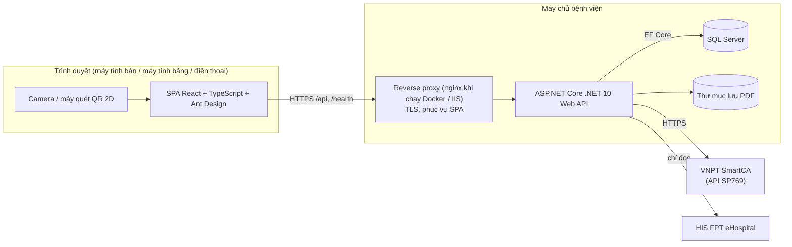
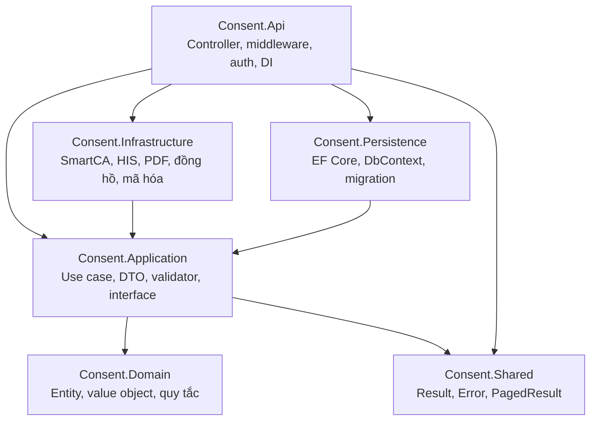
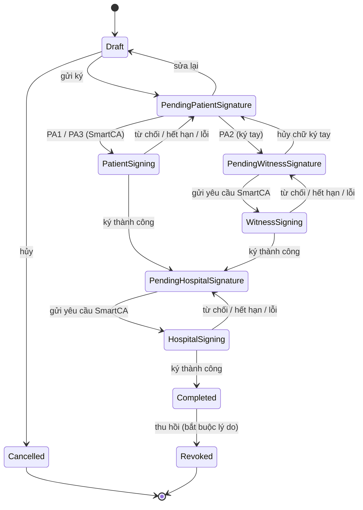

# Kiến trúc — Quản lý Phiếu đồng thuận

> Phiên bản: 1.0 (Sprint 0). Các sơ đồ dùng Mermaid (GitHub hiển thị trực tiếp).
> Tài liệu liên quan: [Yêu cầu nghiệp vụ](yeu-cau-nghiep-vu.md) · [Kế hoạch](KE_HOACH_TRIEN_KHAI.md) · [Tích hợp SmartCA](tich-hop-smartca.md)

---

## 1. Tổng quan



- Trình duyệt chỉ gọi API của bệnh viện. **Không gọi trực tiếp** SmartCA hay HIS, nên bí mật kết nối chỉ nằm trên máy chủ.
- Web và API chạy chung một domain qua reverse proxy, nên không cần CORS ở môi trường chính thức.

---

## 2. Công nghệ (phiên bản dùng ở Sprint 0)

| Thành phần | Công nghệ |
|---|---|
| Backend | ASP.NET Core .NET 10, EF Core 10.0.15 (SQL Server), OpenAPI (`Microsoft.AspNetCore.OpenApi`), Health Checks |
| Cơ sở dữ liệu | Microsoft SQL Server (Docker dev: SQL Server 2022 Developer) |
| Frontend | React 19.3, TypeScript 7.0, Vite 8.3, Ant Design 6.7 (locale `vi_VN`), React Router 8.5, TanStack Query 5, dayjs |
| Kiểm thử backend | xUnit 2.9, `Microsoft.AspNetCore.Mvc.Testing` (integration), test kiến trúc bằng reflection |
| Kiểm thử frontend | Vitest 5, Testing Library, jsdom |
| Lint frontend | oxlint (mặc định của template Vite hiện tại, cảnh báo bị coi là lỗi) |
| Hạ tầng | Docker Compose (dev/test), GitHub Actions (CI) |

Nguyên tắc chọn thư viện: chỉ thêm khi cần, ưu tiên giấy phép MIT/Apache. Không dùng MediatR, AutoMapper (đã chuyển sang giấy phép thương mại) và FluentAssertions 8+ (giấy phép thương mại).

---

## 3. Clean Architecture



| Tầng | Được phụ thuộc vào | Không được phụ thuộc vào |
|---|---|---|
| Domain | (không gì) | mọi tầng khác |
| Shared | (không gì) | mọi tầng khác |
| Application | Domain, Shared | Persistence, Infrastructure, Api |
| Persistence | Application, Domain | Infrastructure, Api |
| Infrastructure | Application, Domain, Shared | Persistence, Api |
| Api | tất cả (composition root) | — |

Quy tắc này được **kiểm tra tự động** bởi `backend/tests/Consent.ArchitectureTests`. Vi phạm sẽ làm CI thất bại.

Quy ước code:
- Controller chỉ nhận request, gọi use case và trả kết quả, không chứa nghiệp vụ.
- API bất đồng bộ đều nhận `CancellationToken`.
- Nullable reference types bật; cảnh báo biên dịch bị coi là lỗi.
- Khóa chính là UUID; mã nghiệp vụ (ví dụ `PDT-2026-000123`) là cột riêng.
- Thời gian lưu UTC.

---

## 4. Cấu trúc thư mục

```
backend/
  ConsentManagement.slnx
  Directory.Build.props        # net10.0, nullable, warnings-as-errors, analyzers
  Directory.Packages.props     # quản lý phiên bản NuGet tập trung
  dotnet-tools.json            # dotnet-ef (công cụ migration)
  Dockerfile
  src/
    Consent.Domain/            # Common/Entity, DomainException
    Consent.Shared/            # Result, Error, PagedResult
    Consent.Application/       # Abstractions (IClock…), DependencyInjection
    Consent.Persistence/       # ConsentDbContext, Migrations, DependencyInjection
    Consent.Infrastructure/    # Time/SystemClock, DependencyInjection
    Consent.Api/               # Program.cs, Infrastructure/ (pipeline, lỗi, security headers)
  tests/
    Consent.Domain.Tests/
    Consent.Application.Tests/
    Consent.Api.IntegrationTests/
    Consent.ArchitectureTests/
frontend/
  src/
    app/                       # App (providers), routes, navigation, theme, queryClient
    api/                       # http client (ProblemDetails → ApiError), hooks TanStack Query
    components/                # layout chung, PagePlaceholder
    features/<module>/         # dashboard (Sprint 0); patients, consent-forms… (các sprint sau)
    pages/                     # 404
    test/                      # setup Vitest, tiện ích render
  nginx.conf, Dockerfile
docs/                          # kế hoạch, SRS, kiến trúc, tích hợp
scripts/run-checks.sh          # chạy mọi kiểm tra giống CI
docker-compose.yml, .env.example
```

---

## 5. Mô hình dữ liệu (dự kiến)

Bảng sẽ được thêm dần theo sprint. Sprint 0 mới chỉ có migration khởi tạo (`InitialCreate`).


Bảng `Users`, `Roles`, `Permissions`, `RefreshTokens`, `ExportJobs` và `AuditLogs` được mô tả ở mục 4 của [kế hoạch](KE_HOACH_TRIEN_KHAI.md).

---

## 6. Vòng đời phiếu



`PendingHospitalSignature`/`HospitalSigning` tương ứng `PendingDoctorSignature`/`DoctorSigning` trong kế hoạch: người ký phía bệnh viện được cấu hình theo mẫu, không nhất thiết là bác sĩ.

---

## 7. Quy ước API

| Chủ đề | Quy ước |
|---|---|
| Đường dẫn | `/api/v1/<tài-nguyên>` (REST, danh từ số nhiều, kebab-case) |
| Định dạng | JSON camelCase; thời gian ISO 8601 UTC |
| Lỗi | ProblemDetails (RFC 9457), `title` tiếng Việt, có `traceId`; không lộ stack trace hay câu lệnh SQL |
| Phân trang | `?page=&pageSize=` (tối đa 100) → `{ items, page, pageSize, totalCount }` |
| Health | `GET /health` (liveness, không kiểm tra phụ thuộc), `GET /health/ready` (kiểm tra SQL Server) |
| Tài liệu | OpenAPI tại `/openapi/v1.json`, **chỉ bật ở môi trường Development** |
| Bảo mật | Security headers (`X-Content-Type-Options`, `X-Frame-Options`, `Referrer-Policy`, CSP), HSTS ngoài Development, CORS chỉ cho origin cấu hình |

---

## 8. Cấu hình và bí mật

| Khóa cấu hình | Biến môi trường | Ghi chú |
|---|---|---|
| `ConnectionStrings:Default` | `ConnectionStrings__Default` | Bắt buộc; thiếu thì API dừng khởi động với thông báo rõ |
| `Database:ApplyMigrationsOnStartup` | `Database__ApplyMigrationsOnStartup` | Mặc định `false`; chỉ bật ở dev/test. Production chạy migration bằng script có kiểm soát |
| `Cors:AllowedOrigins` | `Cors__AllowedOrigins__0`… | Mặc định rỗng; Development cho phép `http://localhost:5173` |
| `SmartCa:*`, `His:*` | `SmartCa__SpPassword`… | Sprint 2–4; xem [tich-hop-smartca.md](tich-hop-smartca.md) |

Không commit bí mật. File `.env` (Docker Compose) nằm trong `.gitignore`; chỉ commit `.env.example`.

---

## 9. Triển khai

**Phát triển/kiểm thử (Docker Compose):** `sqlserver` (SQL Server 2022 Developer, có health check) → `api` (cổng nội bộ 8080, chạy user không phải root) → `web` (nginx không đặc quyền, cổng 8080, phục vụ SPA và chuyển tiếp `/api`, `/health` tới `api`).

**Chính thức (Windows Server tại bệnh viện):** hình thức chạy (IIS + SQL Server có sẵn, hay Docker) chờ bệnh viện xác nhận. Hướng dẫn chi tiết, gồm HTTPS, tài khoản SQL riêng (không dùng `sa`), sao lưu và dung lượng lưu trữ, sẽ có trong `docs/trien-khai.md` (Sprint 6).

---

## 10. Nhật ký quyết định kiến trúc (ADR)

| Mã | Quyết định | Lý do |
|---|---|---|
| ADR-001 | Clean Architecture 6 project, kiểm tra phụ thuộc bằng test | Tách nghiệp vụ khỏi hạ tầng; dễ thay SmartCA/HIS giả lập bằng bản thật |
| ADR-002 | SQL Server + EF Core, migration bằng `dotnet-ef` | Công nghệ bắt buộc; quản lý thay đổi schema có phiên bản |
| ADR-003 | Không dùng MediatR/AutoMapper; handler và mapping viết tay | Tránh phụ thuộc giấy phép thương mại; code tường minh |
| ADR-004 | VNPT SmartCA API SP769 (xác nhận trên app) cho mọi người ký | Định danh bằng CCCD, phù hợp người bệnh vãng lai; không giữ mật khẩu/OTP người ký |
| ADR-005 | Tích hợp HIS qua `IHisGateway`, giai đoạn 1 chỉ đọc, có bản giả lập | Không chặn tiến độ khi chưa có tài liệu API; giảm rủi ro ghi sai vào HIS |
| ADR-006 | Ký PDF 2 pha (deferred signing), PDFsharp + BouncyCastle | SmartCA chỉ ký hash và có thời gian chờ xác nhận; cần spike trên UAT |
| ADR-007 | Tự động migrate khi khởi động chỉ ở dev/test | An toàn cho production; tiện cho phát triển |
| ADR-008 | oxlint cho frontend | Mặc định của template Vite hiện tại, nhanh, ít phụ thuộc |
