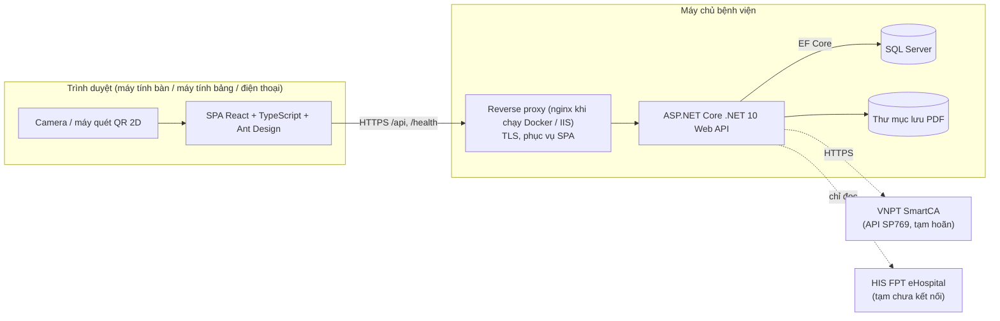
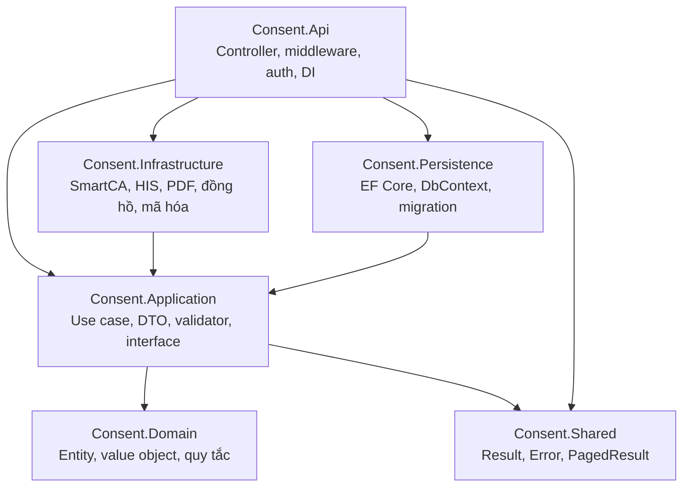
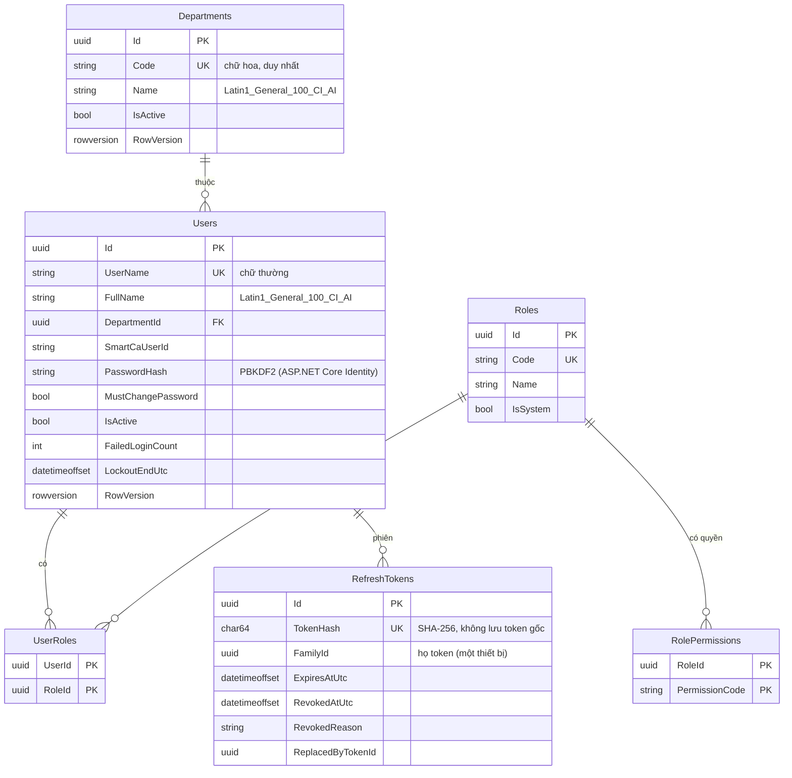
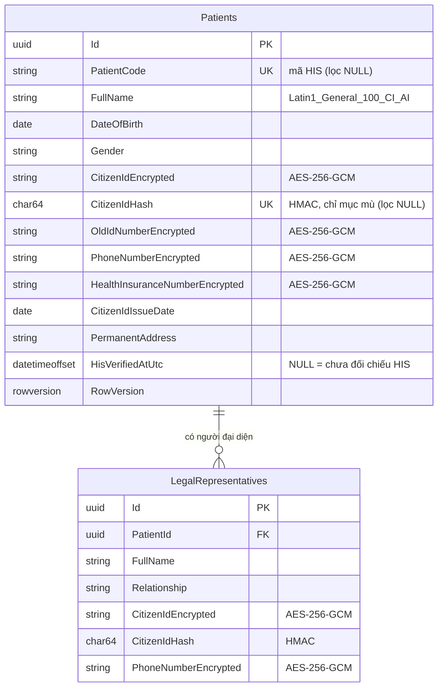
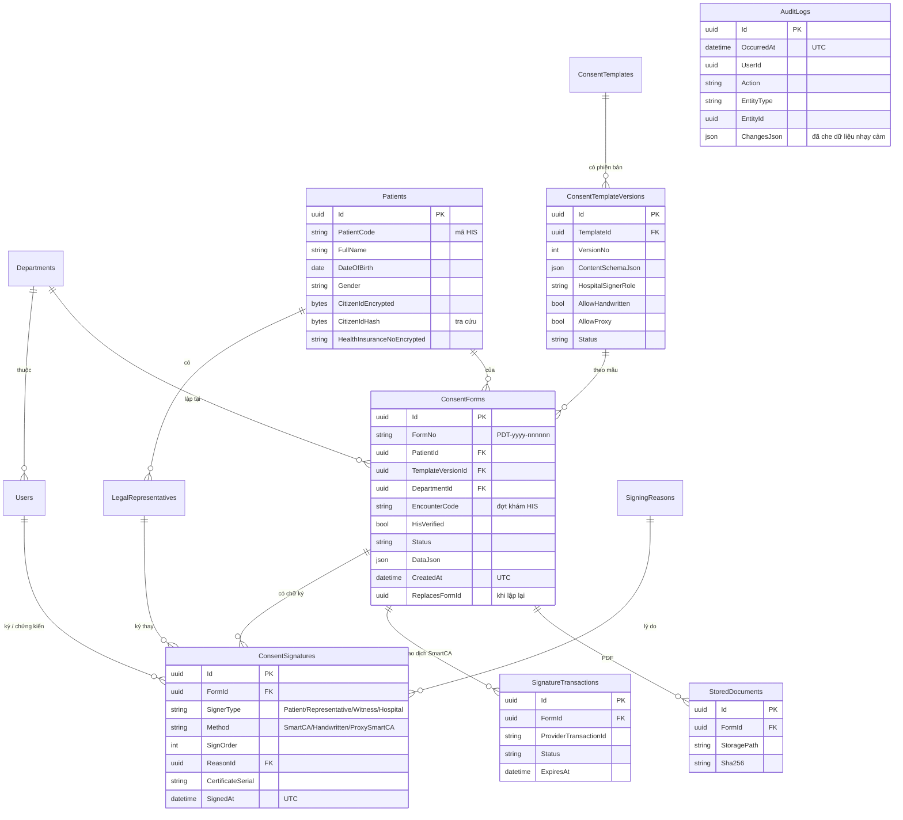
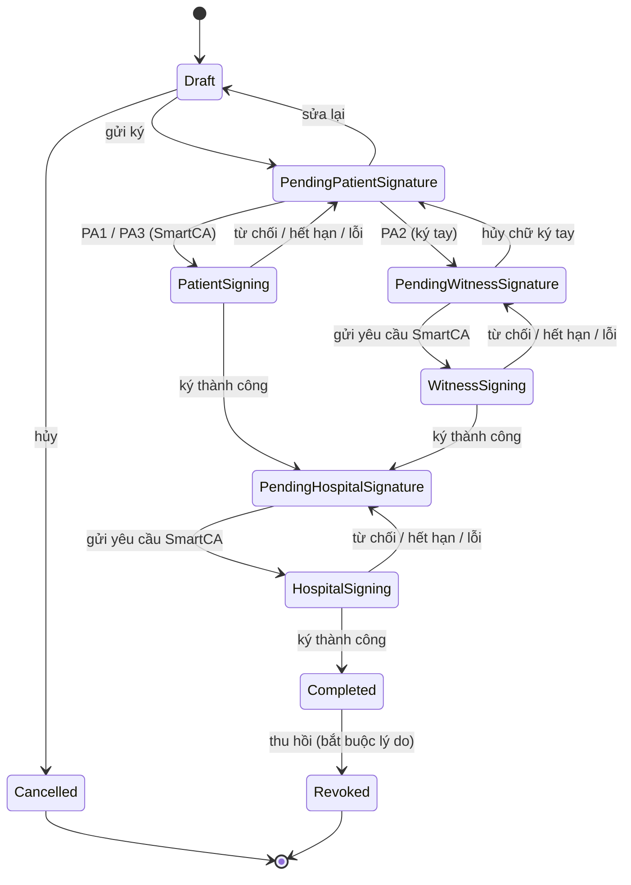
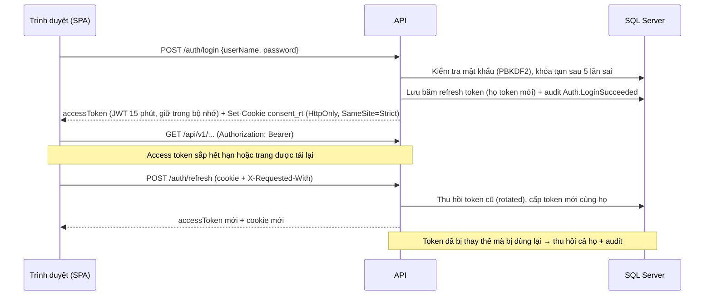

# Kiến trúc — Quản lý Phiếu đồng thuận

> Phiên bản: 1.0 (Sprint 0). Các sơ đồ dùng Mermaid (GitHub hiển thị trực tiếp).
> Tài liệu liên quan: [Yêu cầu nghiệp vụ](yeu-cau-nghiep-vu.md) · [Kế hoạch](KE_HOACH_TRIEN_KHAI.md) · [Tích hợp SmartCA](tich-hop-smartca.md)

---

## 1. Tổng quan



- Trình duyệt chỉ gọi API của bệnh viện. **Không gọi trực tiếp** SmartCA hay HIS, nên bí mật kết nối chỉ nằm trên máy chủ.
- **Hiện tạm chưa kết nối HIS và SmartCA** (ADR-017, nét đứt trong sơ đồ): ứng dụng chạy độc lập; hai kết nối này bổ sung sau qua các interface đã có.
- Web và API chạy chung một domain qua reverse proxy, nên không cần CORS ở môi trường chính thức.

---

## 2. Công nghệ (phiên bản đang dùng)

| Thành phần | Công nghệ |
|---|---|
| Backend | ASP.NET Core .NET 10, EF Core 10.0.15 (SQL Server), JWT Bearer, FluentValidation 12, OpenAPI (`Microsoft.AspNetCore.OpenApi`), Health Checks, Rate Limiting |
| Cơ sở dữ liệu | Microsoft SQL Server (Docker dev: SQL Server 2022 Developer) |
| Frontend | React 19.3, TypeScript 7.0, Vite 8.3, Ant Design 6.7 (locale `vi_VN`), React Router 8.5, TanStack Query 5, dayjs |
| Kiểm thử backend | xUnit 2.9, `Microsoft.AspNetCore.Mvc.Testing` (integration), Testcontainers (SQL Server thật trong Docker), test kiến trúc bằng reflection |
| Kiểm thử frontend | Vitest 5, Testing Library, jsdom |
| Lint frontend | oxlint (mặc định của template Vite hiện tại, cảnh báo bị coi là lỗi) |
| Hạ tầng | Docker Compose (dev/test), GitHub Actions (CI) |

Nguyên tắc chọn thư viện: chỉ thêm khi cần, ưu tiên giấy phép MIT/Apache. Không dùng MediatR, AutoMapper (đã chuyển sang giấy phép thương mại) và FluentAssertions 8+ (giấy phép thương mại).

---

## 3. Clean Architecture



| Tầng | Được phụ thuộc vào | Không được phụ thuộc vào |
|---|---|---|
| Domain | (không gì) | mọi tầng khác |
| Shared | (không gì) | mọi tầng khác |
| Application | Domain, Shared | Persistence, Infrastructure, Api |
| Persistence | Application, Domain | Infrastructure, Api |
| Infrastructure | Application, Domain, Shared | Persistence, Api |
| Api | tất cả (composition root) | — |

Quy tắc này được **kiểm tra tự động** bởi `backend/tests/Consent.ArchitectureTests`. Vi phạm sẽ làm CI thất bại.

Quy ước code:
- Controller chỉ nhận request, gọi use case và trả kết quả, không chứa nghiệp vụ.
- API bất đồng bộ đều nhận `CancellationToken`.
- Nullable reference types bật; cảnh báo biên dịch bị coi là lỗi.
- Khóa chính là UUID; mã nghiệp vụ (ví dụ `PDT-2026-000123`) là cột riêng.
- Thời gian lưu UTC.

---

## 4. Cấu trúc thư mục

```
backend/
  ConsentManagement.slnx
  Directory.Build.props        # net10.0, nullable, warnings-as-errors, analyzers
  Directory.Packages.props     # quản lý phiên bản NuGet tập trung
  dotnet-tools.json            # dotnet-ef (công cụ migration)
  Dockerfile
  src/
    Consent.Domain/            # Common (Entity, IAuditableEntity, SensitiveData), Departments, Patients (Patient,
                               #   LegalRepresentative, CitizenIdNumber), Identity (User, Role,
                               #   RefreshToken, PasswordPolicy, SystemRoles), Authorization (Permissions), Auditing
    Consent.Shared/            # Result, Error (kèm lỗi theo trường), PagedResult
    Consent.Application/       # Abstractions (repository, IClock, ICurrentUser, ITokenService…), Auth, Users,
                               #   Departments, Roles, Auditing (service + validator FluentValidation)
    Consent.Persistence/       # ConsentDbContext, Configurations, Repositories, Auditing (interceptor),
                               #   Seeding, Migrations
    Consent.Infrastructure/    # Security (băm mật khẩu, JWT, mã hóa AES-GCM, chỉ mục mù), His (HIS giả lập), Time
    Consent.Api/               # Controllers, Authorization (HasPermission), Infrastructure (pipeline, lỗi,
                               #   security headers, correlation id, cookie, rate limiting)
  tests/
    Consent.Domain.Tests/
    Consent.Application.Tests/       # service với repository giả trong bộ nhớ
    Consent.Api.IntegrationTests/    # pipeline/phân quyền (không CSDL) + luồng thật với SQL Server (Testcontainers)
    Consent.Infrastructure.Tests/    # mã hóa, chỉ mục mù, HIS giả lập
    Consent.ArchitectureTests/
frontend/
  src/
    app/                       # App (providers), routes, navigation (theo quyền), lazyPages, theme
    api/                       # http client (ProblemDetails → ApiError, tự làm mới phiên), auth, admin (TanStack Query)
    auth/                      # AuthProvider, guards (RequireAuth/RequirePermission), permissions, tokenStore
    components/                # layout chung, PageHeader, PagePlaceholder
    features/<module>/         # dashboard, account, admin (users, roles, departments), patients (QR CCCD, tiếp nhận,
                               #   danh sách, hồ sơ, người đại diện); consent-forms… (các sprint sau)
    pages/                     # đăng nhập, đổi mật khẩu bắt buộc, 403, 404, lỗi
    utils/                     # định dạng ngày, quy tắc mật khẩu, tìm kiếm không dấu, lỗi form
    test/                      # setup Vitest, giả lập API, dữ liệu mẫu
  nginx.conf, Dockerfile
docs/                          # kế hoạch, SRS, kiến trúc, tích hợp
scripts/run-checks.sh          # chạy mọi kiểm tra giống CI
docker-compose.yml, .env.example
```

---

## 5. Mô hình dữ liệu

Bảng được thêm dần theo sprint.

**Đã có:** Sprint 1 (migration `AddUsersRolesAndAudit`): `Departments`, `Users`, `UserRoles`, `Roles`, `RolePermissions`, `RefreshTokens`, `AuditLogs`. Sprint 2 (migration `AddPatients`): `Patients`, `LegalRepresentatives`.





`AuditLogs` không có khóa ngoại (giữ nguyên lịch sử kể cả khi đối tượng bị xóa) và có trigger chặn UPDATE/DELETE.

**Dự kiến (các sprint sau):**



Danh mục quyền được định nghĩa trong mã nguồn (`PermissionCatalog`) và gán cho vai trò qua bảng `RolePermissions` (thay cho bảng `Permissions` dự kiến trong kế hoạch). Bảng `ExportJobs` được mô tả ở mục 4 của [kế hoạch](KE_HOACH_TRIEN_KHAI.md).

---

## 6. Vòng đời phiếu



`PendingHospitalSignature`/`HospitalSigning` tương ứng `PendingDoctorSignature`/`DoctorSigning` trong kế hoạch: người ký phía bệnh viện được cấu hình theo mẫu, không nhất thiết là bác sĩ.

---

## 7. Quy ước API

| Chủ đề | Quy ước |
|---|---|
| Đường dẫn | `/api/v1/<tài-nguyên>` (REST, danh từ số nhiều, kebab-case) |
| Định dạng | JSON camelCase; thời gian ISO 8601 UTC |
| Lỗi | ProblemDetails (RFC 9457), `title` tiếng Việt, có `traceId`; không lộ stack trace hay câu lệnh SQL |
| Phân trang | `?page=&pageSize=` (tối đa 100) → `{ items, page, pageSize, totalCount }` |
| Health | `GET /health` (liveness, không kiểm tra phụ thuộc), `GET /health/ready` (kiểm tra SQL Server) |
| Tài liệu | OpenAPI tại `/openapi/v1.json`, **chỉ bật ở môi trường Development** |
| Bảo mật | Security headers (`X-Content-Type-Options`, `X-Frame-Options`, `Referrer-Policy`, CSP), HSTS ngoài Development, CORS chỉ cho origin cấu hình |

---

## 8. Xác thực, phân quyền và nhật ký audit

### 8.1. Phiên đăng nhập



| Thành phần | Thiết kế |
|---|---|
| Mật khẩu | Băm bằng `PasswordHasher` của ASP.NET Core Identity (PBKDF2 có salt, tự nâng cấp tham số khi đăng nhập). Chính sách: ≥ 10 ký tự, chữ hoa, chữ thường, số, ký tự đặc biệt, không chứa tên đăng nhập |
| Chống dò tài khoản | Cùng thông báo cho sai tên và sai mật khẩu; vẫn băm mật khẩu khi tài khoản không tồn tại để thời gian phản hồi tương đương; trạng thái "bị khóa bởi quản trị" chỉ báo khi mật khẩu đúng |
| Khóa tạm | 5 lần sai liên tiếp → khóa 15 phút (cấu hình `Auth:*`) |
| Access token | JWT HMAC-SHA256, 15 phút, claim: `sub`, `name`, `full_name`, `dept`, `role`, `perm`. Khóa ký ≥ 32 byte; thiếu khóa thì API không khởi động |
| Refresh token | 32 byte ngẫu nhiên, chỉ lưu SHA-256; cookie `HttpOnly`, `Secure`, `SameSite=Strict`, `Path=/api/v1/auth`; hạn 12 giờ, xoay vòng mỗi lần dùng; phát hiện dùng lại → thu hồi cả họ token |
| CSRF | Cookie `SameSite=Strict` + bắt buộc header `X-Requested-With` ở endpoint dùng cookie |
| Giới hạn tần suất | Đăng nhập/đổi mật khẩu 10 lần/phút/IP, làm mới phiên 30 lần/phút/IP (cấu hình `RateLimiting:*`) |
| Phía trình duyệt | Access token chỉ trong bộ nhớ; tự làm mới trước khi hết hạn; khi gặp 401 thì làm mới một lần rồi gửi lại; đăng xuất chủ động không giữ lại đường dẫn cũ (máy dùng chung) |

### 8.2. Phân quyền

- **Mặc định an toàn:** `FallbackPolicy` yêu cầu đăng nhập cho mọi endpoint; chỉ endpoint đánh dấu `[AllowAnonymous]` (đăng nhập, làm mới, đăng xuất, health) mới mở.
- **Theo quyền:** `[HasPermission(Permissions.UsersManage)]` tạo policy động `perm:<mã>` kiểm tra claim `perm` trong access token.
- **Quyền thuộc vai trò:** người dùng có nhiều vai trò; quyền hiệu lực là hợp các quyền. Vai trò `ADMIN` luôn có toàn bộ quyền và không sửa được. Thay đổi quyền có hiệu lực ở lần làm mới token tiếp theo (≤ 15 phút); khóa tài khoản thu hồi refresh token ngay.
- **Phạm vi theo khoa:** access token chứa khoa của người dùng (`dept`) và quyền `scope.all_departments` cho vai trò toàn viện. `ICurrentUser` cung cấp hai thông tin này để lọc dữ liệu phiếu/người bệnh theo khoa từ Sprint 2–3.
- **Giao diện:** menu và nút được ẩn/hiện theo quyền; trang không có quyền hiển thị 403. Đây chỉ là trải nghiệm người dùng, kiểm soát thật luôn nằm ở API.

### 8.3. Nhật ký audit

- `AuditSaveChangesInterceptor` (EF Core) ghi **trong cùng giao dịch** mọi thao tác tạo/sửa/xóa trên thực thể `IAuditableEntity` (khoa, người dùng, vai trò, gán vai trò, gán quyền): người thực hiện, IP, User-Agent, mã truy vết, giá trị trước/sau.
- Che dữ liệu nhạy cảm: `PasswordHash` luôn ghi `***`; bỏ qua thuộc tính kỹ thuật (`RowVersion`, bộ đếm đăng nhập sai…), vốn đã có sự kiện xác thực riêng.
- Sự kiện xác thực được ghi tường minh: đăng nhập thành công/thất bại, khóa tạm, đăng xuất, đổi mật khẩu, phát hiện dùng lại refresh token.
- **Chỉ ghi thêm:** không có API sửa/xóa; `ConsentDbContext` từ chối lưu nếu bản ghi audit bị sửa/xóa; trigger `TR_AuditLogs_AppendOnly` trong SQL Server chặn mọi `UPDATE`/`DELETE` (kể cả truy cập trực tiếp CSDL).

### 8.4. Bảo vệ dữ liệu người bệnh

| Biện pháp | Cách làm |
|---|---|
| Mã hóa cột | Số CCCD, số CMND cũ, số điện thoại, mã thẻ BHYT (người bệnh và người đại diện) mã hóa **AES-256-GCM** (có xác thực toàn vẹn, nonce ngẫu nhiên). Định dạng lưu `v1:` + Base64 để xoay vòng khóa sau này. Thực hiện trong suốt bằng EF Core value converter: Domain và Application làm việc với giá trị gốc |
| Chỉ mục mù | `CitizenIdHash` = HMAC-SHA256 (khóa bí mật riêng) của số CCCD, cập nhật tự động bằng `BlindIndexInterceptor`. Dùng để tìm chính xác và **chặn trùng bằng chỉ mục duy nhất trong CSDL**. Khác SHA-256 thường: không thể thử hết 10^12 số CCCD nếu không có khóa |
| Khóa | `DataProtection:FieldEncryptionKey` và `DataProtection:BlindIndexKey`, mỗi khóa 32 byte ngẫu nhiên, hai khóa phải khác nhau; thiếu khóa thì API không khởi động. **Mất khóa mã hóa = mất dữ liệu đã mã hóa**: phải sao lưu khóa an toàn, tách khỏi bản sao lưu CSDL |
| Không đưa vào URL | Tra cứu theo CCCD dùng `POST` với body; danh sách không bao giờ trả số đầy đủ |
| Che khi hiển thị | API danh sách che số CCCD (`0361******25`); giao diện che CCCD/SĐT/BHYT mặc định, bấm biểu tượng con mắt mới hiện số đầy đủ |
| Nhật ký truy cập | Mỗi lần xem hồ sơ (`Patients.Viewed`) và tra cứu CCCD (`Patients.LookedUp`) đều được ghi, không ghi số CCCD |
| Audit | Thuộc tính gắn `[SensitiveData]` luôn được che `***` trong nhật ký thay đổi |
| QR | Chuỗi QR gốc không được lưu; chỉ lưu các trường đã kiểm tra |

### 8.5. Quét CCCD và tích hợp HIS

- **Đọc QR:** phân tích ở trình duyệt (`cccdQrParser.ts`) để điền form ngay. Hỗ trợ máy quét 2D chế độ bàn phím (nội dung + Enter) và camera (`@zxing/browser`, chỉ tải khi mở camera, cần HTTPS). Có cảnh báo khi họ tên có ký tự lạ (máy quét chưa hỗ trợ tiếng Việt có dấu) hoặc số CCCD không khớp ngày sinh/giới tính. Máy chủ kiểm tra lại mọi trường (`PatientRequestValidator`, `CitizenIdNumber`).
- **HIS — hiện chưa kết nối (ADR-017):** mặc định `His:Provider=None` → `DisabledHisGateway`: không gọi ra ngoài, tra cứu trả `hisStatus: "Disabled"`, không đối chiếu khi lưu; giao diện (qua `GET /api/v1/features`) ẩn mọi thông tin HIS và mã người bệnh được nhập tay.
- **Khi bật lại HIS:** `IHisGateway` (Application) có `FakeHisGateway` (Infrastructure, `His:Provider=Fake`) cho phát triển/kiểm thử; **API từ chối khởi động nếu dùng HIS giả lập ở Production** (để không sinh mã người bệnh/thẻ BHYT không có thật). Kết nối FPT eHospital sẽ là một cài đặt khác của cùng interface. Mọi lời gọi HIS có thời gian chờ (`His:TimeoutSeconds`); HIS lỗi không chặn việc tiếp nhận (cho nhập tay, đánh dấu "Chưa đối chiếu HIS").
- **Đối chiếu khi lưu (khi đã kết nối HIS):** máy chủ tự gọi HIS lúc tạo/cập nhật hồ sơ để đặt `HisVerifiedAtUtc`, không tin cờ do client gửi.

## 9. Cấu hình và bí mật

| Khóa cấu hình | Biến môi trường | Ghi chú |
|---|---|---|
| `ConnectionStrings:Default` | `ConnectionStrings__Default` | Bắt buộc; thiếu thì API dừng khởi động với thông báo rõ |
| `Database:ApplyMigrationsOnStartup` | `Database__ApplyMigrationsOnStartup` | Mặc định `false`; chỉ bật ở dev/test. Production chạy migration bằng script có kiểm soát |
| `Cors:AllowedOrigins` | `Cors__AllowedOrigins__0`… | Mặc định rỗng; Development cho phép `http://localhost:5173` |
| `Jwt:SigningKey` | `Jwt__SigningKey` | **Bí mật**, ≥ 32 ký tự ngẫu nhiên; thiếu thì API không khởi động |
| `Jwt:AccessTokenMinutes` | `Jwt__AccessTokenMinutes` | Mặc định 15 (1–60) |
| `Auth:MaxFailedAttempts`, `Auth:LockoutMinutes` | `Auth__…` | Mặc định 5 lần, 15 phút |
| `Auth:RefreshTokenLifetimeHours`, `Auth:RefreshReuseGraceSeconds` | `Auth__…` | Mặc định 12 giờ, 30 giây |
| `RateLimiting:AuthPermitLimit`, `RefreshPermitLimit`, `WindowSeconds` | `RateLimiting__…` | Mặc định 10, 30 lần / 60 giây / IP |
| `ReverseProxy:TrustAllProxies` | `ReverseProxy__TrustAllProxies` | Mặc định `false`. Chỉ bật khi API không mở cổng ra ngoài và chỉ nhận yêu cầu từ reverse proxy (để lấy đúng IP người dùng) |
| `Seed:Enabled` | `Seed__Enabled` | Tạo vai trò hệ thống và tài khoản quản trị đầu tiên khi khởi động |
| `Seed:AdminPassword` | `Seed__AdminPassword` | **Bí mật**; chỉ dùng khi chưa có người dùng nào. Tài khoản `admin` phải đổi mật khẩu ở lần đăng nhập đầu |
| `Seed:DemoData`, `Seed:DemoPassword` | `Seed__…` | Khoa và tài khoản demo, **chỉ cho môi trường phát triển/thử nghiệm** |
| `DataProtection:FieldEncryptionKey` | `DataProtection__FieldEncryptionKey` | **Bí mật**, Base64 của 32 byte ngẫu nhiên (`openssl rand -base64 32`); khóa mã hóa cột |
| `DataProtection:BlindIndexKey` | `DataProtection__BlindIndexKey` | **Bí mật**, Base64 của 32 byte, khác khóa mã hóa; khóa chỉ mục mù |
| `His:Provider` | `His__Provider` | `None` (mặc định: chưa kết nối HIS) hoặc `Fake` (HIS giả lập, chỉ dev/test; bị từ chối ở Production). Giá trị khác → API không khởi động |
| `His:TimeoutSeconds` | `His__TimeoutSeconds` | Mặc định 5 (1–60) |
| `SmartCa:*` | `SmartCa__SpPassword`… | **Tạm hoãn** (chưa tích hợp SmartCA); thiết kế giữ trong [tich-hop-smartca.md](tich-hop-smartca.md) |

Không commit bí mật. File `.env` (Docker Compose) nằm trong `.gitignore`; chỉ commit `.env.example`.

---

## 10. Triển khai

**Phát triển/kiểm thử (Docker Compose):** `sqlserver` (SQL Server 2022 Developer, có health check) → `api` (cổng nội bộ 8080, chạy user không phải root) → `web` (nginx không đặc quyền, cổng 8080, phục vụ SPA và chuyển tiếp `/api`, `/health` tới `api`).

**Chính thức (Windows Server tại bệnh viện):** hình thức chạy (IIS + SQL Server có sẵn, hay Docker) chờ bệnh viện xác nhận. Hướng dẫn chi tiết, gồm HTTPS, tài khoản SQL riêng (không dùng `sa`), sao lưu và dung lượng lưu trữ, sẽ có trong `docs/trien-khai.md` (Sprint 6).

---

## 11. Nhật ký quyết định kiến trúc (ADR)

| Mã | Quyết định | Lý do |
|---|---|---|
| ADR-001 | Clean Architecture 6 project, kiểm tra phụ thuộc bằng test | Tách nghiệp vụ khỏi hạ tầng; dễ thay SmartCA/HIS giả lập bằng bản thật |
| ADR-002 | SQL Server + EF Core, migration bằng `dotnet-ef` | Công nghệ bắt buộc; quản lý thay đổi schema có phiên bản |
| ADR-003 | Không dùng MediatR/AutoMapper; handler và mapping viết tay | Tránh phụ thuộc giấy phép thương mại; code tường minh |
| ADR-004 | VNPT SmartCA API SP769 (xác nhận trên app) cho mọi người ký | Định danh bằng CCCD, phù hợp người bệnh vãng lai; không giữ mật khẩu/OTP người ký |
| ADR-005 | Tích hợp HIS qua `IHisGateway`, giai đoạn 1 chỉ đọc, có bản giả lập | Không chặn tiến độ khi chưa có tài liệu API; giảm rủi ro ghi sai vào HIS |
| ADR-006 | Ký PDF 2 pha (deferred signing), PDFsharp + BouncyCastle | SmartCA chỉ ký hash và có thời gian chờ xác nhận; cần spike trên UAT |
| ADR-007 | Tự động migrate khi khởi động chỉ ở dev/test | An toàn cho production; tiện cho phát triển |
| ADR-008 | oxlint cho frontend | Mặc định của template Vite hiện tại, nhanh, ít phụ thuộc |
| ADR-009 | Mô hình người dùng/vai trò/quyền trong Domain; chỉ dùng `PasswordHasher` của ASP.NET Core Identity (không dùng Identity stores) | Quy tắc khóa tài khoản, vai trò, quản trị viên cuối cùng nằm trong Domain và kiểm thử được; không phát sinh bảng Identity không dùng; vẫn dùng thuật toán băm chuẩn của Identity |
| ADR-010 | Access token trong bộ nhớ + refresh token trong cookie HttpOnly, xoay vòng, phát hiện dùng lại | Giảm rủi ro XSS đánh cắp token dài hạn; thu hồi được phiên; phát hiện token bị lộ |
| ADR-011 | Quyền nằm trong access token (claim `perm`) | Phân quyền nhanh, không truy vấn CSDL mỗi yêu cầu; độ trễ tối đa 15 phút khi đổi quyền là chấp nhận được (khóa tài khoản có hiệu lực ngay với refresh token) |
| ADR-012 | Audit bằng EF Core interceptor + trigger chặn sửa/xóa | Không thể quên ghi audit ở từng service; ghi cùng giao dịch; bảo vệ cả khi truy cập CSDL trực tiếp |
| ADR-013 | Collation `Latin1_General_100_CI_AI` cho cột tên dùng để tìm kiếm | Tìm không dấu "nguyen van duc" khớp "Nguyễn Văn Đức" (kể cả Đ/D). Collation `Vietnamese_*` coi ư, ơ, ê, đ là chữ riêng nên không đáp ứng |
| ADR-014 | Mã hóa cột ở tầng ứng dụng (AES-256-GCM qua EF value converter) + chỉ mục mù HMAC, thay vì Always Encrypted/TDE | Bảo vệ cả khi lộ bản sao lưu/CSDL hoặc người quản trị CSDL xem trực tiếp; không phụ thuộc phiên bản/edition SQL Server và driver; vẫn tra cứu/chặn trùng được theo CCCD |
| ADR-015 | Đọc QR CCCD ở trình duyệt; máy chủ kiểm tra lại từng trường | Điền form tức thì, chạy được với cả máy quét 2D và camera; máy chủ không nhận chuỗi QR gốc nên không có nguy cơ lưu nhầm |
| ADR-016 | Máy chủ tự đối chiếu HIS khi lưu; HIS lỗi không chặn tiếp nhận | Trạng thái "đã đối chiếu HIS" đáng tin cậy; quầy tiếp đón vẫn làm việc được khi HIS gián đoạn |
| ADR-017 | Tạm chưa kết nối HIS và SmartCA (quyết định 11/11/2026): HIS tắt mặc định (`His:Provider=None`), giao diện ẩn theo `GET /api/v1/features`; HIS giả lập bị chặn ở Production; giữ interface để bật lại | Ứng dụng chạy độc lập, không hiển thị hay lưu dữ liệu HIS giả; khi bệnh viện cần, chỉ thêm cài đặt `IHisGateway`/dịch vụ ký số mà không sửa nghiệp vụ |
| ADR-018 | Khi chưa có SmartCA, phiếu được ký tay trên máy tính bảng. Chỉ lưu ảnh chữ ký (PNG, không lưu dữ liệu nét); ảnh được chèn vào PDF; PDF có mã băm SHA-256 và bị khóa sau khi ký; chế độ ký toàn màn hình phải nhập lại mật khẩu nhân viên mới thoát được | Đáp ứng quyết định của bệnh viện với ít thao tác nhất tại quầy. Không phát sinh dữ liệu sinh trắc học. Phát hiện được sửa file sau khi ký. Người bệnh cầm máy không vào được phần khác. Giới hạn: đây không phải chữ ký số, pháp chế cần xác nhận giá trị pháp lý |
